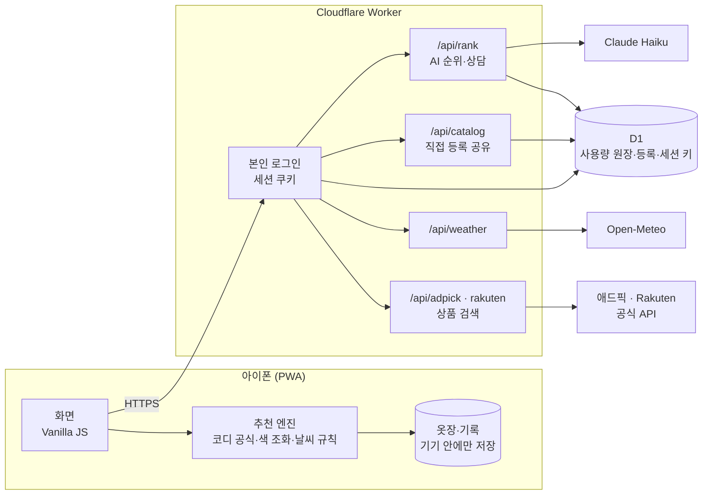

<div align="center">

# Hangit · 행잇

**옷을 걸어 보듯, 가볍게 골라요.**

내 옷장을 모으고, 사기 전에 옆에 걸어 보고, 어울리면 사는 패션 앱

[](https://github.com/daedaem/otjang/actions/workflows/ci.yml)


</div>

> Hangit은 가명이에요. 진짜 이름은 상표 확인 뒤에 정해요.
> 지금은 혼자 아이폰에서 매일 써 보는 **비공개 시험판**이에요. 공개 서비스가 아니에요.

<br>

## 한눈에 보기

| | |
|---|---|
| **무엇** | 대충 말해도 실제 옷을 골라 주고, 내 옷장과 비교해서 살지 말지 판단을 돕는 원스톱 패션 앱 |
| **누구를 위해** | "옷은 많은데 입을 게 없는" 사람, 사고 나서 후회하는 사람 |
| **이름 뜻** | 토스가 돈을 툭 던지듯 보내게 했다면, Hangit은 옷을 쓱 **걸어 보듯(hang it)** 고르게 해요 |
| **형태** | 아이폰 홈 화면에 설치하는 웹앱(PWA) + Cloudflare 서버 함수 |
| **기간** | 2026년 10월 11일 ~ 진행 중 |
| **만든 방식** | 기획자 1명이 제품 결정과 검수를 맡고, AI 개발 도구 2개(Claude Code, Codex)와 함께 구현·리뷰 |

<br>

## 해결하려는 문제

1. **검색이 너무 어려워요.** 쇼핑앱은 카테고리와 필터를 여러 번 눌러야 해요. 사람은 "출근용 셔츠 10만원 이하"처럼 말하는데요.
2. **내 옷장을 모른 채 사요.** 이미 비슷한 옷이 있는지, 가진 옷과 어울리는지 모르고 사서 후회해요.
3. **아침마다 뭐 입을지 고민해요.** 날씨와 내 옷을 같이 보고 정해 주는 곳이 없어요.

<br>

## 핵심 기능

| 기능 | 하는 일 |
|---|---|
| **한 줄로 찾기** | 말한 조건(종류·상황·예산·색·제외)을 그대로 지켜서 실제 상품을 찾아요. 없으면 "없어요"라고 하고, 다른 걸 몰래 끼워 넣지 않아요 |
| **AI 순위와 이유** | 찾은 후보 안에서만 Claude가 순서를 정하고, 왜 맞는지 한 줄로 말해요 |
| **걸어 보고 사기** | 사기 전에 후보를 내 옷장 옆에 걸어 두고, 겹치는 옷과 새로 생기는 코디 수를 비교해요 |
| **내 옷장 모으기** | 브랜드·상품명으로 찾아 넣고, 목록에 없는 옷은 직접 등록해요. 옷이 늘수록 코디 수가 같이 늘어요 |
| **오늘 날씨 코디** | 아침 기온·낮 기온·비 소식과 내 옷으로 코디를 골라요. 맞는 겉옷이 없으면 필요한 옷을 실제 상품으로 보여 줘요 |
| **코디 상담** | 옷과 코디 이야기만 답하는 AI 상담. 다른 주제는 정중히 거절하고, 지난 대화를 이어서 물을 수 있어요 |
| **새 옷과 중고** | 국내·해외 공식 쇼핑 API로 새 상품을 찾고, 중고는 국내 4곳·해외 5곳 검색으로 이어져요 |

<br>

## 구조



- **추천 엔진은 기기 안에서 돌아요.** 서버가 없어도 찾기·옷장·코디는 동작하고, AI·날씨·상품 검색만 서버를 거쳐요.
- **서버는 얇게.** 서버 함수는 API 키를 숨기고, 요청을 검사하고, 사용량을 세는 일만 해요.

<br>

## 기술적으로 고민한 것

**1. AI가 지어내지 못하게**
- AI에게는 서버가 고른 후보 상품의 사실(이름·가격·수집일)만 넘겨요. 사용자가 보낸 문장을 그대로 AI 지시로 쓰지 않아요.
- AI 답은 형식을 검사해요. 후보에 없는 상품 id, 빠진 후보, 중복이 있으면 버리고 기본 순서로 돌아가요.
- 옷과 무관한 질문은 AI가 `on_topic: false`로 표시하고, 화면은 정해진 거절 문구만 보여 줘요.

**2. 비용과 남용 막기**
- 하루·한 달·분당 AI 호출 수를 D1에서 SQL 한 번으로 확인하고 예약해요. 요청이 동시에 몰려도 한도를 넘지 않아요(한도 1에 동시 65요청 → 1건만 통과하는 검사).
- 요청 크기, 질문 길이, 출력 길이, 응답 대기 시간에 모두 상한을 뒀어요.

**3. 개인정보는 기기 밖으로 덜**
- 옷장 사진은 서버로 보내지 않아요.
- 날씨를 물을 때 위치는 약 10km 단위로 줄여서 서버를 거쳐 보내요. 사용자 IP는 날씨 서비스로 가지 않아요.
- 직접 등록의 하루 한도용 IP는 원문을 저장하지 않고, 비밀 값을 섞은 해시만 남겨요.

**4. 정직한 화면**
- 가격은 늘 "언제 확인한 가격"인지 같이 보여 줘요.
- 결과가 0건이면 조건을 몰래 풀지 않고, 사용자가 고를 수 있는 대안을 보여 줘요.
- 설명 문구가 화면을 덮지 않게, 주의 사항은 화면마다 ⓘ 한 곳으로 모았어요.

**5. 상품 데이터는 합법적으로**
- 크롤링하지 않아요. 국내는 애드픽, 해외는 Rakuten 공식 API를 쓰고, 공개 데이터는 라이선스(ODbL)를 지켜서 써요.
- 목록에 없는 옷은 사용자가 직접 등록하고, 서로 다른 3명이 같은 옷을 등록해야 모두의 검색에 나와요.

<br>

## 품질

| 범위 | 자동 검사 |
|---|---|
| 추천 엔진·첫 버전 웹 앱 (`app`) | 680개 이상 |
| 설치 앱 서버 함수 (`app/lite`) | 130개 이상 |
| 자체 서버 (`server`) | 50개 안팎 |

- 모든 push에서 GitHub Actions가 앱 검사·서버 검사·Docker 이미지 검사를 돌려요.
- 화면은 Playwright로 아이폰 크기(390·360px), 어두운 화면, PC에서 흐름을 직접 눌러 보며 확인해요.
- 외부 AI·DB가 필요한 검사는 가짜 AI와 메모리 SQLite로 돌려서 비용이 들지 않아요.

<br>

## 기술 스택

| 영역 | 사용한 것 |
|---|---|
| 화면 | Vanilla JS, PWA(서비스 워커), Pretendard, Phosphor Icons |
| 서버 | Cloudflare Workers, D1(SQLite), Wrangler |
| AI | Anthropic Claude Haiku (`@anthropic-ai/sdk`) |
| 외부 데이터 | Open-Meteo, 애드픽 API, Rakuten API, Open Products Facts |
| 자체 서버 | Node 22, `node:sqlite`, Docker, Cloudflare Tunnel, Litestream |
| 검사 | `node:test`, Playwright, GitHub Actions |

<br>

## 폴더 안내

| 폴더 | 무엇이 있나요 |
|---|---|
| `app/lite` | 아이폰에 설치하는 앱과 서버 함수 |
| `app/mockups/ux10v2` | 화면 시안과, 모든 화면이 함께 쓰는 추천 엔진 묶음 |
| `app` | 첫 버전 웹 앱, 추천 엔진, 상품 목록 도구 ([설명](app/README.md)) |
| `server` | 계정·동기화·커뮤니티용 자체 서버 ([설명](server/README.md)) |
| `deploy` | 자체 서버 운영 묶음 ([설명](deploy/README.md)) |
| `experiments` | 가상 착용 같은 로컬 실험 |
| `docs` | 결정 기록과 설계 문서 |

<br>

## 직접 실행해 보기

Node 22가 필요해요. 키 없이 가짜 AI로 둘러볼 수 있어요.

```bash
cd app/lite
npm ci
npm test              # 서버 함수 검사 (비용 0원)
npm run build
node dev.mjs --fake   # http://127.0.0.1:8790
```

실제 AI·로그인·DB 연결은 [설치 앱 안내](docs/lite-app-setup-20261020.md)를 따라요.

<br>

## 일하는 방식

- **결정은 사람이, 구현은 AI와 함께.** 기획자가 요구와 우선순위를 정하고, Claude Code와 Codex가 구현하고 서로의 작업을 리뷰해요.
- **요구사항은 한 곳에.** [대표 요구사항](docs/owner-requirements.md)에 모든 결정을 날짜와 함께 적고, 두 AI가 작업 전에 먼저 읽어요.
- **검증하지 않은 건 했다고 쓰지 않기.** 문서마다 확인한 것과 확인하지 못한 것을 나눠 적어요.
- 규칙은 [AGENTS.md](AGENTS.md)와 [CONTRIBUTING.md](CONTRIBUTING.md)에 있어요.

<br>

## 다음 할 일

- [ ] 실제 아이폰에서 매일 쓰며 불편한 점 고치기
- [ ] 상담이 옷장의 빈자리를 기준으로 실제 상품을 권하게 하기
- [ ] 아침 알림 "오늘 코디"
- [ ] 코디·OOTD를 나누는 커뮤니티
- [ ] 진짜 서비스 이름 정하기(상표 확인)
