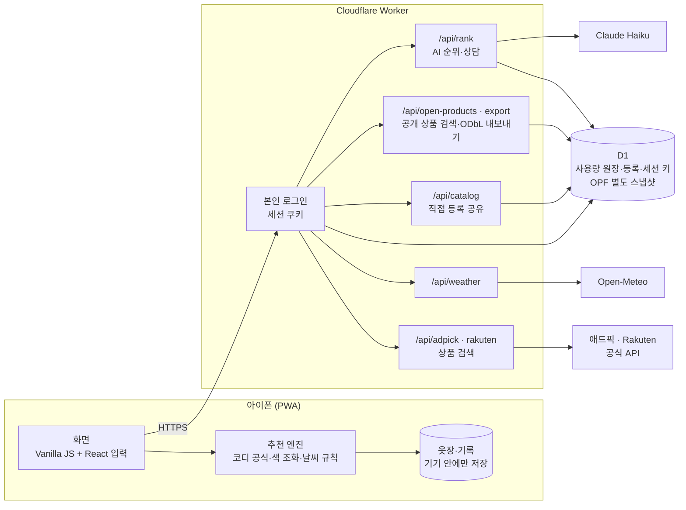

<div align="center">

# Hangit · 행잇

**옷을 걸어 보듯, 가볍게 골라요.**

말로 옷을 찾고, 원하면 내 옷과 비교해 구매 판단을 돕는 패션 앱

[](https://github.com/daedaem/otjang/actions/workflows/ci.yml)


</div>

> Hangit은 가명이에요. 진짜 이름은 상표 확인 뒤에 정해요.
> 지금은 대표 본인용 **비공개 시험판**이에요. 아이폰 홈 화면 설치가 목표이며, 실제 아이폰의 전체 흐름 검증은 남아 있어요.
> **사업·개발을 이어가기:** [최신 문서 목차](docs/README.md) · [대표 요구사항](docs/owner-requirements.md) · [사업 계획](docs/business-plan.md) · [개발 계획](docs/development-plan.md) · [시스템 인수인계](docs/system-handover.md)

<br>

## 한눈에 보기

| | |
|---|---|
| **목표** | 대충 말해도 실제 옷을 골라 주고, 비교·새 상품과 중고 구매·구매 후 기록까지 잇는 원스톱 패션 서비스. 옷장 등록은 선택이에요 |
| **누구를 위해** | "옷은 많은데 입을 게 없는" 사람, 사고 나서 후회하는 사람 |
| **이름 뜻** | 토스가 돈을 툭 던지듯 보내게 했다면, Hangit은 옷을 쓱 **걸어 보듯(hang it)** 고르게 해요 |
| **형태** | 아이폰 홈 화면에 설치하는 웹앱(PWA) + Cloudflare 서버 함수 |
| **기간** | 2026년 10월 11일 ~ 진행 중 |
| **만든 방식** | 기획자 1명이 제품 결정과 검수를 맡고, AI 개발 도구 2개(Claude Code, Codex)와 함께 구현·리뷰 |

<br>

## 해결하려는 문제

1. **검색이 너무 어려워요.** 쇼핑앱은 카테고리와 필터를 여러 번 눌러야 해요. 사람은 "출근용 셔츠 10만원 이하"처럼 말하는데요.
2. **내 옷장을 모른 채 사요.** 이미 비슷한 옷이 있는지, 가진 옷과 어울리는지 모르고 사서 후회해요.
3. **아침마다 뭐 입을지 고민해요.** 날씨와 내 옷을 함께 보고 고르는 과정을 줄이고 싶어요. 경쟁 앱보다 낫다는 것은 실제 비교로 확인해야 해요.

<br>

## 핵심 기능

| 기능 | 하는 일 |
|---|---|
| **한 줄로 찾기** | 앱 카탈로그에서 지원하는 종류·상황·예산·색·제외 조건을 해석해요. 미지원·0건은 표시해요. 아래의 외부 상품 검색은 별도 범위예요 |
| **AI 순위와 이유** | 앱 카탈로그 후보와 공개 데이터 후보를 각각 Claude가 비교해요. 공개 데이터에는 가격·재고·구매처가 없고, 애드픽·Rakuten 결과는 AI로 재정렬하지 않아요 |
| **걸어 보고 사기** | 사기 전에 후보를 내 옷장 옆에 걸어 두고, 겹치는 옷과 새로 생기는 코디 수를 비교해요 |
| **내 옷장 모으기** | 브랜드·상품명으로 찾아 넣고, 목록에 없는 옷은 직접 등록해요. 옷이 늘수록 코디 수가 같이 늘어요 |
| **오늘 날씨 코디** | 아침 기온·낮 기온·비 소식과 내 옷으로 코디를 골라요. 맞는 겉옷이 없으면 필요한 옷을 실제 상품으로 보여 줘요 |
| **코디 상담** | 앱 후보를 붙여 답하고 상담을 이어가요. 목록 밖 브랜드는 일반 지식으로 구분해요. #66이 예산 모순 아래 실제 가격 확인 줄을 붙이며 자유문장 전체의 정확도는 별도 검증이 필요해요 |
| **새 옷과 중고** | 새 상품은 국내 애드픽·일본 Rakuten 공식 API 키워드 검색이에요. 예산·핏 적용과 상품별 AI 추천은 미포함이에요. 중고는 국내 4곳·해외 5곳의 외부 검색 링크이며 앱 안 매물 연동은 아니에요 |

목표와 현재 구현은 같지 않아요. 확인된 주문·배송·반품 연동, 가상 착용, 공개 커뮤니티와 일반 사용자 출시는 아직 완료되지 않았어요. [완료 기준과 남은 작업](docs/development-plan.md)을 함께 봐 주세요.

<br>

## 구조



- **추천 엔진은 기기 안에서 돌아요.** 서버가 없어도 찾기·옷장·코디는 동작하고, AI·날씨·상품 검색만 서버를 거쳐요.
- **서버의 역할.** 키와 인증을 보호하고, 요청 검증·사용량 예약·공개 데이터 검색과 AI 후보 근거 확인을 해요. 공개 데이터 비교는 `open_rank`로 분리돼요.
- 이 구조는 `app/lite` 기준이에요. `legacy/app`·`legacy/server`의 별도 계정·사진 동기화·커뮤니티 기능이 설치 앱에 모두 합쳐진 것은 아니에요.

<br>

## 기술적으로 고민한 것

**1. AI 응답의 근거를 제한하기**
- 상품 순위는 서버가 확인한 후보 사실로 제한해요. 상담에는 질문·제한된 대화 이력·옷장 속성도 보내며, 목록 밖 브랜드의 일반 지식은 확인된 상품 사실과 구분해요. 사진은 보내지 않아요.
- AI 답은 형식을 검사해요. 후보에 없는 상품 id, 빠진 후보, 중복이 있으면 버리고 기본 순서로 돌아가요.
- 옷과 무관한 질문은 AI가 `on_topic: false`로 표시하고, 화면은 정해진 거절 문구만 보여 줘요.
- 형식 검사는 답변 내용 전체의 정확성을 보장하지 않아요. 발견한 예산 설명 오류와 실제 검증 범위는 [AI 인수인계](docs/log/2026-10/ai-provider-403-20261022.md)에 남겼어요.

**2. 비용과 남용 막기**
- 하루·한 달·분당 AI 호출 수를 D1에서 SQL 한 번으로 확인하고 예약해요. 요청이 동시에 몰려도 한도를 넘지 않아요(한도 1에 동시 65요청 → 1건만 통과하는 검사).
- 요청 크기, 질문 길이, 출력 길이, 응답 대기 시간에 모두 상한을 뒀어요.

**3. 개인정보는 기기 밖으로 덜**
- 옷장 사진은 서버로 보내지 않아요.
- 날씨를 물을 때 위치는 약 10km 단위로 줄여서 서버를 거쳐 보내요. 사용자 IP는 날씨 서비스로 가지 않아요.
- 직접 등록의 IP별 하루 한도는 `CROWD_SALT` 설정 때만 적용돼요. 이때 IP 원문 대신 비밀 값을 섞은 해시를 저장하고, 설정이 없으면 IP별 한도는 적용하지 않아요. 기기별 한도는 별도로 유지해요.

**4. 정직한 화면**
- 가격은 늘 "언제 확인한 가격"인지 같이 보여 줘요.
- 결과가 0건이면 조건을 몰래 풀지 않고, 사용자가 고를 수 있는 대안을 보여 줘요.
- 설명 문구가 화면을 덮지 않게, 주의 사항은 화면마다 ⓘ 한 곳으로 모았어요.

**5. 출시용 상품 데이터의 사용 범위 나누기**
- 신규 공급은 국내 애드픽·일본 Rakuten 공식 API와 ODbL 공개 데이터를 연결했어요. 공급처마다 표시·저장·AI 처리·이미지·공개 출시 권한은 따로 확인해요.
- 과거 수집한 앱 카탈로그 937개는 비공개 시험용이고 공개 출시 권리가 확인되지 않았어요. 애드픽·Rakuten의 전체 상품 DB 저장·외부 AI 가공 권한도 확보됐다고 쓰지 않아요. [공급처별 상태](docs/log/2026-10/legal-clothing-sources-20261021.md)를 참고해 주세요.
- 목록에 없는 옷은 사용자가 직접 등록하고, 현재는 서로 다른 기기 ID 3개가 같은 옷을 등록하면 검색에 나와요. 실제 3명을 검증하는 장치는 아니어서 공개 운영 전 보완해야 해요.

<br>

## 품질

| 범위 | 자동 검사 |
|---|---|
| 추천 엔진·이전 웹 앱 (`legacy/app`) | 정리 후보에서 683개 통과. 기존 688개 중 날씨 5개를 lite로 이동 |
| 설치 앱·서버 함수 (`app/lite`) | 정리 후보에서 191개 통과. master c02ea9a의 174개에 백업5·이전날씨5·입력7을 보강 |
| 자체 서버·Docker | server50개(49통과·기존 실제 모델1skip). 새 위치 #70 CI의 Docker 빌드·응답 검사 성공 |
| 모바일 브라우저 자동 검사 | 입력·백업·공유 초안·방문 뒤 오프라인·중복 재시도·길이 경계 왕복 Chromium19/WebKit19 총38개 통과. 실물 기기 검증과 별개 |

- 모든 push에서 GitHub Actions가 앱 검사·서버 검사·Docker 이미지 검사를 돌려요.
- 일부 버전에서 브라우저 모바일 크기·어두운 화면·PC 검사를 했어요. 이를 최신 설치 앱 전체나 실제 아이폰 검증 완료로 확대하지 않아요.
- 자동 검사는 가짜 AI와 메모리 SQLite 등을 사용해요. 별도로 10월 22일 실제 AI 요청 5회와 제공자 로그를 대조했으며, 장기 안정성·추천 정확도의 증거와 구분해요.

<br>

## 기술 스택

| 영역 | 사용한 것 |
|---|---|
| 화면 | Vanilla JS + React 19 입력, TypeScript, Vite, PWA, Pretendard, Phosphor Icons |
| 서버 | Cloudflare Workers, D1(SQLite), Wrangler |
| AI | Anthropic Claude Haiku (`@anthropic-ai/sdk`) |
| 외부 데이터 | Open-Meteo, 애드픽 API, Rakuten API, Open Products Facts |
| 자체 서버 | Node 22, `node:sqlite`, Docker, Cloudflare Tunnel, Litestream |
| 검사 | `node:test`, Playwright, GitHub Actions |

<br>

## 폴더 안내

| 폴더 | 무엇이 있나요 |
|---|---|
| `app/lite` | 아이폰에 설치하는 앱과 서버 함수 |
| `app/lite/src` | 운영 화면·코어·공유 도메인·브라우저 보조·React 입력 |
| `legacy/app` | 이전 독립 웹 앱과 상품 목록 도구 ([설명](legacy/app/README.md)) |
| `legacy/server` | 계정·동기화·커뮤니티용 자체 서버 ([설명](legacy/server/README.md)) |
| `legacy/deploy` | 자체 서버 운영 묶음 ([설명](legacy/deploy/README.md)) |
| `docs/design/mockups` | 운영 빌드 입력과 분리한 과거 디자인 시안 |
| `experiments` | 가상 착용 같은 로컬 실험 |
| `docs` | 현행 문서 5개, 월별 판단·실행 근거는 `docs/log/YYYY-MM` |

<br>

## 직접 실행해 보기

Node 22가 필요해요. 키 없이 가짜 AI로 둘러볼 수 있어요.

```bash
cd app/lite
npm ci
npm test              # 서버 함수 검사 (비용 0원)
npm run build
node dev.mjs --fake   # http://127.0.0.1:8790
```

로컬 `.mjs` MIME 문제는 #66으로 수정됐어요. 위 명령은 가짜 AI의 로컬 실행이며 실제 로그인·D1·제공자 연결 검증과는 달라요.

실제 AI·로그인·DB 연결과 이전 두 앱의 차이는 [현재 시스템 인수인계](docs/system-handover.md)를 먼저 읽고, [설치 앱 안내](docs/log/2026-10/lite-app-setup-20261020.md)의 날짜별 절차를 참고해요.

<br>

## 일하는 방식

- **결정은 사람이, 구현은 AI와 함께.** 기획자가 요구와 우선순위를 정하고, Claude Code와 Codex가 구현하고 서로의 작업을 리뷰해요.
- **요구사항은 한 곳에.** [대표 요구사항](docs/owner-requirements.md)에 결정을 날짜·출처와 함께 적고, 두 AI가 [최신 문서 목차](docs/README.md)부터 읽어요. 개발 계획·운영 상태가 바뀌면 관련 문서도 같은 작업에서 갱신해요.
- **검증하지 않은 건 했다고 쓰지 않기.** 문서마다 확인한 것과 확인하지 못한 것을 나눠 적어요.
- 규칙은 [AGENTS.md](AGENTS.md)와 [CONTRIBUTING.md](CONTRIBUTING.md)에 있어요.

<br>

## 다음 할 일

완료 기준·의존성·검증 범위는 [개발 계획](docs/development-plan.md)에 모아요. 우선 실제 아이폰의 핵심 흐름과 상담의 조건 설명을 확인하고, 출시 권리가 확인된 상품 공급을 확보해야 해요. 날씨 알림·커뮤니티·이름 확정은 별도 후속 과제로 유지해요.

확인한 master는 #66·#67을 포함한 `c02ea9a`예요. 위 새 위치와 검사 수는 정리 PR 후보 기준이며 실제 병합·활성 배포는 따로 확인해요. [PR #48](https://github.com/daedaem/otjang/pull/48)은 병합 없이 닫혔고 d16은 참고 시안이에요. 현재 화면은 d12를 유지해요.
