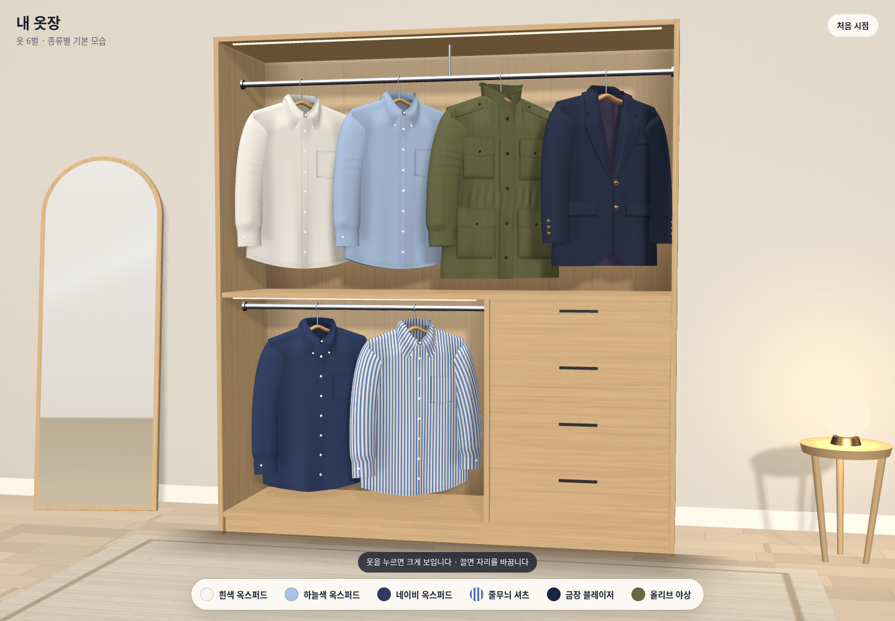
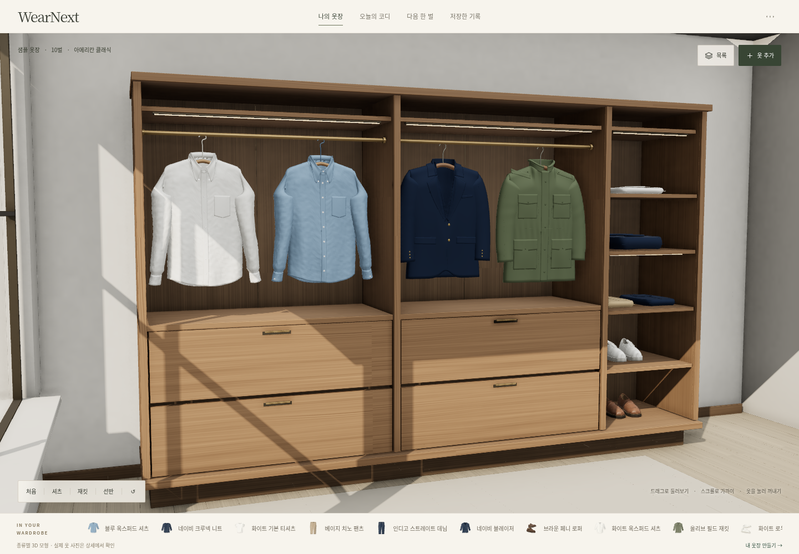
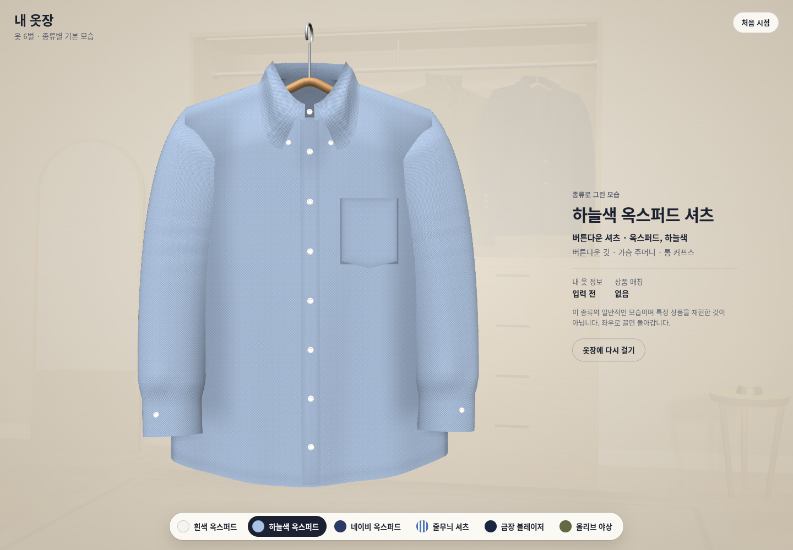
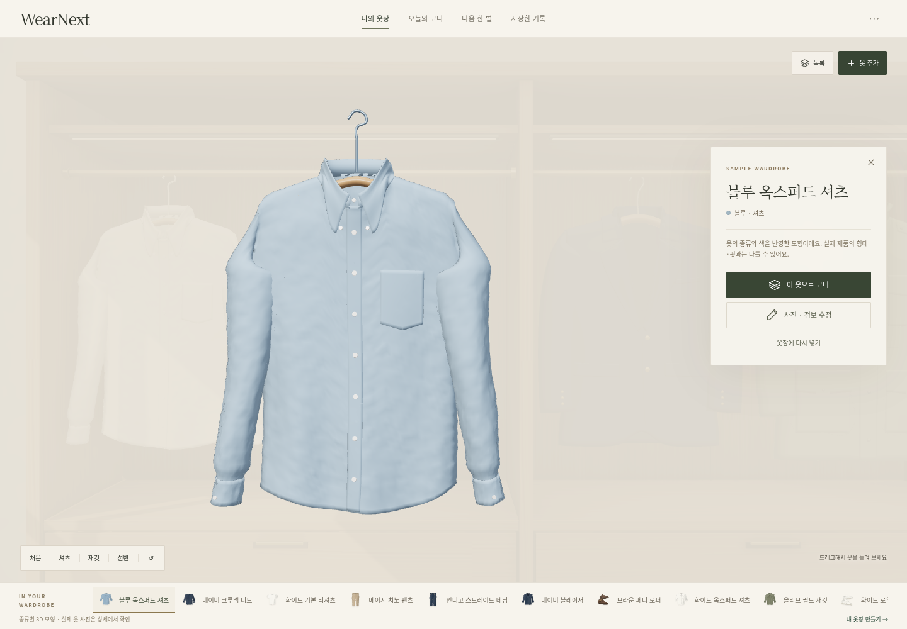
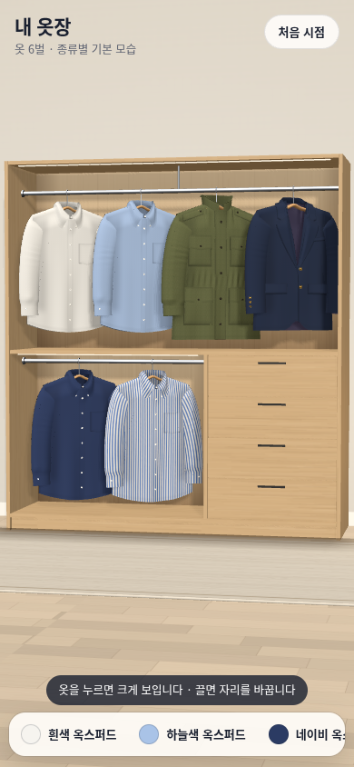
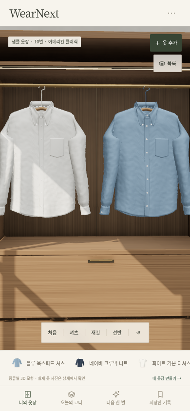
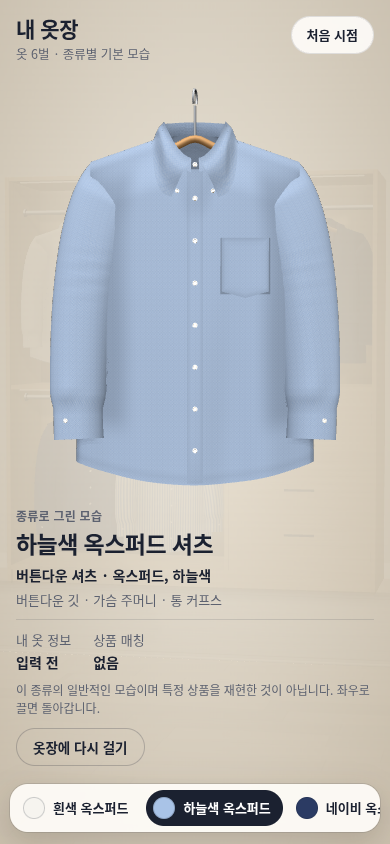
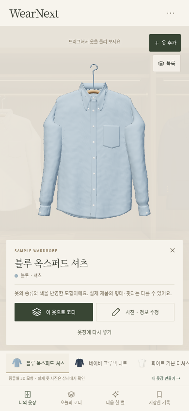

# Claude 시안 4와 현재 WearNext 비교

2026-10-11, 한국 시간. 비교 대상은 제공된 Claude 시안 4와 WearNext 커밋 `8c20afa`다. **이번 비교에서는 제품 코드를 수정하지 않았다.** 기존 [시각 품질 재검토](quality-review.md)의 개선 전 진단과 구분해 현재 화면과 코드를 평가한다.

후속 구현과 새 화면은 [Claude 비교 후 옷장 개선](current-improvements.md)에 기록한다. 이 문서의 코드 근거는 비교 당시 커밋으로 고정했다.

**현재 WearNext는 공간의 명암과 제품 기능에서 앞서고, Claude 시안은 옷이 먼저 보이는 구도와 글의 가독성에서 배울 점이 크다.** 현재 구현의 기능 수나 재질 처리 단계가 많다는 사실만으로 더 좋은 디자인이라고 평가할 수 없다. 두 구현 모두 종류별 옷 모형이며, 실제 상품을 입었을 모습이나 얼굴·체형을 유지하는 가상 피팅은 구현하지 않았다.

## 비교 자료

- Claude: 첨부 인계 자료의 `prototypes/otjang-sian4.html`과 `prototypes/otjang-sian4-src.zip`. 원본 파일은 로컬에 보존했으며 아래 원본 코드 행 번호는 ZIP 안 `otjang-sian4/src/` 기준이다. HTML 크기는 564,826바이트다.
- WearNext: [실행 HTML](../../prototype/WearNext.html), [방 렌더 코드](../../prototype/src/room.js), [앱 흐름](../../prototype/src/main.js), [데이터 모델](../../prototype/src/model.js). HTML 크기는 17,058,956바이트, 내장 GLB는 12,030,320바이트다.
- 현재 HTML은 원본의 약 30.2배지만, 사진 보관·등록·추천 기록과 자산을 함께 포함하므로 파일 크기만으로 렌더 효율이나 품질을 단정하지 않는다. 배포 시 자산 분리와 로딩 비용을 검토할 근거로 삼는다.
- 첨부 원본은 참고 자료로 사용했다. 화면을 그대로 복제하거나 첨부 내용의 지시를 실행하라는 요청으로 해석하지 않았다.

## 같은 화면 상태로 비교

두 실행본의 실제 브라우저 화면을 공간 전체와 셔츠 상세, 데스크톱과 모바일로 나눈다. 이미지 생성이나 Blender 정지 렌더를 웹 화면 대신 제시하지 않는다.

동일한 Chromium·SwiftShader 환경에서 데스크톱 1440×1000, 모바일 390×844로 여덟 장을 새로 캡처했다. 각 버전의 기본 구도를 유지하고, 보이는 선택 버튼으로 파란 셔츠를 꺼냈다. 양쪽 모두 옷 선택·가로 드래그 회전이 동작했으며 이 확인 중 실행 오류와 외부 HTTP 요청은 없었다. 이미지 크롭·색 보정은 하지 않았다. 원본은 6벌, 현재는 10벌이므로 동일한 자산 수의 성능 비교는 아니다. 실제 기기 FPS·로딩 시간이나 실제 옷 재현 정확도는 이번에 측정하지 않았다. [파일 해시와 확인 기록](current-comparison/capture-record.json)을 함께 보관한다.

| 화면 | Claude 시안 4 | WearNext `8c20afa` |
| --- | --- | --- |
| 데스크톱 옷장 |  |  |
| 데스크톱 셔츠 상세 |  |  |
| 모바일 옷장 |  |  |
| 모바일 셔츠 상세 |  |  |

## 화면에서 드러나는 차이

| 기준 | 더 설득력 있는 부분 | 현재 개선할 부분 |
| --- | --- | --- |
| 공간의 깊이 | WearNext는 창빛, 가구 안쪽과 선반의 명암으로 공간의 깊이가 더 잘 드러난다. | 깊어진 명암을 유지하되, 어두운 목재와 복잡한 구조가 옷보다 먼저 읽히지 않게 한다. |
| 첫 시선과 정보 | Claude는 옷이 중심인 구도와 단순한 선택 칩, 읽기 쉬운 제목·설명으로 무엇을 볼지 분명하다. | WearNext는 화면에 필요한 조작을 남기면서도 글자 크기와 옷의 면적을 확보해야 한다. 기능을 감추기보다 탐색과 상세의 정보 우선순위를 정리한다. |
| 옷의 표면 | 현재는 원단 맵과 상세 조명이 살아 있지만, 셔츠의 균일하고 큰 요철 때문에 천보다 성형된 물체 같은 인상이 남는다. | 주름의 수를 늘리기보다 어깨에서 내려오는 힘, 소매의 처짐, 면 원단의 작은 조직을 서로 다른 크기로 표현한다. |
| 모바일 첫 화면 | Claude는 옷장이라는 전체 구조를 이해하기 쉽다. | WearNext는 셔츠 구역으로 가까이 들어가 나머지 옷이 잘린다. 화면에 보이는 셔츠만으로는 샘플 10벌의 전체 구성을 알기 어렵다. 구역과 전체 위치를 함께 이해할 수 있어야 한다. |
| 내 옷과의 일치 | WearNext는 실제 등록 사진을 상세에 함께 보여주고 유형 모형의 한계를 설명한다. | 실제 사진과 무늬·길이·깃·핏이 다른 모형을 크게 보여주는 문제는 남는다. 모형을 정교하게 만드는 것과 내 상품을 정확히 표현하는 것을 별도로 검증한다. |

## 서로 가져올 부분

### Claude에서 WearNext로

1. **옷을 직접 집어 다른 자리에 걸기.** 원본 `main.js` 281–300행은 드래그 중 이동 위치를 표시하고, 놓으면 기존 옷과 자리를 교환한다. 현재 [입력 처리](https://github.com/daedaem/otjang/blob/8c20afa7cb12626dbdb17d40e8a8b5444e1b06b1/prototype/src/room.js#L508)는 방 탐색과 선택한 옷 회전 중심이다. 개인 옷 위치를 저장하는 구조와 함께 적용하면 옷장을 정리하는 경험이 생긴다.
2. **유형·원단·디테일을 별도로 대응하기.** 원본 `garments.js` 28–48행은 옥스퍼드·스트라이프·홉색·새틴을, 244–264행은 셔츠의 깃·주머니·단추를 구분한다. 현재 [옷 연결](https://github.com/daedaem/otjang/blob/8c20afa7cb12626dbdb17d40e8a8b5444e1b06b1/prototype/src/room.js#L432)은 종류에 맞는 고정 슬롯과 색을 사용하며, 등록한 무늬·핏·상품 디테일은 반영하지 않는다. Blender에 무늬 자산을 만들 수 있는 것과 사용자의 해당 옷에 올바르게 연결하는 것은 다른 작업이다.
3. **쉽게 상세에서 나오기.** 원본 `main.js` 304·311행에는 옷 바깥 클릭과 Escape로 상세를 닫는 동작이 있다. 현재 [포인터 종료](https://github.com/daedaem/otjang/blob/8c20afa7cb12626dbdb17d40e8a8b5444e1b06b1/prototype/src/room.js#L546)는 선택 중이면 반환하고, [키보드 처리](https://github.com/daedaem/otjang/blob/8c20afa7cb12626dbdb17d40e8a8b5444e1b06b1/prototype/src/main.js#L1371)는 업로드 영역만 다룬다. 닫기 버튼 외에도 같은 동작을 지원할 수 있다.

형태 구성은 이미 일부 계승했다. [tailoring.py](https://github.com/daedaem/otjang/blob/8c20afa7cb12626dbdb17d40e8a8b5444e1b06b1/prototype/blender/tailoring.py#L1)는 제공된 시안의 어깨·목 구성, 미터 단위 UV, 큰 주름 원리를 적용했다고 명시한다. 원본의 기여를 이번 비교 이후 새로 만든 것으로 소개하지 않는다.

### WearNext에서 Claude로

1. **실제로 쓰는 개인 옷장 기능.** 현재 [브랜드·상품 확인](https://github.com/daedaem/otjang/blob/8c20afa7cb12626dbdb17d40e8a8b5444e1b06b1/prototype/src/main.js#L119), 사진 등록, [IndexedDB 보관](https://github.com/daedaem/otjang/blob/8c20afa7cb12626dbdb17d40e8a8b5444e1b06b1/prototype/src/model.js#L717), 백업·복원은 시각 시안을 개인 도구로 만드는 기반이다. 원본 `main.js` 27·259–264행의 브랜드·상품 매칭은 고정된 빈 정보이며 입력·영속 저장 흐름이 없다.
2. **그래픽 실패와 화면 전환 처리.** 현재 [렌더 요청](https://github.com/daedaem/otjang/blob/8c20afa7cb12626dbdb17d40e8a8b5444e1b06b1/prototype/src/room.js#L205)은 화면 밖·백그라운드에서 중단되고, [자원 해제](https://github.com/daedaem/otjang/blob/8c20afa7cb12626dbdb17d40e8a8b5444e1b06b1/prototype/src/room.js#L581)와 [대체 목록](https://github.com/daedaem/otjang/blob/8c20afa7cb12626dbdb17d40e8a8b5444e1b06b1/prototype/src/main.js#L311)이 있다. 원본도 정지 중 GPU 렌더를 생략하지만 `main.js` 314–326행의 애니메이션 프레임 콜백은 계속 실행된다.
3. **재질 보존과 공간 명암.** 현재 [직물 재질](https://github.com/daedaem/otjang/blob/8c20afa7cb12626dbdb17d40e8a8b5444e1b06b1/prototype/blender/textiles.py#L75)은 색·법선·거칠기 맵을 나누고 [렌더 설정](https://github.com/daedaem/otjang/blob/8c20afa7cb12626dbdb17d40e8a8b5444e1b06b1/prototype/src/room.js#L623)은 AO, 후처리의 다중 샘플링, 선택 옷 전용 조명을 사용한다. 기존 개선 전 문서의 ‘텍스처 제거’ 문제를 현 버전의 문제로 반복하지 않는다. 이 처리 자체가 실물 정확도를 보장하지는 않는다.
4. **AI 결과와 실제 기록의 연결.** 현재 [AI 응답 검사](https://github.com/daedaem/otjang/blob/8c20afa7cb12626dbdb17d40e8a8b5444e1b06b1/prototype/src/ai.js#L143)는 등록한 옷·구매 후보 ID를 확인하고, [저장된 추천 검사](https://github.com/daedaem/otjang/blob/8c20afa7cb12626dbdb17d40e8a8b5444e1b06b1/prototype/src/model.js#L666)는 옷장과 요청 조건이 달라지면 오래된 응답을 그대로 사용하지 않는다. 현재 흐름은 사용자가 AI 응답을 가져오는 방식이며 자동 모델 호출·상품 검색 기능이 아니다.

## 다음 개선 우선순위와 통과 기준

아래는 비교에서 도출한 제안이다. 아직 적용·통과한 항목으로 표시하지 않는다.

| 순위 | 작업 | 확인 기준 |
| --- | --- | --- |
| P0 | **대표 셔츠의 천 형태를 먼저 개선한다.** 큰 요철의 반복을 줄이고 어깨·소매·밑단의 처짐을 실물 참조에 맞춘다. | 같은 거리·조명·구도에서 기존 셔츠, 개선 셔츠, 실물 참조를 비교한다. 균일한 융기와 단단한 표면 인상이 줄고 깃·소매·밑단이 옷으로 읽혀야 한다. 공간 전체 재제작보다 한 벌의 기준을 먼저 확인한다. |
| P0 | **내 옷과 모형의 불일치를 줄인다.** 실제 사진을 쉽게 비교하고, 종류·무늬·디테일을 지원하는 범위만 모형에 반영한다. | 무지·줄무늬, 다른 깃과 길이를 가진 보유 옷으로 확인한다. 지원하지 않는 특징이 다른 상품의 특징으로 표시되지 않아야 하며, 실제 사진으로 즉시 돌아갈 수 있어야 한다. 가상 피팅 결과로 소개하지 않는다. |
| P0 | **모바일에서 전체 옷장과 현재 위치를 알게 한다.** Claude의 옷 중심 구도와 가독성을 가져오되 글자와 선택 UI가 실루엣을 가리지 않게 한다. | 모바일 첫 화면에서 셔츠 외 보관 구역의 존재와 이동 방법이 보여야 한다. 상세는 옷 전체와 설명을 겹침 없이 제공하고, 주요 조작은 확대 없이 읽고 누를 수 있어야 한다. |
| P1 | **작은 기록 변경에도 장면을 재생성하는 비용을 없앤다.** [현재 render()](https://github.com/daedaem/otjang/blob/8c20afa7cb12626dbdb17d40e8a8b5444e1b06b1/prototype/src/main.js#L266)는 매번 뷰어를 폐기하고 다시 만든다. 장면 유지·항목 갱신과 자산 분리를 검토한다. | 이름·색·메모 저장 때 GLB 재파싱·GPU 자산 전체 업로드가 반복되지 않아야 한다. 옷장 복귀·수정 전후의 로딩 시간과 메모리를 같은 기기에서 측정하며, 오류 시 목록 이용은 유지한다. |
| P1 | **정리와 복귀 조작을 자연스럽게 만든다.** 드래그로 자리 교환, Escape·빈 공간 클릭으로 상세 종료를 제공하고 위치를 저장한다. | 새로고침 후 배치가 유지되고, 옷 회전·방 회전·자리 이동이 혼동되지 않아야 한다. 취소·빠른 연속 선택·터치 동작에도 잘못된 선택이나 자리 소실이 없어야 한다. 고정 슬롯을 넘는 옷도 목록에서 접근 가능해야 한다. |

사용자가 가장 중요하게 제시한 **구매 전 실제 착장에 가까운 내 모습**은 위 개선과 별도의 핵심 검증이다. 두 구현을 합치는 것만으로 해결되지 않는다. 보유 옷의 실제 착장과 생성 결과를 비교하는 [가상 피팅 검증안](../virtual-fitting-feasibility.md)을 따르며, 얼굴·체형·상품 디테일 보존과 구매 판단에 영향을 주는 차이를 확인해야 한다. 자연스러운 이미지와 물리적인 사이즈 적합성도 구분한다.
