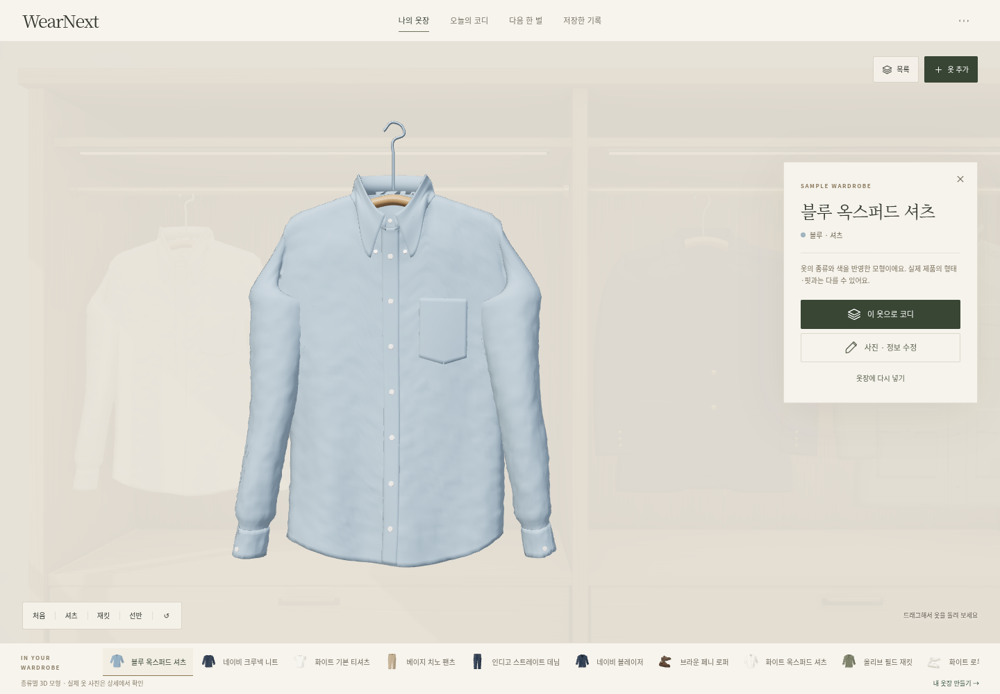
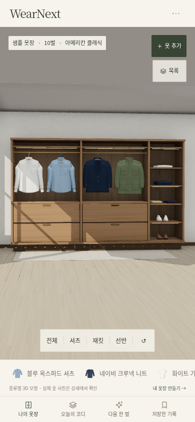
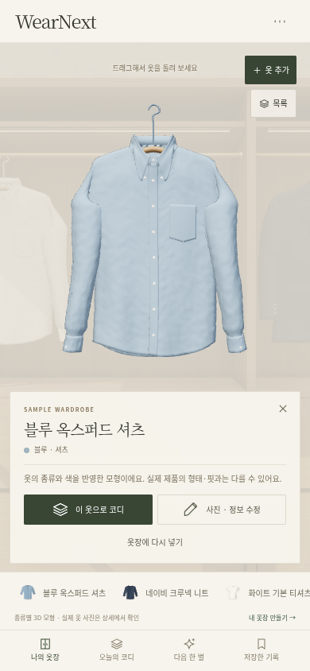
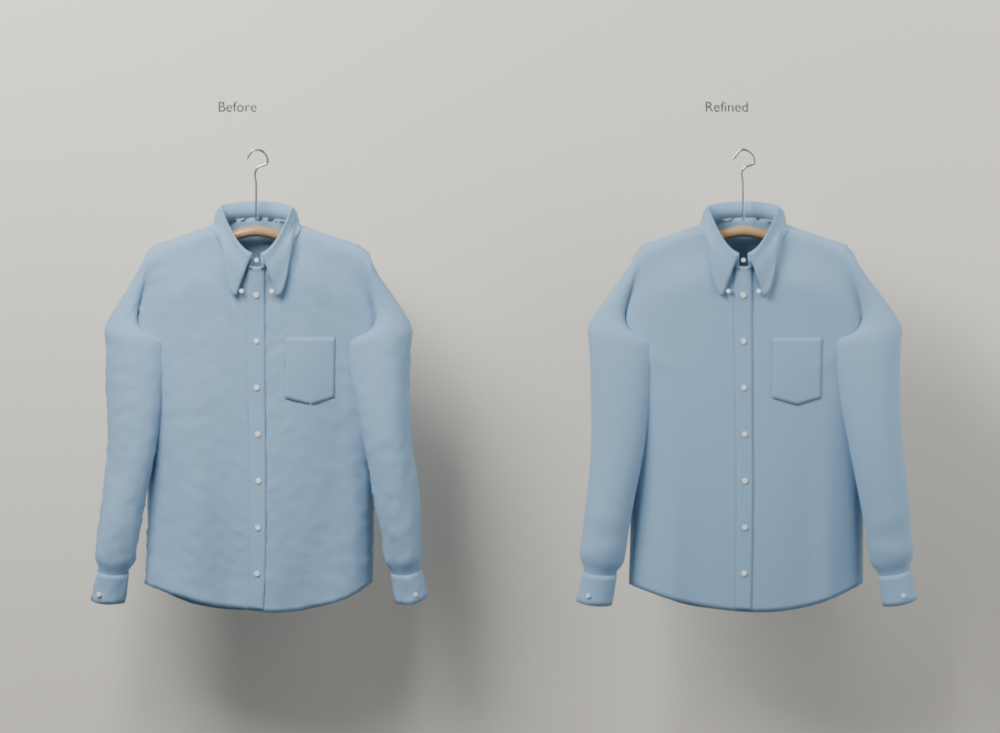

# Claude 비교 후 옷장 개선

**[개선본을 브라우저에서 바로 실행하기](https://daedaem.github.io/otjang/)** — 파일 다운로드 없이 열고 **먼저 둘러보기**를 누릅니다.

2026-10-11, 한국 시간. [기존 비교](current-comparison.md)는 커밋 `8c20afa`의 화면 기록으로 유지한다. 이 문서는 그 비교에서 찾은 문제를 이번 작업에서 어떻게 바꿨는지 설명한다. 실제 브라우저에서 새 자산을 확인했으며 아래 네 화면은 이번 개선본의 캡처다.

옷 정보를 고칠 때마다 공간이 다시 열리고, 모바일에서는 전체 옷장보다 셔츠 구역이 먼저 보였으며, 옷을 꺼낸 뒤에도 탐색 버튼과 선택 목록이 화면을 차지했다. 이번 개선은 **수정할 때 열린 옷장을 유지하고, 전체에서 원하는 구역으로 이동하고, 꺼낸 한 벌을 충분히 볼 수 있게 하는 데** 집중한다.

| 사용하면서 겪는 문제 | 적용한 변경 | 확인한 점 |
| --- | --- | --- |
| 이름·브랜드·메모를 저장하면 3D 공간 전체를 다시 만든다. | 열린 옷장의 렌더러와 캔버스를 유지하고, 바뀐 설명·목록만 갱신한다. | 이름 수정·색 변경·백업 교체·삭제·첫 등록에서 같은 캔버스와 렌더러를 유지한다. 이름 수정은 모형을 다시 연결하지 않으며 회전과 카메라도 유지한다. |
| 색을 바꿨을 뿐인데 선택한 옷이나 걸린 위치가 달라질 수 있다. | 기존 항목의 슬롯을 유지하면서 색을 갱신한다. | 색 변경 때 같은 슬롯·회전을 유지하고 원단 맵을 보존한다. 미지원 종류나 제외된 옷은 모형을 숨기고, 지원 종류로 복귀하면 같은 기록을 다시 선택한다. |
| 꺼낸 옷을 다시 넣으려면 작은 닫기 버튼을 찾아야 한다. | Escape와 빈 캔버스 클릭으로도 옷장으로 돌아갈 수 있게 한다. 드래그로 옷을 돌리는 동작과 구분한다. | Escape와 실제 빈 공간 클릭으로 닫고 원래 선택 버튼으로 초점을 돌려준다. 실제 드래그는 선택한 옷을 돌리면서 상세를 유지한다. 선택 옷의 별도 조명 레이어도 클릭 검사에 포함했다. |
| 모바일 첫 화면에서 셔츠만 보이고 나머지 보관 구역을 이해하기 어렵다. | 전체 가구를 먼저 보여주고, `전체·셔츠·재킷·선반` 버튼으로 구역에 가까이 간다. | 첫 화면에서 샘플 10벌의 위치가 모두 투영된다. 구역 버튼과 전체 복귀를 실제 조작으로 확인했다. 새 원경에서 드러난 바닥·천장 앞끝은 기존 AO를 유지하는 2개 환경면으로 이어졌다. |
| 모바일 상세에서 추가·목록·옷 선택 UI가 한 벌의 옷과 경쟁한다. | 선택 중에는 추가·목록 버튼과 옷 선택 도크를 숨기고, 앱 메뉴·닫기·코디·수정 동작을 유지한다. 주요 버튼의 터치 영역을 44px로 키우고 설명 글자를 읽기 쉽게 조정한다. | 선택한 모형 전체가 캔버스 안에 들어오고 카드와 겹치지 않는다. 주 버튼과 닫기는 44px다. 실제 옷 사진은 개인 상세에 함께 남는다. |
| 셔츠에 균일한 작은 돌기가 반복돼 천보다 단단한 성형물처럼 보인다. | 셔츠 v3에서 시뮬레이션에 남은 작은 위치 흔들림을 줄여 표면을 정리한다. | 같은 카메라·조명에서 반복 돌기 감소를 비교했다. 원본 메시 연결·UV·목과 어깨 고정점 58개는 유지했다. 두 셔츠 옷걸이의 어깨 288개 정점씩 검사해 겉 봉제면 밖으로 나온 점은 없었다. |

데스크톱·모바일의 옷장 전체와 셔츠 상세를 실제 WebGL에서 캡처하고, 저장·선택·회전·복귀 흐름을 함께 확인했다. 장면 유지·정보 수정·클릭 검사 52개와 WebGL 검사 77개 고유 항목이 통과했다(두 화면을 나눠 실행한 39+41개에서 폴백 3개는 중복). 자산을 더 정교하게 만든 사실만으로 실물 수준의 품질이나 성능 개선을 확정하지 않는다.

| 화면 | 옷장 전체 | 선택한 셔츠 |
| --- | --- | --- |
| PC 1440×1000 |  |  |
| 모바일 390×844 |  |  |

### 셔츠의 같은 조건 비교

왼쪽은 이전 셔츠, 오른쪽은 v3다. 동일 카메라·조명·소재의 Cycles 16 samples 비교이며 위 웹 캡처와 렌더러가 다르다. 큰 요철은 줄었지만 몸판·소매의 매끈하고 대칭적인 형태, 주머니·손목 경계는 여전히 간소화된 모형으로 보인다. 실사 품질 통과로 평가하지 않는다.

[전체 검증 기록](../../prototype/VALIDATION.md) · [캡처·파일 해시](current-improvements/capture-record.json). 테스트는 합성 옷·사진을 사용했고 실제 기기 성능은 측정하지 않았다.

구매 전 본인의 얼굴·체형과 실제 상품을 재현하는 가상 피팅은 아직 구현되지 않았다.
