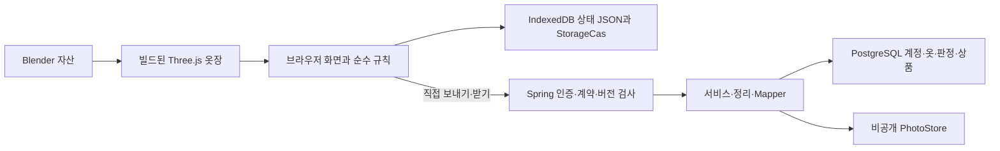

# 개발자 인수인계

기준일: 2026-10-14. 대상: `feat/editorial-mobile-20261013`의 작업 소스. 반품·사이즈 계약과 후속 기록 동기화 보호를 구현했고 서버·Node 자동 검증을 실행했다. 실제 브라우저와 운영 배포 검증은 남아 있다. 이 문서는 개발자가 코드를 찾아 수정하는 길잡이이며 출시 완료 보고서가 아니다.
기록 용량 보호와 실제 상품 비교 연결의 검증 대상 코드는 `d7dfa70cc80c6f3d71ba0870476a03571755d9f3`다. 기존 `e508ecb` 이후 변경 23개 파일의 동결 원문과 커밋 blob SHA-256 일치를 확인했고, GitHub 기능 브랜치와 초안 PR #10의 동일 SHA 게시를 확인했다. 실제 앱 운영 배포는 하지 않았다.
받기 저장 실패·계정 전환·대기 중 편집 보호의 검증 대상 코드 `2cef23332dcae2270df5eb97512298fa0f8be6d7`는 **GitHub 기능 브랜치와 초안 PR #10에 게시됐다**. 코드 3개 파일의 동결 원문/커밋 blob 바이트·SHA-256과 원격 코드 SHA, 게시 범위 Node 278개(기존 231개 + 신규 47개)와 세 빌드, 독립 집중 회귀 90개를 확인했다. 독립 검토가 제보한 연속 후속 제출 P1은 실제 재현해 해결을 확인했으며 이번 범위의 추가 확정 P0/P1은 없었다. 실제 운영 서버 배포는 하지 않았다. 대상 소스 SHA와 미실행 범위는 [검증 기록](verification-2026-10-13.md)을 따른다.
사용자 검토용 [빈 자료 미리보기](https://daedaem.github.io/otjang/preview/review-86c5bae/)는 앞선 `86c5bae` 소스다. 생성된 7개 파일과 Pages 게시 원문의 일치를 확인했지만 브라우저 렌더는 미확인이다. 이번 받기 보호나 별도 입력 UX 시안이 반영된 화면으로 읽지 않는다.

## 처음 읽는 순서

1. [작업 규칙](../CONTRIBUTING.md): 사용자 결정·제안·검증 사실 구분, 비공개 자료 경계.
2. 이 문서: 진입점, 저장 위치, 기능 흐름, 수정·검증 방법.
3. [설계 선택 기록](architecture-decisions.md): 문제와 선택 이유, 비용, 다시 검토할 조건.
4. [알파 시스템 설계](system-design-alpha.md): 이번 수정의 완료 기준과 이후 구현 순서.
5. [서버 운영 기준](../server/OPERATIONS-BETA.md): 인증, 사진, 백업, 계약 2, 환경 설정의 현재 계약.
6. [앱 명령](../app/package.json), [서버 의존성](../server/pom.xml), 아래 해당 기능의 코드와 테스트.

오래된 README·상태 문서의 테스트 수와 미실행 표는 해당 날짜의 기록이다. 최종 커밋의 검증 결과를 먼저 확인하고, 중간 수치나 소스 리뷰 점수를 현재 결과로 읽지 않는다.

## 진입점과 디렉토리

| 위치 | 책임과 처음 볼 곳 |
| --- | --- |
| [app/build.mjs](../app/build.mjs) | HTML 안의 `/*@@…@@*/` 마커에 JS·JSON·CSS 삽입; 3D 번들, CSP, PWA 산출물 생성 |
| [app/src/app.html](../app/src/app.html) | 앱 상태, 화면, 이벤트, 저장, 파일 가져오기, `syncFetch`·`syncPush`·`syncPull` |
| [app/src/beta-ui.js](../app/src/beta-ui.js) | 간단 등록, 확인 전 안내, 후속 결과, 전체 백업, 계정별 저장 전환; app.html 클로저 안에 삽입 |
| [app/src/wardrobe.js](../app/src/wardrobe.js) | 어휘·스키마, `cleanItem`·`cleanDecision`, 사진 상태, 상품 확인, 내보내기 |
| [app/src/judge.js](../app/src/judge.js) · [recommend.js](../app/src/recommend.js) | 후보의 겹침·추가 조합·판정 보류와 보유 옷 코디 규칙 |
| [app/src/needs.js](../app/src/needs.js) · [needs-ui.js](../app/src/needs-ui.js) | 보유 종류 집계, 목적·계절별 빈틈, 실제 후보 연결 화면 |
| [app/src/pick.js](../app/src/pick.js) · [catalog.js](../app/src/catalog.js) | 편집 카탈로그 추천/근거와 사용자가 넣은 상품 목록의 정리/순위; 서로 다른 입력 모델 |
| [app/src/sync.js](../app/src/sync.js) · [beta.js](../app/src/beta.js) | 네트워크 없는 동기화 계산·계약 보호·baseline과 전체 백업 형식 검증 |
| [app/src/storage-cas.js](../app/src/storage-cas.js) | 같은 계정의 마지막 성공 원문과 현재 IDB/LS 복사본 비교, 원자적 쓰기, 검증된 장애의 대체 저장 |
| [app/src/photo-intake.js](../app/src/photo-intake.js) · [colorguess.js](../app/src/colorguess.js) | 사진 품질 안내·크롭 영역, 색/밝기 초안; 상품 식별 모델은 없음 |
| [app/src/closet/](../app/src/closet/) · [blender/README.md](../blender/README.md) | Three.js 표시·천 흔들림·원단과 Blender 자산 제작 |
| [app/data/](../app/data/) · [app/tools/](../app/tools/) | 합성 예시/편집 상품과 빌드·카탈로그·브라우저 검사 도구 |
| [server/src/main/java/otjang/](../server/src/main/java/otjang/) | `OtjangApplication` → security 필터 → api → service → domain/persistence/store |
| [server/src/main/resources/](../server/src/main/resources/) | 설정, Flyway 마이그레이션, 기본 옷장 초안; Hibernate는 스키마를 validate |
| [contracts/](../contracts/) · [app/test/](../app/test/) · [server/src/test/](../server/src/test/) | 양쪽 공통 사례, 순수 JS 테스트, Java 도메인/API/PostgreSQL 검증 |
| [record-limits.json](../contracts/record-limits.json) · [RecordLimits](../server/src/main/java/otjang/domain/RecordLimits.java) · [AccountCapacity](../server/src/main/java/otjang/service/AccountCapacity.java) | 신규 생성 한도와 기존 자료 읽기 상한의 공통 값, 서버 계정별 용량 검사 |
| [release-tools/local-beta.mjs](../release-tools/local-beta.mjs) | 빈 앱·로컬 Java·별도 DB의 실행 준비와 start/status/stop; 운영 절차는 운영 안내 참조 |

`dist/`, `assets.gen.js`, `server/target/`은 산출물이다. 화면을 고칠 때 빌드 결과를 직접 편집하지 않는다. 공개 모바일 미리보기는 `data/empty.json`을 사용하며 개인 옷장·사진을 빌드에 넣지 않는다.

현재 자료 흐름은 다음과 같다.



## 자료가 어디에 있는가

| 자료 | 현재 저장/전송 경계 |
| --- | --- |
| 브라우저 상태 | `schema:2`; owner/items/decisions 외 prefs/pickLog/others/rack/meta 등도 포함 |
| 지속 저장 | app.html의 IndexedDB `kv`에 상태 JSON 하나; 원문 검증 뒤 쓰기만 실패하면 Web Lock 안에서 localStorage 대체 저장. 읽기 실패·충돌은 저장 실패 안내 |
| 저장 순서 | `_storageRevision`으로 읽을 복사본 선택, `savePromise`로 같은 탭 직렬화, 계정별 마지막 성공 원문으로 CAS. 같은 revision의 다른 JSON도 충돌 |
| 로그인 상태 | UI 메모리의 bearer 토큰; 서버 origin+인증 ownerId로 브라우저 저장 키 분리 |
| 서버 옷장 | PostgreSQL의 owner/items/decisions; JPA 엔티티와 `ItemMapper`가 파일 모델에 매핑 |
| 동기화 | 명시적 보내기/받기; owner/items/decisions와 별도 catalog 요청. prefs/pickLog/others/rack은 서버 동기화 대상 아님 |
| 사진 | 브라우저 상태의 data URL; 선택한 서버 전송 후 비공개 폴더의 해시 파일과 DB 참조 |
| 전체 백업 | 브라우저 `otjang-backup` version 1과 서버 `otjang-server-backup` schema 1은 범위가 다름 |

공유용 옷장 내보내기는 선택 필드·보유 옷만 담으므로 전체 백업 대용이 아니다. 계정 API 백업도 DB 운영 백업 대용이 아니다. 계약 상세는 [구매 후속 계약 2](../server/OPERATIONS-BETA.md#구매-후속-기록-계약-2), [공유 fixture](../contracts/followup-contract.json), [Wardrobe.java](../server/src/main/java/otjang/domain/Wardrobe.java)에 연결된다.

## 기능을 따라 읽기

### 옷 등록과 거친 사진

`needs-ui.js` 등록 버튼 → `beta-ui.js::openQuickItem` → `Wardrobe.cleanItem` → `replaceItem` → `await save()` 순서다. 간단 등록은 이름·분류부터 받고 모르는 속성은 비워 둔다. 저장 실패 시 이전 items로 되돌리고 안내한다.
사진 등록은 app.html의 `readImage`, 일괄 사진/크롭 흐름, `PhotoIntake.quality`, `ColorGuess.guess`를 함께 본다. 기본 `readImage`는 긴 변 480px 이하로 다시 인코딩한다. 품질 검사와 색 초안은 브랜드·상품명·핏을 식별하지 않는다. 원본 재촬영·한 벌씩 크롭·사용자 확인 경로와 품질 측정은 계속 필요하다.
상품 사진의 `candidate`/`substitute`/`confirmed`와 속성의 `photo-draft`/`owner`/`owner-confirmed`는 다른 축이다. `confirmedAt` 없이 동일 상품으로 확정하지 않으며 사용자 입력을 자동 추정으로 덮지 않는다.

### 빈틈 발견과 살까 말까

`needs-ui.js::wardrobePlan` → `Needs.analyze`는 보유 종류와 목적·계절별 역할을 계산한다. 종류 제안에서 `openNeedProduct`로 실제 상품을 입력하거나 `Pick.recommend`로 편집 카탈로그 후보를 연결한다. 추천된 종류 자체를 실재 상품으로 저장하지 않는다.
작업 소스의 `needOfferCard` → `compareNeedOffer`는 표시한 실제 상품을 `pickToCand`로 저장한 뒤 그 후보의 판정 화면을 연다. 브랜드·상품명·가격·확인일·판매처 링크와 추천 기록의 `candidateId` 연결을 유지한다. 같은 상품은 중복 생성하지 않으며 저장 실패·계정 전환이면 성공 이동하지 않는다. 현재 편집 카탈로그의 자동 추천 종류는 `white-tee`뿐이다. 다른 빈틈은 수동 상품 입력으로 이어지며 확인된 상품이 없을 때 가상 상품이나 구매 링크를 만들지 않는다.
판정 화면은 추천 전 마음을 `decisions[].before`에 저장하고 `Judge.judgeCandidate`를 호출한다. 결과에는 겹치는 옷, 추가 조합, blockers와 `ready/partial/needs-confirmation`이 있다. 확인 전 속성을 계산에서 제외하고, 이유를 보여 준다. 결정은 `after`, 실제 후속 결과는 `followup`이다.
서버 경로는 [RulesController](../server/src/main/java/otjang/api/RulesController.java) → `WardrobeService` 조회 → `Judge`/`Recommend`이며 앱은 로컬에서 직접 계산할 수 있다. 편집 추천의 `pick.js` 전체가 Java로 이식된 것은 아니다.

### 구매·착용·반품 결과

`app.html::saveBought`는 구매 버튼과 함께 비동기 저장 성공을 기다린다. 실패하면 이번 구매 필드·보유 전환만 되돌리고 사이즈 선택을 보존한다. 계정/state 교체와 다른 편집은 덮지 않는다. 뒤 큐나 import-add가 잠정 구매를 포함했으면 현재 사본을 보상 저장한다. 보상까지 실패하면 저장소에 잠정 구매가 남을 수 있으므로 완전 복구로 표시하지 않는다. 회귀와 선택 이유는 [검증 기록](verification-2026-10-13.md), ADR-13을 따른다.

`beta-ui.js::openFollowupDialog`는 outcome/worn/regret/sizeResult/returnReason/note/at를 저장한다. 반품은 연결된 item을 `gone`으로 바꾸고 3D rack에서 빼며, 구매로 정정하면 연결 item을 다시 `owned`로 만든다. 저장 실패 시 후속 기록·item·rack을 되돌린다.
서버는 [FollowupWriteValidator](../server/src/main/java/otjang/api/FollowupWriteValidator.java) → cleaner → mapper → `DecisionEntity`와 V8 제약으로 처리한다. `pickLog` 구매 기록과 `decisions.followup`이 아직 별개다. `pickLog.returned`는 판매처에서 앱으로 돌아왔다는 뜻이며 상품 반품이 아니다.

### 기록 용량과 원문 복구

작업 소스는 [공통 용량 정책](../contracts/record-limits.json)을 브라우저 빌드와 Node 모듈, 서버 Maven 자원에서 읽는다. 옷·판정·상품의 신규 생성은 목록별 500개, 로컬 추천 기록은 1,000개, 비교 옷장 추가는 6묶음이다. 기존 업무 목록은 각각 2,000개까지 온전히 읽고 수정·백업한다. 3D rack의 6자리는 표시 제약이다. 이 값들은 알파 운영 가정이며 성능·저장 공간의 검증된 최대치가 아니다.

`app.html::canAdd`는 실제 생성 호출 전에 검사하며 신규 ID가 없으면 기존 501번째 기록의 수정이나 후속 결과를 막지 않는다. 일반 옷장 가져오기의 **추가**는 기존 ID를 그대로 두고 새 옷만 더한다. **바꾸기**는 기존 ID의 내용을 교체할 수 있지만 새 ID를 포함한 결과가 생성 한도를 넘으면 전체 거부한다. 명시적인 엄격한 전체 백업 복원은 목록별 읽기 상한까지 기존 초과 자료를 복원할 수 있는 별도 경로다. 백업 파일이 과거 어느 계정에서 왔는지를 인증하는 기능은 없다.

서버 `AccountCapacity`는 실제 owner 행을 잠근 트랜잭션 안에서 기존 ID와 새 ID를 비교한다. 단건·bulk·직접 service 호출 모두 사진 저장·행 수정·import 영수증 생성 전에 검사하며, 초과 생성은 422 `ACCOUNT_LIMIT`로 요청 전체를 거부한다. `WardrobeCleaner`와 조회/export/backup은 기존 자료를 500개로 자르지 않는다. 2,000개를 넘는 입력·조회는 일부 결과 대신 전체 실패한다.

브라우저 `cleanState`·`chooseStoredCopy`·`recoveryFor`는 최신 원문이 상한 초과·손상·무효 revision이거나 같은 revision의 두 원문이 다르면 계정 범위별 복구 화면을 연다. 빈 옷장을 자동 저장하지 않는다. `renderRecovery`에서 확인할 수 있는 각 저장 원문을 그대로 다운로드하고, 사용자가 정상 전체 백업 교체를 명시적으로 확인한 뒤 `restoreRecovery`의 CAS 저장에 성공해야 잠금을 해제한다. 일반 JSON과 복원 파일은 파싱 전에 50 MiB(UI 표기 50MB) 크기를 제한한다.
복원에는 목록 수 외에도 전체 백업 형식·각 사진 data URL 600,000자 제한·파일 크기 조건이 모두 필요하다. 사진이 많은 자체 백업도 50 MiB를 넘으면 앱 복원 화면에서 거부될 수 있다. 신규 500개나 읽기 2,000개는 브라우저 저장 용량이나 모든 백업의 복원 가능성을 보장하지 않는다. 실패 시 원문과 백업을 보존하고 일부만 잘라 복원하지 않는다.

`renderCapacity`·`cleanupSelected`는 초기 선택 없이 백업·사용자 선택·자료 지문·CAS 확인 후 선택 기록만 정리한다. 구매·후속 답이 있는 기록을 자동 삭제하지 않는다. 정리는 해당 브라우저에만 적용되므로 동기화한 옷·판정·상품은 서버에서 다시 받을 때 나타날 수 있다. `pickToCand`·구매·선택 정리는 실패한 변경을 선별 복구하고 뒤 큐의 잠정 사본에 보상 저장을 시도한다. **보상까지 실패하면 마지막 성공 저장소에 잠정 후보·구매 또는 삭제가 남을 수 있다.** 이 경로는 일반 outbox나 원자적 동기화가 아니다.

### 보내기·받기와 충돌

app.html의 `syncFetch`가 인증/계약/If-Match 헤더와 응답 버전을 처리한다. 보내기는 meta 지원 확인 → 고정한 wardrobe 본문 → import → 성공한 본문 기준 ack 저장 → catalog import 순서다. 두 import가 하나의 원자적 묶음은 아니므로 부분 성공 가능성이 남는다.

재로그인에서 `syncStamp`가 없거나 무효여도 같은 origin·인증 owner의 유효한 ack는 이전에 확인한 revision을 증명한다. 보내기는 이 값을 `If-Match`로 유지해 최신 서버 정정에 409로 멈춘다. ack를 두고 최신 revision을 probe해 조건만 올리면 오래된 로컬 자료가 덮어쓰기를 할 수 있으므로 그렇게 복구하지 않는다. 다른 계정·출처·손상 ack는 사용하지 않는다.

받기는 meta/옷장/catalog 읽기 → raw 자료와 정리 결과의 손실 확인 → followup 3방향 비교 → 사용자 선택 → 적용 직전 재검사 → 상태와 baseline 저장 순서다. baseline은 성공한 정확한 자료·서버·계정·revision에 묶는다. 성공한 upsert push는 원격 목록의 부재를 증명하지 못하며, 정리 손실 없는 완전한 pull만 이를 증명한다. 기준점이 없을 때는 검증한 서버 자료에서 이 기기 결과를 유지하는 선택만 제공한다. 명시적인 원격 null 정정도 키 누락과 구분해 직접 선택한다. 일반 필드 병합·삭제 전파·outbox를 제공한다고 해석하지 않는다.
`2cef233`의 `applySyncPull`은 시작한 state·계정 키·출처·토큰을 고정하고 저장을 기다린다. 실패 시 `undoPullSnapshot`은 이번 받기가 설치한 값만 복구한다. `save`의 `writtenSnapshots`는 계정 키별 마지막 성공 원문·target과 그 저장 시점의 제출 값·참조·성공/실패 상태를 기록하며, 뒤 큐가 잠정 받기를 포함했으면 `repairPullSnapshot`이 그 사본을 큐 끝에서 CAS 정정한다. 로그아웃·새 state·새 전체 복원의 자료와 UI를 이전 작업이 덮지 않는다. 사진/상품 확인 정보, 후속 결과/연결 item 생애 상태/rack, 분류/종류/실측을 일관된 묶음으로 유지한다. 같은 값의 새 후속 제출도 구분하고 실패한 제출은 건너뛰어 마지막 성공 결과를 보존한다. 판정 객체를 유지해 대기 중 폼의 참조가 끊기지 않도록 하고, 실제 후속 callback은 계정·state·시도 결과를 확인한 뒤 성공 UI를 적용한다. 보상 저장까지 실패하면 해당 계정에 잠정 받은 자료가 남을 수 있다는 안내를 남긴다.
받기 대기 중 신규 생성 수는 실패 시 복구할 기록까지 예약한다. 적용 전 기존/받을 목록별 ID 합집합이 2,000개를 넘으면 변경·저장 전에 전체 거부한다. 기존 ID 수정은 허용하며 수를 맞추려고 일부 기록을 자르지 않는다. 이유와 제한은 ADR-17을 따른다. 이 경계는 아직 정상 받기의 일반 자료 병합을 제공하지 않는다.
현재 followup 이외의 일반 미전송 로컬 옷·판정·상품은 전체 받기로 교체되며 손실될 수 있다. 용량 보호가 이 병합 결함을 해결하지 않는다. 받기 전에 양쪽 전체 백업을 보관하고 미전송 변경을 직접 대조한다. 이 결함과 명시적 삭제 전파가 용량 작업 뒤의 우선 수정 대상이다.
서버는 `BearerFilter` → `AuthenticatedRevisionFilter` → `RevisionService` → controller/service 순서다. owner 행 잠금 안에서 버전 확인·업무 트랜잭션·revision 갱신을 하고 실패 응답은 롤백한다. import는 upsert여서 로컬 목록에서 빠졌다는 이유만으로 서버 항목을 지우지 않는다.

### 사진 전송·교체·삭제

`ItemMapper`는 `PhotoStore` 뒤의 실제 이미지 검증·저장과 DB 참조를 연결한다. [PhotoLifecycle](../server/src/main/java/otjang/store/PhotoLifecycle.java)은 참조·할당량을 확인하고 커밋/롤백 뒤 고아 사진을 수거한다. 인증된 owner의 참조를 통해 읽으며 공개 사진 URL을 만들지 않는다.
파일과 DB는 분리되어 있으므로 양쪽을 함께 보존·복구해야 한다. 강제 종료 후 남은 고아 파일의 정기 수거와 비공개 객체 저장소 이관은 미완료다. 실제 삭제 확인 없이 보관 정책이 완료됐다고 표시하지 않는다.

## 수정할 때의 순서

1. 재현 가능한 합성 입력, 기대 결과, 이슈의 완료 기준을 먼저 적는다. 개인 자료·사진·토큰·대화 원문을 테스트나 커밋에 넣지 않는다.
2. 파일/어휘를 바꾸면 JS `wardrobe.js`와 Java DTO/cleaner/validator/mapper/엔티티를 함께 검토한다. API 거부와 로컬 정규화의 의도된 차이도 fixture로 기록한다.
3. DB 변경은 새 Flyway V번호로 추가한다. 적용된 이전 파일을 고치지 않는다. 기존 행 보존·업그레이드·DB 제약 거부를 테스트한다.
4. 판정/코디/상품 순위의 공통 규칙은 JS·Java를 함께 바꾸고 골든 교차 비교한다. `needs.js`·`pick.js`처럼 대응 Java가 없는 모듈은 동등한 서버 구현이 있다고 가정하지 않는다.
5. UI 동작은 해당 app.html/beta-ui.js와 순수 계산 모듈을 나눠 확인한다. `build.mjs` 삽입 조각은 단독 스크립트와 실행 범위가 다르므로 실제 빌드도 검사한다.
6. 저장 성공을 기다린 뒤 성공 안내를 내고, 실패 시 변경을 되돌리거나 미저장 상태를 명확히 표시한다. 네트워크 await 뒤 현재 상태가 전송한 자료와 같다고 가정하지 않는다.
7. 실행 로그·대상 SHA·환경·실패/건너뜀·미실행 범위를 함께 남긴다. push, PR, 배포, 공개 화면 확인은 별도로 기록한다.

## 검증 명령과 확인 위치

아래는 재현용 절차다. 각 명령을 이 문서 작성 작업에서 새로 실행한 것은 아니다. Node 22 이상, Java 21, Maven, 실행 가능한 Docker가 필요하다. Node 22.23.2의 독립 임시 설치에서 `npm ci --ignore-scripts --no-audit --no-fund`와 직접 의존성 버전 일치를 확인했다. 설치 성공과 최종 프런트 테스트·빌드는 별도 결과다.

```bash
cd app
npm ci
npm test
npm run check:catalog
npm run assets
npm run build
npm run build:mobile
```

서버 전체 테스트는 `server/`에서 `mvn test`로 실행한다. API 테스트가 disposable PostgreSQL Testcontainers를 띄우므로 운영 DB를 연결할 필요가 없다. 결과는 `server/target/surefire-reports/`에 있으며 실패·오류·건너뜀까지 확인한다. 실제 서버 실행은 [운영 기준](../server/OPERATIONS-BETA.md)과 로컬 실행 도구를 따른다.

핵심 회귀 위치는 `followup-contract.test.cjs`, `sync.test.cjs`, `sync-flow.test.cjs`, `storage-cas.test.cjs`, `app-persistence.test.cjs`, `purchase-persistence.test.cjs`, `pull-persistence.test.cjs`, `capacity-flow.test.cjs`, `needs-offer-flow.test.cjs`, `backup-schema.test.cjs`, `calendar-integrity.test.cjs`, `readiness.test.cjs`와 서버 `FollowupContractTest`, `FollowupApiContractTest`, `AccountCapacityTest`, `ContractGuardTest`, `AuthIsolationTest`, `RevisionConcurrencyTest`, `GoldenParityTest`다. 앱 흐름 회귀는 실제 함수 본문을 추출해 합성 HTTP/저장 어댑터로 실행하며 실제 브라우저 검사는 아니다.
골든 기대값 생성은 의도한 규칙 변경 때만 `npm run golden`과 `node server/tools/gen-rank-golden.mjs`를 사용한다. 실패를 없애려고 기대값을 먼저 갱신하지 않는다.
브라우저 환경이 준비되면 `npx playwright install chromium` 뒤 `npm run check`, `check:storage`, `check:import`, `check:beta`, `check:web`, `check:a11y`, `check:perf`를 해당 산출물·환경에 맞게 실행한다. Node 테스트·빌드 성공은 이 검사의 실행이나 실제 휴대폰 확인을 대신하지 않는다.

## 문제가 나면 처음 볼 곳

| 관찰한 문제 | 코드에서 확인할 경계 |
| --- | --- |
| 저장 실패 또는 다시 열면 예전 자료 | app.html `save`/`load`, storageRevision과 IDB/LS 모드, 호출부의 save 결과 처리 |
| 401 로그인 필요 | `syncFetch`와 `BearerFilter`/`AuthService`; 토큰 원문을 로그에 남기지 않기 |
| 409 `CLIENT_UPGRADE_REQUIRED` | meta 응답, `X-Eoul-Contract`, `AuthenticatedRevisionFilter`의 계약 검사 |
| 428 또는 서버 버전 변경 409 | If-Match와 X-Wardrobe-Version, syncStamp/ack 출처, `RevisionService` |
| 422와 필드 path | `FollowupWriteValidator`, 해당 공유 fixture, DB 제약; 정규화로 실패를 숨기지 않기 |
| 422 `ACCOUNT_LIMIT` / `READ_CEILING`, 복구 화면 | `AccountCapacity`·`RecordLimits`, 앱 `canAdd`·`chooseStoredCopy`·`renderRecovery`; 신규 한도와 읽기 실패를 구분하고 원문 보존 |
| 복원 거부 | `Beta.newerSchemaPath`/`readBackup`, `TenantDataService.restore`; 형식·범위·손상 여부 |
| 삭제한 옷이 다시 나타남 | 현재 import upsert와 미구현 tombstone; 목록 누락으로 삭제를 추정하지 않기 |
| 사진 누락 또는 삭제 파일 잔존 | `ItemMapper`, `PhotoStore`, `PhotoLifecycle`의 참조·커밋/롤백·수거 흐름 |
| 새 빌드가 화면에 안 보임 | 실제 산출물·배포 SHA와 `app/web/sw.js`의 scope/캐시; 소스 수정과 배포를 구분 |

## 확인된 범위와 남은 책임

| 항목 | 2026-10-14 작성 시점 상태 |
| --- | --- |
| 서버 | 이전 계약 변경은 실제 PostgreSQL 16 Testcontainers 130개 통과. `d7dfa70` 용량 변경은 Java 21·PostgreSQL 16.15에서 전체 141개 통과, 실패/오류/건너뜀 0. 독립 서버 소스 검토에서 이 변경의 추가 확정 P0/P1 없음; 검토자가 전체 테스트를 재실행한 것은 아님 |
| 공유 사례 | 88건의 계약 입력/정규화/거부 사례; DB/API 테스트 수와 같은 숫자는 아님 |
| 클라이언트 | 게시 이력은 최초 184개 → 재로그인 수정 188개 → 구매 저장 수정 203개 통과. 용량·상품 연결 `d7dfa70`의 Node 22.23.2 전체 231개 통과, 실패/건너뜀 0; 용량 VM 22개·구매 15개·상품 연결 6개 포함. 기본 12.24 MB·분리 웹/모바일 각 1.10 MB + 3D 11.14 MB 빌드 성공. 독립 검토자는 해당 43개를 재실행하고 소스를 검토해 이번 범위의 추가 확정 P0/P1을 찾지 못함; 전체 231개는 로그 확인이며 독립 전체 재실행은 아님. 코드 23개 파일의 동결 원문/커밋 일치와 원격 브랜치·PR SHA를 확인함 |
| 받기 저장 실패 보호 `2cef233` | 게시 범위 Node 278개 통과(기존 231개 + 신규 47개), 실패/건너뜀 0. 세 빌드·각 14 scripts 구문/계약·제출 출처 주입 검사 통과. 독립 집중 회귀 90개 직접 재실행, 연속 제출 제보 해결 확인 및 이번 범위의 추가 확정 P0/P1 없음. 전체 278개와 빌드는 로그 확인이며 독립 전체 재실행은 아님. 코드 3개 파일의 동결 원문/커밋 blob과 원격 기능 브랜치·PR 코드 SHA 일치 확인. 실제 브라우저·두 기기·운영 배포는 별도 확인 대상. 서버 141개를 이번 JS 변경에서 새로 실행한 결과로 쓰지 않음 |
| 브라우저/실제 기기/운영 복구 | 현재 변경의 전체 E2E, 실제 휴대폰·Safari, 배포 복구/성능은 별도 검증 필요 |

AI가 설계 제안·구현·테스트·이 문서를 작성했다. 사용자는 핵심 규칙과 대안을 이해하고 실제 옷장·구매 후보로 결과의 타당성을 확인해야 한다. 자동 테스트는 패션 취향, 상품 정보의 사실성, 사진 체감 품질이나 사업성을 입증하지 않는다.
용량·상품 연결과 받기 저장 실패 보호 코드의 검증·게시를 확인했다. 다음에는 일반 미전송 자료의 pull 손실과 명시적 삭제/tombstone을 먼저 해결한다. 단계 A 순수 모듈 초안은 별도 실험이며 앱의 실제 송수신에 통합하지 않았고 이번 게시에서 제외한다. 이후 원자적 v2 sync/outbox, PurchaseCase 이전, 복원 epoch·CI gate, 실제 기기, 상품·가격 출처 검증을 이어간다. 현재 FASHN v1.5 착용 품질은 불합격으로 채택 보류했다(ADR-14). 다른 방식도 같은 인물·상품의 자연스러움과 상품 형태 보존을 검증해야 한다. 실제 상품 자동 수집·전체 시장 최저가·실사 착장·정확한 핏·3D 품질 완성은 완료 기능으로 소개하지 않는다.
다음 담당자는 [알파 완료 기준](system-design-alpha.md#완료-확인)을 재현한 뒤 후속 작업을 이어간다. 사업 평가는 문제 해결·차별화·검증 계획을 별도로 보고, 서비스 시작 전 사용자·거래·매출 수치를 점수로 채우지 않는다.
