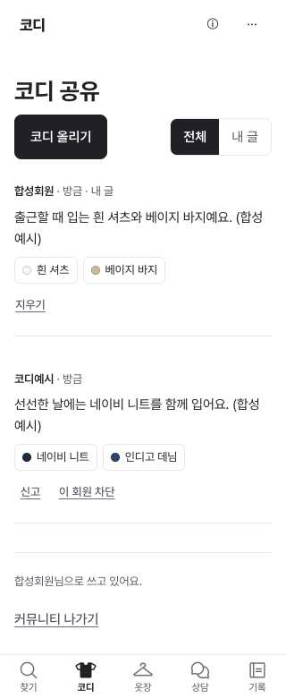
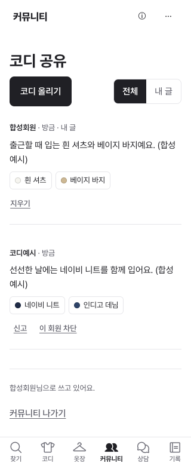

# 커뮤니티 독립 진입

2026-10-28 시작, 10-29 검증 갱신. 대표의 검토 채팅 '어울 React 전환 상태 확인'에서 직접 사용자 turn 두 건("독립으로 빼는게 맞지않아요?", 제안 뒤 "개선해줘요")을 읽고 대조했다. 전달만 받은 것을 구현 완료로 쓰지 않는다. 구현 담당은 Codex 어울 개발 한 곳이며 기반 masterfecbb60다. 시작 당시 사진1회는 별도 승인 대기로 두고 이 독립 UI 작업을 진행했으며, 이후 10-29 명시적 승인 뒤 그1회도 실행해 실제 AI3회를 마쳤다.

## 바꾸는 이유와 유지하는 것

커뮤니티는 기존 코디 탭의 작은 버튼으로 들어가야 했고, 들어간 후에도 현재 탭이 코디로 표시됐다. 옷장 등록과 무관하게 피드/내 글/코디 올리기로 바로 들어가야 한다는 대표 결정에 따라 하단 독립 커뮤니티를 만든다.

- 하단은 찾기·코디·옷장·커뮤니티·상담·기록의6개다. 기존 기능을 메뉴 밖으로 옮기거나 제거하지 않는다. 기존48px 높이와 글자 크기는 유지하고6개 열을 균등 배치한다.
- React `AppChrome`와 정적/로딩 실패 fallback 모두 같은 커뮤니티 버튼이다. `tabFor`의 community→looks 별칭만 없애 현재 탭 표시를 맞춘다. 기존 `#/community`, 직접 진입·새로고침과 K.go/K.tab/Back 계약을 재사용한다.
- 첫 게시판/현재 제목은 코디 공유다. 기존 전체/내 글·코디 올리기·신고·차단·삭제·운영자·동의/사진 제한을 그대로 쓴다. 코디의 '이 코디 공유'는 선택한 조각을 채워 주는 단축 진입으로 유지한다. 세일/자유게시판은 후속 미구현이며 빈 탭을 만들지 않는다.
- community private/초대 회원/public 준비 조건·API·모델/한도·저장 키/스키마·백업·계정 분리를 바꾸지 않는다. 실제 글/회원 생성·공개 전환·새 비용·개인 사진 전송은 실행하지 않는다.

## 검사·시각 증거

1. 기존 실제 Worker 처리기/메모리 SQLite fixture를 공유 모듈로 옮겼다. 기존12개 커뮤니티 행동 검사는 보존했다. 실제 사용자/DB/제공자 대신 같은 합성 환경을 사용한다.
2. 수정 전 신규8개가 두 엔진에서 모두 실패했다. 빈 옷장 독립 버튼0개(기대1), 공유 화면 현재 탭은 코디(기대커뮤니티)였다. 실패 커밋은af002fd다.
3. 수정 뒤 Node454/454·skip0, TypeScript/Vite 빌드99파일, Chromium/WebKit 관련40개 통과(1.2분). 새 브라우저는 각4개(+8), 기존 검사 삭제0·timeout/retry/skip 변경0.
4. 320px에서6개 버튼 모두44px 이상 폭/높이·화면 안 배치·가로 글자 넘침 없음을 검사했다. 빈 옷장에서도 Enter로 진입해 내 글·글쓰기 열기/취소, 직접 주소 새로고침, 상담/기록 왕복을 확인했다. 세 경우(React·ui=vanilla·Chrome 섬 로딩 실패)를 대조했다.
5. 공유 단축 진입의3조각과 community 현재 표시·브라우저 Back 후 코디 표시를 확인했다. 게시0회·옷장 원문 바이트 동일이다.
6. [캡처 명세](evidence/community-navigation/manifest.json)는 동일 합성 상태의320/390px·어두움·1440px, 옷장/피드/공유 초안 전후를 기록한다. 스크립트는 `app/lite/tools/capture-community-navigation.mjs`. 실제 개인 자료/회원 글·외부 요청은 없다. 캡처 생성/검토와 원격 CI/병합·실물 검증은 별도로 기록한다.

이 문단까지는 초기 코드/로컬 검사 당시 기록이다. 아래 최종 PR/CI/병합/활성 배포 확인으로 갱신했다. 메뉴 개선이 실제 다중 회원·소셜/메일·공개 커뮤니티 출시 완료는 아니다.

## 직접 주소 보완 — 검증 갱신 2026-10-29

10-28에 시작한 작업의 전후 캡처에서 같은 문서의 해시만 `#/community`로 바꾸면 주소만 바뀌고 화면이 그대로인 기존 K 라우터 문제가 드러났다. 루트 옷장·쌓인 상품 상세에서 각각 직접 주소→Back/Forward를 추가해 두 엔진4개 모두 실패로 재현했다. 캡처가 안 된 것을 네트워크 불안정으로 넘기지 않았다.

K.start의 선택적 externalRoute에 **community 경로만** 연결한다. 기존 입력 보호를 통과한 후 URL이 이미 만든 기록에 화면을 맞추며 새 브라우저 기록을 추가하지 않는다. popstate/hashchange의 중복 이벤트와 비동기 보호의 중복 실행을 막는다. 기존 같은 URL의 등록 단계/k 기록을 유지하고, 공유 화면에서 Back한 뒤 Forward하면 선택한 조각을 RAM에서 다시 채운다. 새로고침 영구 초안/기기 간 동기화나 다른 모든 외부 주소의 라우팅을 새로 구현했다는 뜻은 아니다.

추가 Node3개(전체457/457): 같은 주소 등록 단계 Back·입력 보호 거절·비동기 중복 이벤트. 집중 브라우저6개가 두 엔진 모두 통과(10.8초)했다. 기존 사례를 지우거나 timeout/retry/skip을 늘리지 않았다. 넓은 관련 검사와 캡처는 최종 증거 커밋에서 결과를 덧붙인다.

전후 캡처는 각 버전의 실제 진입을 쓴다. 이전은 코디 탭→코디 공유 버튼, 이후는 독립 커뮤니티 탭이며 같은 합성 피드·공유 초안을 그린다. 직접 주소 보완의 증거는 위 별도 실패/통과 검사로 남긴다.

전후 화면을 직접 검토해 앱 안의 상단 문맥이 여전히 '코디'로 남아 있던 것을 '커뮤니티'로 맞췄다. 첫 게시판 제목 '코디 공유'와 독립 `/c`의 행잇 표기는 유지한다. 320px 작성 시트는 기존 세로 스크롤을 유지하며 메뉴 글자/누르기 영역과 별개로 검토했다. 합성 글2개의 시각 순서도 고정 시각을 나눠 모든 전후 쌍에서 같도록 검증한다.

넓힌 초기94개는93통과/1실패였고, trace에서 WebKit이 이전 community CSS 경로에404를 받은 것을 확인했다. 검사 중 빌드 출력을 다시 만든 실행 간섭이었다. 빌드 출력을 고정한 뒤 해당 React 진입2개가통과(8.6초)했고 별도 실측/보유 편집/프로필보호60개도통과(1.7분)했다. 이를 제품 오류/불안정으로 무시하거나 기존 실패를 성공으로 합산하지 않는다.

## 최종 로컬 증거 — 2026-10-29

- Node457/457·실패/skip0, TypeScript/Vite 빌드99파일 성공.
- 초기 독립 진입8개/직접 주소4개 실패를 각각 재현했다. 수정 뒤 관련40개, 추가 주소/공유6개, 넓힌94개 중93통과/빌드 교체 간섭1실패, 출력을 고정한 실패 경로2개 통과, 별도 실측·프로필·편집 보호60개 통과를 분리해 기록한다. 상단 문맥까지 보완한 마지막 집중12개는 모두통과(22.4초)했다. 반복 실행을 서로 다른 검사/사람 수로 합산하지 않는다.
- 기존 검사 삭제0·timeout/retry/skip 완화0. 신규는 Node3개와 커뮤니티 행동 각6개(두 엔진+12)다. 기존 커뮤니티12개/Chrome4개와 기존 등록·보호 검사는 유지한다.
- 전후24장 총1,024,670바이트, source32004f0. 파일해시와 동일 합성 글 순서를 모두 확인했다. 320px·PC 전후와 어두운 공유/좁은 작성 시트를 직접 열어 검토했다. 실제 사용자/회원/글·외부 제공자는 이 캡처에 없다.

| 320px 이전 | 320px 이후 |
|---|---|
|  |  |

[PC 이전](evidence/community-navigation/before-desktop-feed.png) · [PC 이후](evidence/community-navigation/after-desktop-feed.png) · [어두운 공유 초안](evidence/community-navigation/after-mobile-dark-share.png) · [전체 명세](evidence/community-navigation/manifest.json)

## 최종 원격·실제 비공개 배포 — 2026-10-29

- [PR #129](https://github.com/daedaem/otjang/pull/129) 최종 head `a9d2c674695c600bda4ddf4f5267784ebab6de3b`의 전체 CI15개 성공·미해결 리뷰0·기반 masterfecbb60을 확인한 뒤 병합했다. 병합 master는 `ef4eec07f161286801950421c0d10b8530e294a6`다.
- PR CI run40720829781의 원본 로그에서 Chromium304개(8.6분)·WebKit304개(12.2분)를 대조했다. 예상 검사 수를 실제 통과 수로 대신 쓰지 않았다.
- Cloudflare 기존 Worker `f18d7d75`에서 masteref4eec0·빌드48초·100% 활성 표시를 확인했다. 이전 #128도 masterfecbb60/Workerfbe75723·빌드1분23초로 표시됐다. Secrets/DB/공개 스위치는 바꾸지 않았다.
- 배포 직전에 연 검증 탭은 구버전5탭이었다. 입력 없는 그 탭만 새로고침한 뒤 실제 앱 상단 **커뮤니티**, 게시판 **코디 공유**, 찾기·코디·옷장·커뮤니티·상담·기록의6개 메뉴, 커뮤니티 `aria-current=page`를 확인했다. 기존 사용자 앱 탭/저장소는 유지했다.
- 실제 화면은 가입 전 규칙/이름 양식까지만 읽었다. 이름 입력·약관 동의·회원/게시/삭제는 실행하지 않았다. 전체 피드/공유 행동의 전후 증거는 위 합성24장과 자동검사이며 실제 다중 사용자 성공으로 확대하지 않는다.

구현·검증·인수인계 완료로 진행 중 코드 표시를 해제한다. 다음은 실제 폰·OAuth/메일·전용 DB/운영자·공급 권리/공개 승인이다. 세일/자유게시판은 미구현 후속으로 유지한다.
