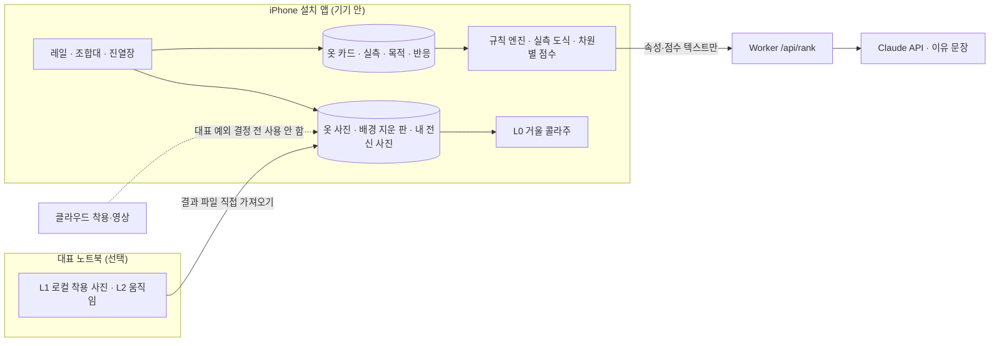

# 옷장 레일·구매 비교·가상 착용 설계 제안 (2026-10-25, Claude)

> 문서 시점: 2026-10-25. **대표 요청에 대한 Claude의 설계 제안이다.** 대표 확정, 구현, 모델 실행, 실기기 검증, 사업 효용 확인은 하지 않았다. 현재 결정과 우선순위는 [최신 문서 목차](../../README.md)를 따른다. 기술 현황은 이날 확인한 공개 자료(맨 아래 출처) 기준이며 빠르게 바뀌므로 구현 직전에 다시 확인한다.

## 0. 대표 요청 (2026-10-25, 대표 → Claude)

내 실제 옷장을 중심으로 옷을 모으고, 입고, 다음에 살 옷을 판단하는 서비스. 수집하고 컬렉션을 구경하는 즐거움도 중요하다.

1. 상의·하의·아우터가 실제 옷장 레일에 걸린 것처럼 구경하고, 꺼내서 조합한다.
2. 사려는 옷을 내 옷들과 비교해 실제로 잘 어울리는지 본다. 형태·기장·품·소재감·무늬·디테일과 전체 조합을 함께 본다.
3. 취향과 입을 상황에 맞춰 어떤 조합이 더 어울리는지와 그 이유를 이해한다.
4. 사거나 입어 보기 전에 내 얼굴·체형에 그 옷을 입힌 모습으로 분위기를 대략 본다. 내 모습과 실제 상품의 특징이 유지돼야 한다. 랄프로렌 상품 영상에서 모델이 입고 나오는 것처럼 AI로 내 모습을 보고 싶다.
5. 비슷한 옷이 있어도 디테일·소장 목적으로 살 수 있다. 활용 가치와 수집의 즐거움을 함께 본다.

요청 범위: 현재 기술로 어디까지 되는지 검토하고, 가능/검증 필요/현실적으로 어려움을 구분해 설계하고, 무엇부터 확인·제작할지 제안. **설계만** 요청했다.

## 1. 결론

설계의 축은 한 줄이다. **그림은 분위기, 숫자는 핏, 이유는 기록된 사실에서.**

사진(레일·가상 착용)은 색·무늬·분위기를 보여 주는 데 쓴다. 핏·기장·품은 실측 숫자로 판단한다. AI 설명은 옷 카드에 기록된 속성과 엔진 점수에서만 만든다. 이렇게 나누면 가상 착용이 불완전해도 구매 판단은 무너지지 않는다.

| # | 목표 | 판정 | 이유 |
|---|---|---|---|
| 1 | 레일 옷장·꺼내 조합 | **지금 가능** | 사진 기반 2.5D 화면은 일반 웹 기술로 된다. 배경 지우기는 iPhone 기본 기능이나 기존 기기 내 모델(U-2-Netp)로 사진을 밖으로 보내지 않고 할 수 있다. 다만 현재 설치 앱(lite)은 옷 사진을 저장하지 않으므로 사진 저장·보존이 새로 필요하다 |
| 2 | 구매 후보 vs 내 옷 상세 비교 | **부분 가능, 데이터가 병목** | 실측 숫자를 비교하면 기장·품 차이는 정확히 말할 수 있다. 그러나 실측·소재·디테일은 현재 연결된 공급 API 응답에 거의 없고, 판매처 상세 이미지에 들어 있는 경우가 많다. 무단 수집은 하지 않으므로 사용자 입력 보조가 필요하다. 사진만으로 소재감·디테일을 자동 판정하는 것은 정확도 미검증이며 사진 전송 원칙과도 부딪힌다 |
| 3 | 취향·상황별 조합과 이유 | **가능, 설명 품질은 검증 필요** | 확인된 후보 사실을 받아 AI가 순위·이유를 정하는 구조(R2)와 상황·날씨 코디 규칙(R6·R17)이 이미 있다. 취향 기록과 차원별 근거 필드를 더하면 된다. 이유가 실제로 납득되는지는 대표 판정으로 확인해야 한다 |
| 4 | 내 얼굴·체형 가상 착용 | **정지 사진: 검증 필요 / 영상: 현재 가장 어려움** | 얼굴·로고·무늬·단추 같은 디테일이 생성 과정에서 가장 먼저 바뀐다. 영상은 프레임마다 다시 생기므로 더 심하다. 10-16 대표의 영상 보류 결정, 개인 사진 외부 전송 금지 원칙, 대표 노트북 8GB GPU 한계가 함께 걸린다. **핏·사이즈는 원리상 보여 주지 못한다**(모델이 옷을 몸에 맞춰 그리므로 S와 XL이 비슷하게 보인다) |
| 5 | 활용 가치 + 수집 가치 | **지금 가능** | 기술보다 데이터 모델과 화면 규칙의 문제다. 소장 목적을 표시하면 중복 감점을 끄고 '다른 점'을 보여 준다 |

## 2. 지켜야 하는 기존 결정과 이번 요청이 부딪히는 곳

| 기존 결정 | 이번 요청과의 관계 | 이 설계의 처리 |
|---|---|---|
| 고정 원칙: 개인 옷장 사진은 외부로 보내지 않는다. 온라인 데모·유료 API에 사진을 보내지 않는다 | 얼굴·체형 사진은 옷 사진보다 더 민감하다. 성능이 좋은 영상·착용 서비스(Google Doppl, Veo, Kling, FASHN API 등)는 대부분 클라우드다 | 기본은 기기·개인 PC 안에서만 처리. 클라우드 사용은 **대표의 명시적 예외 결정 없이는 하지 않는다**(7절) |
| 2026-10-16 대표 결정: 착용 영상 보류. "모델 자체가 별로라 굳이 할 필요 없다" ([vton-video-local](../../../experiments/vton-video-local/README.md)) | 이번 요청이 영상을 다시 원한다 | 보류를 자동 해제하지 않는다. 기록된 재시험 조건(눈에 띄게 좋은 무료·로컬 모델, 또는 상용 모델을 공개 예제로 확인)에 맞는지부터 확인한다 |
| R20: 상품 사진·응답의 표시·저장·가공·AI 처리 범위는 공급자별로 확인 | 상품 사진을 배경 지우기·합성·가상 착용 입력으로 쓰는 것은 가공·AI 처리다 | '본인 비공개·결과 공유 금지'는 권리 확인을 대신하지 않는다(비공개 이용의 포괄 예외는 승인된 적 없음). 비공개 시험이라도 공급자별 허용 범위를 먼저 확인하고, 미확인 공급자의 상품 사진은 가공·시험 입력에서 뺀다. 원본 그대로의 원격 표시는 기존 표시 경계를 따른다 |
| R5: 수집하는 맛은 가짜 게임 요소 없이 실제 숫자로 | 목표 5와 같은 방향 | 컬렉션 칸·목표는 사용자가 정한 것만, 숫자는 실제 보유·착용·조합 수만 |
| 모르는 속성·가격은 만들지 않는다 | 비교에 필요한 속성이 비어 있는 경우가 많다 | 값마다 출처 상태(판매처 표기/직접 잼/직접 고름/AI 추정·확인 전/모름)를 둔다 |
| 개발 계획: 저장소 정리(Codex, #74) 진행 중. 새 기능 PR은 정리 종료 후 | 이번 설계를 바로 구현하면 겹친다 | 이 문서는 설계만. 구현은 진행 중 표시가 지워진 뒤 대표 승인으로 시작 |

**랄프로렌 영상 자체에 내 얼굴을 합성하는 방식은 제외한다.** 브랜드 영상의 모델 얼굴을 바꾸는 것은 모델 초상권과 영상 저작권 문제가 있다. 대신 "그 영상처럼" 고정 카메라 앞에서 서고, 걷고, 도는 연출을 **내 사진과 상품 사진에서 새로 만드는** 방향만 검토한다.

## 3. 공통 기반: '옷 한 벌 카드' 확장

목표 1·2·3·5는 같은 옷 데이터를 쓴다. 현재 엔진은 종류(slot)·색·스타일 점수·상황 위주라 형태·기장·품·소재감·무늬·디테일을 담을 칸이 없다(`app/lite/src/domain/data/slots.js`, `wardrobe.js`의 `WARDROBE_SCHEMA = 7`).

| 묶음 | 필드(제안) | 비고 |
|---|---|---|
| 형태 | 세부 종류(예: 버튼다운·레귤러·밴드 칼라), 실루엣(슬림·레귤러·와이드·오버) | 선택지 고르기 |
| 기장·품 (실측, cm) | 상의: 총장·어깨·가슴단면·소매. 하의: 총장·허리단면·허벅지단면·밑단단면·밑위. 아우터는 상의와 같음 | 비교의 핵심. 종류별 **기준 옷 1벌**만 재도 비교가 된다 |
| 소재감 | 원단(옥스퍼드·데님·코듀로이·울…), 두께(얇음·보통·두꺼움), 표면(매끈·결·기모·광택), 데님 온스 | 사진만으로 확정하지 않음 |
| 무늬 | 무지·스트라이프(간격)·체크(종류·크기)·도트·프린트 | |
| 디테일 | 자유 목록: 셀비지, 체인스티치, 사이드 심 유무, 생산국, 라벨 시대, 단추 수 등 | 수집 가치 판단에 쓰임 |
| 출처 상태 | 값마다: 판매처 표기 / 직접 잼 / 직접 고름 / AI 추정(확인 전) / 모름 | 확인 전 값은 화면과 AI 입력에 표시 |
| 목적 | 착용 / 소장 / 둘 다, 컬렉션 묶음(예: LVC 501 연식) | 목표 5 |
| 사진 | 내 사진(기기 저장), 배경 지운 판, 상품 사진(원격 링크) | 상품 사진은 기존처럼 원격 표시 |

**이전은 두 겹이다.** 도메인 `WARDROBE_SCHEMA`(7)와 설치 앱의 코어 저장 형식(`app/lite/src/core.mjs`의 `{v:1, garments, journeys, registrations, …}`)은 별개다. `readSaved()` → `buildState()`는 저장된 옷 배열을 현재 도메인 스키마의 `newWardrobeState()`에 그대로 얹으므로, 도메인 이전 함수만 추가하면 옛 옷이 이미 새 스키마인 것처럼 검증돼 새 필드가 필수일 때 기존 자료를 읽지 못할 수 있다. 그래서 다음을 함께 바꾼다.

- 코어 snapshot 버전과 이전 함수, `M.canReadSaved()`를 통한 #66 백업 사전 검증. 새 필드는 모두 선택(없음 = 모름)으로 둔다.
- 등록 초안(`input-session.js`의 `clean()`·`read()`)과 등록 영수증(`domain/lite-registration.js`의 `registrationInput()`, `core.mjs`의 `registerGarment()`)은 지금 기존 필드만 복사·비교한다. 새 속성을 등록 화면에서 받으면 초안·영수증의 호환 버전, 새 속성의 정규화와 같은 draftId 재시도의 충돌 판정, 옷·메타데이터의 원자 저장을 같은 변경에 넣는다. 옷 객체에만 새 값을 붙이면 재접속 때 값이 사라지거나 새 속성만 다른 재시도를 같은 등록으로 처리한다.
- 완료 기준: 기존 v1 자료 읽기, 미래 버전 원문 보호, 백업 복원 후 재시작, 새 속성을 포함한 초안 재개·재시도.

현재 JSON 백업(`screen.html`의 `BK`)은 localStorage 문자열만 담고 가져오기는 5MB로 제한되므로 IndexedDB 사진은 들어가지 않는다. **사진 보존은 별도 설계이며 실제 개인 사진 저장보다 먼저 만든다**(7절 위험 2, 6절 B2a).

## 4. 목표별 설계

### 4.1 목표 1 — 옷장 레일 (사진 기반 2.5D)

- **화면:** 아우터·상의·하의 레일 3단. 레일마다 가로로 넘긴다. 옷걸이에 배경 지운 옷 사진을 건다. 실측 총장이 있으면 그 비율로 높이를 맞춰 **레일에서 기장 차이가 실제로 보이게** 한다. 없으면 같은 높이로 두고 "실측 없음"을 작게 표시한다.
- **둘러보기:** 색 순·최근 넣은 옷·많이 입은 옷·브랜드·컬렉션 정렬. 넘길 때 옷이 살짝 흔들리는 정도의 움직임만 넣는다(과한 연출은 사진 수백 장에서 느려진다).
- **꺼내기·조합:** 옷을 누르면 앞으로 나오며 상세가 열린다. '조합대에 올리기'로 아래 조합대(상의·하의·아우터 칸)에 겹쳐 놓는다. 아우터는 상의 위에 그린다. 실측이 있으면 상의 총장과 하의 밑위로 "상의가 엉덩이를 얼마나 덮는지"를 단순 도식으로 보여 준다.
- **사진을 쓰는 이유:** 실제 상품의 색·무늬·디테일을 그대로 유지하는 것은 사진이다. 예전 종류별 3D 옷장(PR #6·#7)은 "종류로 그린 모습, 상품 재현 아님"이 한계였고 대표가 3D 품질 개선을 미뤘다. 3D는 이번 설계에서 제외하고 나중 선택지로 남긴다.
- **배경 지우기:** 1순위 iPhone 사진 앱의 '피사체 들어올리기'로 PNG를 만들어 등록(기기 안 처리, 앱 코드 필요 없음). 2순위 기존에 시험한 브라우저 모델 U-2-Netp(약 7MB, 1장 약 2초, [시험 기록](background-removal-20261015.md)). 둘 다 사진이 기기 밖으로 나가지 않는다. 대상은 **내가 찍은 내 옷 사진**이다. 구매 후보의 상품 사진은 원본 그대로 걸고, 배경 지우기 같은 가공은 그 공급자의 허용이 확인된 뒤에만 한다(R20).
- **옷장 0벌:** 빈 레일과 '체험용 옷'(가진 옷 아님 표시)으로 시작한다. 옷장 없이 추천을 시작하는 기존 계약(R3)은 그대로다.
- **성능:** 썸네일(긴 변 512px 정도)만 레일에 올리고 화면 밖 옷은 그리지 않는다. 몇 벌부터 느려지는지는 실기기에서 잰다.

### 4.2 목표 2 — 구매 후보를 내 옷과 비교

세 겹으로 나눈다. 위에서부터 신뢰도가 높다.

**(가) 실측 비교 — 가장 정확**
- 후보 상품의 실측과 내 **기준 옷**(같은 종류 중 "가장 잘 맞는다"고 표시한 옷)을 비교한다.
- 결과 예: "총장 +3cm · 가슴단면 +2cm · 어깨 같음 → 내 기준 옥스퍼드보다 조금 길고 여유 있어요."
- 두 옷의 윤곽을 같은 축척으로 겹친 **실측 도식**을 그린다. 종류별 기본 윤곽을 숫자로 늘리고 줄이는 방식이라 AI가 필요 없고 결과가 늘 같다.
- 사이즈 옵션(S·M·L)마다 비교해 기준 옷에 가장 가까운 사이즈를 보여 준다. 이것은 "내 기준 옷과 숫자가 가깝다"는 뜻이지 착용감 보장이 아니다.
- **데이터 확보:** 판매처 사이즈표를 보고 숫자를 넣는 칸, 사이즈표 글자를 붙여 넣으면 기기 안에서 숫자만 읽는 규칙 파서, 사이즈표가 이미지이면 iPhone 라이브 텍스트로 글자를 복사해 붙여 넣기. 자동 수집(크롤링)은 하지 않는다.

**(나) 속성 비교 — 형태·소재감·무늬·디테일**
- 내 옷 중 비슷한 옷(같은 종류 + 가까운 색 + 같은 실루엣)을 찾아 "같음 / 다름 / 모름" 표로 보여 준다.
- 상품명·설명 글에서 속성 후보를 뽑는 데 AI를 쓸 수 있지만, 애드픽·Rakuten 응답의 외부 AI 처리는 권리 미확인(R20)이다. 1단계는 앱 카탈로그·OPF·사용자가 직접 넣은 값만 쓴다.

**(다) 조합 비교 — 전체 그림**
- 후보가 들어오면 새로 생기는 조합 수와 대표 조합 3개를 조합대에 미리 놓아 보여 준다(기존 코디 엔진 확장).
- 이미 비슷한 옷이 있으면 겹침을 알리되, 목적이 '소장'이면 감점하지 않는다(4.5).

### 4.3 목표 3 — 취향·상황에 맞는 조합과 이유

- **취향 기록:**
  1. 선언: 스타일(기존 아메리칸 클래식·아메카지 등), 좋아하는 브랜드, 좋아하는 코디 사진(기기 안에만).
  2. 반응: 조합마다 '좋아요/별로' + 이유 칩(색이 답답해요, 너무 격식 있어요, 기장이 안 맞아요 등).
  3. 착용: 실제로 입은 조합(기존 착용 기록).
- **상황:** 기존 상황 5개(데일리·출근·데이트·주말·격식) + 오늘 날씨(R17) + 활동(많이 걷기 등).
- **엔진과 AI의 역할 (R2 유지):** 엔진은 사실·실측 계산, 조건 위반 거르기, 차원별 점수를 만든다. 차원은 색 조화, 격식 일치, 실루엣 균형(예: 오버 상의 + 와이드 하의는 부피 과다 경고), 소재·계절, 스타일 문법(예: 아메리칸 클래식 = 옥스퍼드 셔츠 + 치노 + 로퍼), 취향 반응이다. 실루엣·스타일 규칙은 **편집자 판단**이므로 그렇게 표시하고 대표 반응으로 고친다. **최종 순위와 이유는 R2대로 AI가 정한다.** AI는 엔진이 거른 후보와 차원별 점수·근거 필드를 입력으로 받는다. 엔진만으로 순위를 정하는 안은 R2를 바꾸는 일이라 이 설계에 넣지 않았고, 원하면 대표 결정이 필요하다(8절).
- **이유:** 두 조합을 비교할 때는 "A가 B보다 나은 이유: 격식이 출근에 더 맞고, 색 대비가 덜 강해요"처럼 차원 차이를 말하게 한다. 카드에 없는 속성(예: 기록되지 않은 소재)을 말하면 기존 가격 대조(`price_check`)처럼 사실 줄로 바로잡는 대조를 넓힌다.
- **검증:** 대표가 20개 상황에서 두 조합 중 하나를 미리 이유를 보지 않고 고른다. 최종(AI) 1위와의 일치 여부와 이유 납득도(1~5)를 기록하고, 엔진 점수 1위도 함께 적어 둘이 갈리는 사례를 본다. 합격 수치는 대표가 정한다. 관찰하지 않은 정확도 수치를 만들지 않는다.

### 4.4 목표 4 — 내 모습 가상 착용 (사진 → 영상)

**보여 줄 수 있는 것과 없는 것**
- 보여 줄 수 있음: 내 사진 속 사람이 그 옷을 입은 **분위기**(색 조합, 대략의 형태, 전체 인상).
- 원리상 못 보여 줌: 실제 사이즈·핏, 원단이 실제로 떨어지는 모양, 상품 사진에 없는 면(뒷면 등은 모델이 지어낸다).
- 그래서 결과에는 늘 "분위기 미리보기 · 핏 근거 아님"을 붙이고 원본 상품 사진과 나란히 둔다. 핏은 4.2의 실측 비교로 본다.

**2026-10-25 기준 기술 현황 (공개 자료 확인, 직접 실행 안 함)**

| 구분 | 현황 | 이 서비스에 대한 의미 |
|---|---|---|
| 정지 사진, 상의 한 벌 | 오픈·상용 모두 꽤 좋다. 다만 FASHN VTON v1.5 공식 설명도 긴 옷 → 짧은 옷, 부피 큰 옷 → 슬림한 옷에서 원래 옷 흔적이 남는다고 밝힌다 | 대표가 10-16에 실제 사진으로 본 v1.5는 품질 미달이었다 |
| 정지 사진, 여러 벌 겹쳐 입기 | 여러 이미지를 받는 편집 모델이 나왔다. Qwen-Image-Edit-2511(8GB용 커뮤니티 워크플로가 있으나 실측값 미확인), FLUX.2 [klein] 4B(Apache-2.0, 참조 이미지 최대 4장, 공식 VRAM 약 13GB, 8GB 주장과 충돌) | 재시험 후보. 셔츠 위 재킷 열어 입기 같은 겹침과 디테일 유지가 관건 |
| 상용 소비자 경험 | Google Labs Doppl: 전신 사진 + 옷 이미지 → 착용 사진 → 짧은 움직임 영상. 미국 중심, 바지가 약하고 옷이 어긋난다는 사용 후기가 있다 | 대표가 원하는 경험에 가장 가까운 공개 사례. 외부 전송이라 원칙상 개인 사진으로 쓰지 않는다 |
| 상용 API | FASHN Try-On Max(약 50초, 2026-01부터 API 제공). 영상 전용 착용 API는 확인하지 못했다 | 공개 예제로 품질만 비교할 수 있다 |
| 영상 생성 | Veo 3.1 Ingredients to Video는 인물 일관성 향상을 공식 발표했지만 옷 디테일 고정은 공식 확인하지 못했다. 오픈 Wan2.2 Animate-14B는 공식 80GB급, TI2V-5B는 24GB 기준이다 | 대표 노트북(RTX 3070 Laptop 8GB)으로는 어렵다. 양자화·오프로딩으로 될 수 있으나 시간과 품질 미확인 |
| 영상 착용 연구 | MagicTryOn(Wan2.1 기반), TryOnCrafter(4D 프록시, 카메라 이동) 등 논문이 나오고 있다 | 공개 가중치·소비자 GPU 실행은 확인 필요 |
| 10-16 클라우드 CPU 시험 | 착용 사진 → 영상 직접 생성: 로고 뭉개짐·얼굴 바뀜으로 불합격. 움직임 재사용(광학 흐름으로 착용 사진 픽셀 이동): 얼굴·로고 유지, 움직임이 아주 작음 | 디테일 유지와 움직임 크기가 서로 맞바뀐다 |

**설계: 4단 사다리** (아래 단을 통과해야 다음 단으로 간다)

| 단계 | 내용 | 내 모습 유지 | 상품 특징 유지 | 사실감 | 상태 |
|---|---|---|---|---|---|
| L0 거울 콜라주 | 기기에 저장한 내 전신 사진 위에 배경 지운 **내 옷 사진**을 손으로 맞춰 놓는다. 키와 사진 속 머리·발 위치를 찍어 주면 실측 비율로 크기를 맞춘다. 구매 후보는 원본 상품 사진을 옆에 둔다(가공은 공급자 허용 확인 후). AI 생성 없음 | 완전 | 완전 | 낮음 | **지금 가능** |
| L1 로컬 착용 사진 | 대표 노트북에서 Qwen-Image-Edit-2511·FLUX.2 klein 4B 등을 재사용 조건이 확인된 공개 예제나 직접 찍은 옷 사진으로 먼저, 통과하면 대표 사진으로. 구매 후보 상품 사진은 그 공급자의 가공·AI 처리 허용이 확인된 뒤에만 입력한다. 결과 파일을 앱에 직접 가져온다(서버 경유 없음) | 검증 필요 | 검증 필요 | 높음 | **검증 필요** |
| L2 살아 있는 사진·작은 움직임 | L1 결과에 깊이 기반 시차, 또는 움직임 재사용(이미 시험한 방식) | L1과 같음 | L1과 같음 | 중간 | L1 통과 뒤 |
| L3 짧은 착용 영상 | 걷기·돌기 3~5초. 로컬 영상 모델 또는 클라우드 | 현재 가장 어려움 | 현재 가장 어려움 | 높음 | **현실적으로 어려움**(장비 또는 원칙 예외 필요) |

- 판정표는 기존 [FASHN 시험 판정](../../../experiments/vton-fashn-1.5/README.md)의 항목(얼굴·체형·색·무늬·로고·구조·경계·배경)을 그대로 쓰고, 영상은 프레임마다 같은 항목을 본다.
- **추천 순위:** ① L0을 앱에 만들고 L1을 공개 예제로 재시험 → ② 상용 모델은 공개 예제 결과만 관찰해 로컬과 비교 → ③ 그래도 로컬이 크게 못 미치고 대표가 영상을 강하게 원할 때만 7절의 클라우드 예외를 검토. 이유: L0은 원칙과 충돌 없이 "내 모습과 실제 상품 특징 유지"를 확실히 지키고, L1 결과가 나와야 L2·L3에 비용과 원칙 예외를 쓸 가치가 있는지 판단할 수 있다.

### 4.5 목표 5 — 활용 가치와 수집 가치

- **두 축을 따로 보여 주고 한 점수로 섞지 않는다.** 섞으면 "왜 이 점수인지"가 사라진다.
  - 활용: 새로 생기는 조합 수, 기존 옷과 겹침, 계절·상황 범위, 구매 뒤 착용 횟수·한 번 입을 때 비용.
  - 수집: 목적(착용/소장/둘 다), 컬렉션 묶음 안의 위치, 비슷한 보유 옷과의 디테일 차이, 희소성(단종·한정은 판매처·브랜드 표기가 있을 때만, 없으면 모름).
- **중복 문구를 바꾼다.** "비슷한 옷 2벌 있어요 → 사지 마세요"가 아니라 "비슷한 옷 2벌: 다른 점은 셀비지·원단 두께. 착용용이면 새 조합 +1, 소장용이면 컬렉션 3번째."
- **진열장:** 레일과 별도로 컬렉션 묶음별 칸을 둔다. 빈칸은 사용자가 정한 목표만 만들고, 앱이 수집 목표를 지어내지 않는다(R5). 숫자는 실제 보유 수·착용 횟수·함께 입은 조합 수만.
- **구매 뒤 기록과 연결:** 소장 목적으로 산 옷은 '안 입음'을 실패로 세지 않는다(기존 #66 구매 기록 흐름 확장).

## 5. 시스템 구조 (제안)

- 사진은 기기와 대표 노트북 안에만 있다. Worker에는 속성·점수 텍스트만 간다. "사진을 보내지 않는다"와 "텍스트도 안 보낸다"는 다르다는 기존 구분을 유지한다.
- 새 유료 서비스는 없다. 가상 착용 L1·L2는 무료 모델이지만 노트북 시간과 전기를 쓴다.

## 6. 무엇부터 확인하고 만들까

**확인 먼저 (구현 전, 새 비용 0)**

| 순서 | 확인할 것 | 방법 | 통과 기준(제안, 대표 확정 필요) |
|---|---|---|---|
| C1 | 등록 부담 | 대표 옷 10벌을 iPhone 피사체 들어올리기 + 실측 입력으로 등록해 한 벌당 시간을 잰다 | 대표가 "계속할 만하다"고 판단. 이 결과에 레일·비교 전체가 달려 있다 |
| C2 | 비교 데이터의 위치 | 실제로 고민 중인 후보 10개에서 실측·소재·디테일이 글/이미지/없음 중 어디에 있는지 표로 적는다 | 입력 보조 방식(붙여넣기 파서 / 라이브 텍스트 / 직접 입력) 결정 |
| C3 | iPhone 사진 보존 | 합성·시험 사진 50~100장을 설치 앱에 넣고 재실행, 며칠 뒤 유지·용량을 실기기에서 본다 | 관찰 결과를 기록한다. 결과와 관계없이 사진 백업·복원(B2a)은 실제 개인 사진 저장보다 먼저 만든다 |
| C4 | 가상 착용 재시험 자격 | Qwen-Image-Edit-2511·FLUX.2 klein 4B를 대표 노트북에서 실행, 기존 판정표로 기록. 입력은 재사용 조건이 확인된 공개 예제나 직접 찍은 옷 사진만. 상용은 공개 예제 결과만 관찰 | 대표가 10-16 결과보다 "눈에 띄게 좋다"고 판단할 때만 L1 진행 |
| C5 | 원칙 예외 여부 | 대표 결정 | 기본 추천: 예외 없이 유지 |

**만들기 (정리 종료 후, 대표 승인 뒤)**

| 순서 | 작업 | 이 순서인 이유 |
|---|---|---|
| B1 | 옷 카드 확장(속성·출처 상태·목적). 도메인 스키마와 코어 snapshot 이전, `canReadSaved()` 백업 사전 검증, 초안·영수증 호환 버전과 새 속성 충돌 판정, 옷·메타데이터 원자 저장(3절) | 1·2·3·5가 모두 이 데이터를 쓴다 |
| B2a | 기기 사진 저장과 사진 포함 백업·복원 기반: 묶음 형식, 옷↔사진 참조 무결성, 중간 실패·재시작 복구, 사진 없는 이전 JSON 처리 | 사진 보존 계약이 먼저다. 이것 없이 개인 사진을 넣으면 복원·되돌리기로 사진을 되찾을 수 없다 |
| B2b | 레일 3단 + 조합대 | 목표 1. C1·B2a가 전제 |
| B3 | 실측 비교 + 실측 도식 + 사이즈 옵션 비교 | 목표 2의 가장 정확한 부분 |
| B4 | 수집 축(목적·컬렉션·다른 점·진열장) | 목표 5. B1 위에서 작게 끝난다 |
| B5 | 취향 반응 기록 + 차원별 이유 + 블라인드 검증 | 목표 3. 반응이 쌓여야 의미가 있어 B2 뒤 |
| B6 | L0 거울 콜라주 | 목표 4의 원칙 안 최저선 |
| B7 | L1 → L2 → L3 | C4 통과와 대표 결정이 있을 때만 |

대표의 협업 선호(시스템 설계는 Claude 검토, 기능 구현·검증은 Codex)에 맞춰 B1부터 작은 PR로 나눌 수 있다. 한 영역은 한 번에 한 에이전트만 변경한다.

## 7. 위험과 대안

| 위험 | 영향 | 대안 |
|---|---|---|
| 1. 실측 입력이 귀찮다 (가장 큰 위험) | 목표 2·레일 기장 표현이 비어 버린다 | 종류별 기준 옷 1벌만 필수, 나머지는 선택. 붙여넣기 파서. 실측 없이도 속성·조합 비교는 동작 |
| 2. iPhone 기기 저장 유실 | 사진·옷장 손실. WebKit 문서는 홈 화면 앱이 7일 삭제 정책에서 빠진다고 하지만 반대 버그 보고도 남아 있다. 현재 백업은 사진을 담지 못한다 | `navigator.storage.persist()` 요청, 실제 개인 사진 저장 전에 사진 포함 백업·복원(B2a) 완성, C3 실기기 관찰 |
| 3. 가상 착용의 그럴듯한 거짓 | 실제와 다른 옷을 보고 산다 | "분위기 미리보기 · 핏 근거 아님" 고정 표시, 원본 사진 나란히, 핏은 실측으로만 |
| 4. 상품 사진 권리 | 표시·저장·가공·AI 처리 권한이 공급자마다 다르고, 비공개 이용의 포괄 예외는 승인된 적 없다 | 원본 그대로의 원격 표시는 기존 경계를 따른다. 배경 지우기·합성·가상 착용 입력은 허용이 확인된 공급자의 사진, 재사용 조건이 확인된 공개 예제, 직접 찍은 옷 사진만 쓴다 |
| 5. 실루엣·스타일 규칙이 편집자 판단 | 이유가 대표 취향과 어긋날 수 있다 | 규칙임을 표시, 반응 기록으로 조정, 블라인드 검증 |
| 6. 레일 성능 | 사진 수백 장에서 느려짐 | 썸네일·화면 밖 생략, 실기기 측정 |

**클라우드 예외를 검토한다면(대표 결정 필요)**: 본인 사진만, 한 공급자, 학습 미사용·보존 기간 약관 확인, 결과 비공개, 삭제 절차 확인, 비용 상한을 대표가 직접 정한다. 이 문서는 예외를 추천하거나 승인하지 않는다.

## 8. 대표가 정할 것

1. 이 방향(사진 기반 2.5D 레일, 실측 비교 중심, 가상 착용은 확인 후 단계적)을 채택할지.
2. 실측 입력을 어디까지 할지(종류별 기준 옷 1벌 추천).
3. 옷·전신 사진을 기기에 저장하고 사진 포함 백업을 만들지.
4. 가상 착용 범위: 로컬 재시험만 / 공개 예제로 상용 비교까지 / 개인 사진 클라우드 예외 검토.
5. 영상(L3)을 정지 사진(L1) 검증 뒤로 둘지(추천: 뒤로).
6. 조합 추천의 최종 순위를 누가 정할지: R2대로 AI(추천) / 엔진 점수만(R2 예외 결정 필요).

## 9. 이번에 한 것과 하지 않은 것

- 한 것: 저장소 현행 문서·도메인 코드·기존 실험(`experiments/`)·배경 지우기 기록 검토, 2026-10-25 공개 자료 검색.
- Codex 검토(PR #75, 커밋 `c989202` 대상) 5건을 코드에서 확인한 뒤 반영했다: 상품 사진 가공의 R20 경계(P1), 코어 snapshot과 도메인 스키마의 이전 분리, 초안·영수증 계약, R2와의 역할 관계, 사진 백업 선행(각 P2). Codex는 기존 등록·초안·백업 검사 25개가 통과했다고 밝혔고, 새 필드는 아직 검증 대상이 아니다.
- 하지 않은 것: 코드 변경, 모델 실행, 실기기 검증, 실제 AI 호출, 비용 발생, 개인 사진 사용. 아래 출처의 수치(VRAM 등)는 공급자·커뮤니티 발표이며 직접 측정하지 않았다.

## 출처 (2026-10-25 확인)

- FASHN VTON v1.5 연구 소개: https://fashn.ai/research/vton-1-5
- FASHN 변경 기록(Try-On Max API): https://fashn.ai/pt/changelog
- Qwen-Image-Edit-2511 8GB 다중 이미지 워크플로(커뮤니티): https://civitai.com/models/1998998
- FLUX.2 [klein] 공식 소개: https://bfl.ai/blog/flux2-klein-towards-interactive-visual-intelligence
- FLUX.2 [klein] 도움말: https://help.bfl.ai/articles/8642316687-flux-2-klein-fast-generation-guide
- Veo 3.1 Ingredients to Video 공식 발표: https://blog.google/innovation-and-ai/technology/ai/veo-3-1-ingredients-to-video/
- Google Doppl 소개 기사: https://getcoai.com/news/googles-doppl-app-creates-virtual-try-on-videos-from-any-outfit
- Wan2.2 로컬 실행 정리(2차 자료): https://computingforgeeks.com/run-wan-video-generation-locally/
- MagicTryOn: https://arxiv.org/pdf/2505.21325
- TryOnCrafter: https://arxiv.org/html/2606.26092v2
- WebKit 저장 정책: https://webkit.org/?p=14403
- WebKit 홈 화면 앱 7일 삭제 버그 보고: https://bugs.webkit.org/show_bug.cgi?id=237350
