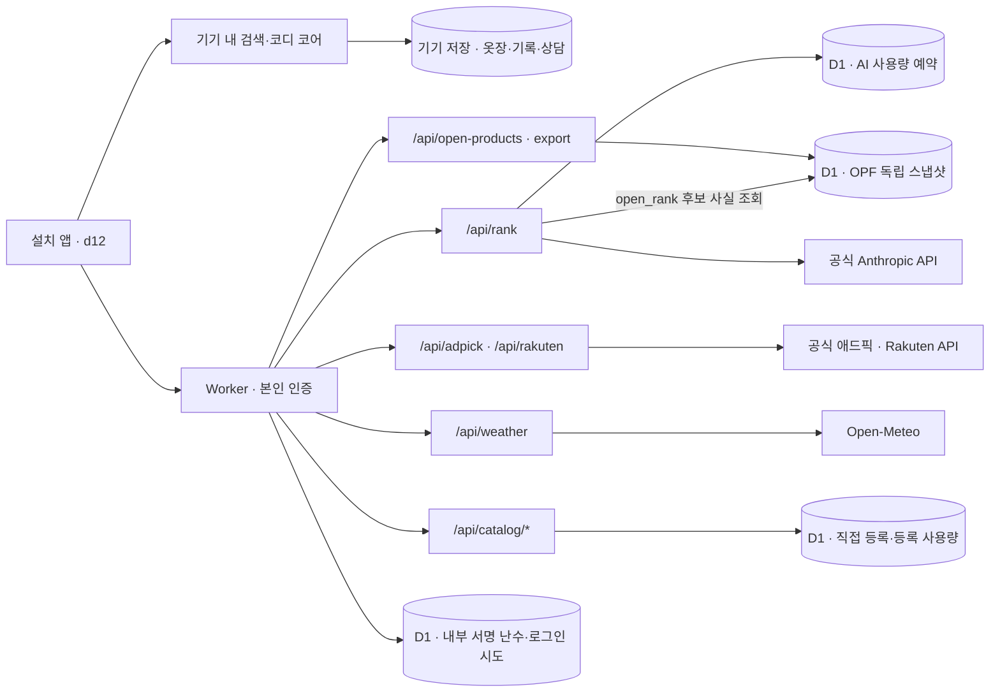

# 시스템·운영 인수인계

갱신: 2026-10-27. 현재 확인한 원격 master는 `bc921ef`로 #74→#75→B1~B6b #76~#86·직접 진입 #87·상품 검색 등록 본문 #88을 순차 병합했다. 아래의 후보/미병합 표기는 당시 이력이고 최신 저장·사진·React 상태는13~26장과 개발 계획을 따른다. 실제 병합·활성 배포·실물 검증은 구분한다. 아래 운영 호출 증거는 **2026-10-22 검증**, MIME 등 후속 구현은10-23 기록이다. 오늘 운영 버전·잔액을 새로 조회하거나 실제 AI를 호출하지 않았다.

작업 시작점은 [문서 안내](README.md), 제품 결정은 [대표 요구사항](owner-requirements.md), 다음 구현 순서는 [개발 계획](development-plan.md)이다. 날짜가 붙은 문서는 당시 판단·실행 증거로 보존한다. 이후 결정과 충돌하면 최신 요구사항과 이 인수인계를 먼저 보고, 과거 기록을 삭제해 이력을 맞추지 않는다.

## 1. 현재 운영 앱과 다른 코드의 경계

| 코드 | 역할 | 현재 확인 상태 |
|---|---|---|
| `app/lite` | 본인 전용 설치형 PWA, Cloudflare Worker API·D1 연결 | master 개발 코드와 기존 비공개 운영은 별개. 10-22 Chrome 로그인/AI/일부 검색 확인, 현재 master의 활성 배포는 미확인 |
| `app/lite/src/screen.html` | d12 화면 원본 | #70으로 master에 반영한 새 위치. `build.mjs`는 시안 폴더를 읽지 않음 |
| `app/lite/src/core.mjs`·`src/domain` | 기기 내 검색·코디·저장, 공유 도메인 원본 | #66 정본을 이동하고 R22 읽기/저장 경계를 추가. 빌드·pretest가 `.generated/core-bundle.js` 생성, 생성물은 Git 제외 |
| `app/lite/src/browser`·`public/icons` | 브라우저 보조와 아이콘 | 기존 원본 이동. 저장 키·API 경로·Worker 빌드 루트는 유지 |
| `legacy/app` | 기존 독립 웹 앱, 전체 백업·복원 등 기존 기능 | lite와 모든 기능·자료가 자동 연결된 것은 아님 |
| `legacy/server`·`legacy/deploy` | Node 자체 서버, 계정·동기화·커뮤니티·Docker 도구 | 공유 도메인은 lite의 같은 원본을 읽음. Worker의 가입·자동 동기화·커뮤니티 완성을 뜻하지 않음 |
| 시안·실험 브랜치 | 디자인 대안·VTON 등 | master 병합·설치 앱 채택·배포·실물 검증과 구분 |

d16 시안은 PR #48이 닫히며 채택되지 않았다. 현재 화면을 d16으로 인계하지 않는다.

위 이동 경로는 #70 이후 master의 경로다. 옛 커밋에서 실행할 때는 해당 커밋의 경로와 대조한다. 과거 시안은 `docs/design/mockups`이며 운영 원본이 아니다. 전후 판단은 [정리 전 인수인계](log/2026-10/system-handover-before-cleanup-20261025.md)에 보존했다.

## 2. 요청과 저장 흐름

`RANK_DB`·`CROWD_DB`는 **같은 D1의 두 바인딩 이름**이다. 그림은 논리 영역을 나눈 것이며 DB 여러 개를 새로 만든 구성이 아니다.

| 영역 | 저장·전송하는 것 | 하지 않는 것 |
|---|---|---|
| 브라우저 | 옷장·저장/구매 관련 기록·직접 등록·상담 이력·날씨 지역 | 기기 간 자동 동기화 보장 없음. 로그인 성공만으로 개인 자료가 D1에 백업되지 않음. 10-23 PR #66(master `9826dac`)부터 메뉴 '백업 · 복원'으로 `eoul-` 키 원문을 JSON 한 파일로 내보내고 되돌릴 수 있다(사용자가 직접 보관, 서버 저장 없음) |
| 인증 D1 | 서버가 만든 내부 서명 난수, 분 단위 로그인 시도 HMAC 태그 | API 키·앱 비밀번호·원본 IP 저장 안 함 |
| AI 사용량 D1 | `rank_budget_usage`에 공유 일/월/분 사용 예약 | 질문·상담 원문을 사용량 원장에 저장하지 않음 |
| 사용자 등록 D1 | `crowd_items`, `crowd_submission_usage` | 개인 옷장 전체 동기화 DB가 아님. 사진을 받지 않음 |
| OPF D1 | `open_product_snapshots`, `open_product_facts`에 별도 ODbL 스냅샷 194건 | 애드픽·Rakuten·개인 행과 섞지 않음. 가격·재고·사진·구매 링크를 채워 만들지 않음 |
| 외부 검색 D1 | `external_source_usage`의 단기 호출 카운터 | 애드픽·Rakuten 상품 목록·검색어의 장기 복제 없음 |
| 코디 공유 D1 (10-28, **기본 꺼짐**) | `community_members`(이름·규칙 동의), `community_posts`(한마디·옷 종류·색·이름), `community_photos`(글에 동의한 사진, 이 기기에서 다시 그린 JPEG를 base64로), `community_reports`·`community_blocks`·`community_post_usage`·`community_log`(처리만, 글·작성자 없음) | 스위치 `COMMUNITY_MODE`가 `private`일 때만 쓴다. 없거나 `off`면 아무것도 읽거나 쓰지 않는다. `public`은 회원 로그인(C4) 전까지 열리지 않는다. 옷장 id·메모·구매 링크·사진 위치 정보는 받지 않는다. 사진 전체 상한 `COMMUNITY_MAX_MB`(기본 300MB) |

직접 등록의 현재 기본 집계는 서로 다른 무작위 **기기 ID 3개**다. 실제 사람 3명이나 인증 계정 3개를 확인한 것이 아니며 기기 ID는 위조할 수 있다. 본인 전용 테스트의 임시 집계로 유지하고 공개 전에 계정 기반 중복·남용 방지를 설계해야 한다. [현재 구현](../app/lite/functions/api/catalog.js).

OPF는 최초 인증된 조회에서 배포 스냅샷을 멱등하게 넣고, 이후 검색·내보내기는 DB 행을 읽는다. 20행씩 묶어 D1 Free의 호출/바인딩 상한 안에 둔다. 스냅샷 교체는 유지보수 작업이며 자동 전 상품 수집이 아니다. [선택 이유·운영 내보내기 증거](log/2026-10/automatic-search-open-catalog-20261022.md).

## 3. 실제 상품 검색과 AI의 역할

- 검색·등록 화면은 검색 **제출 한 번**으로 국내 애드픽 검색을 실행한다. 자동완성 타이핑마다 외부 조회하지 않는다. 같은 검색의 진행 중 요청만 공유하고 완료 상품 응답은 장기 저장하지 않는다. 상담의 없는 브랜드 검색 버튼은 사용자가 눌렀을 때만 조회한다.
- 애드픽·Rakuten은 공식 API가 준 원문·순서·참고 가격·원래 구매 링크를 표시한다. 예산·핏·보유 옷과의 조화 적용이나 상품별 AI 재정렬을 완료한 경로가 아니다. 두 공급자의 응답/사진을 외부 AI에 넘기지 않는다.
- `/api/rank`의 `rank`·`consult`는 기존 서버 카탈로그 후보를 사용한다. 상담은 같은 상담의 최근 메시지 최대 6개와 선택된 텍스트 옷장 참고 정보를 보낼 수 있다. 상담 요청은 선택 필드 `budget {max?, min?}`(원 단위 정수 1,000~100,000,000, 화면의 엔진 검색 조건에서 읽음)을 받고, 없으면 서버가 질문 문장에서만 읽는다(`parseBudget`, #70 이후 `app/lite/src/domain/query.js`의 `priceBounds`를 그대로 사용). 서버는 후보마다 `budgetFit`을 붙여 AI에 주고, 답이 그 판정과 반대로 말한 후보가 있으면 응답 `price_check.lines`에 "가격 확인: …" 줄을 넣는다(답 문장 수정·재호출 없음). 화면은 그 줄을 답 아래 사실 줄로 보여 주고 상담 이력(`turn.check`)에 함께 저장한다. **사진을 보내지 않는다는 원칙과 텍스트까지 전송하지 않는다는 주장은 다르다.** 없는 브랜드의 일반 지식 답변은 확인된 상품 사실과 구분한다.
- `open_rank`는 질문과 최대 12개 OPF 코드만 받고 서버 DB에서 이름·브랜드·분류를 확인한 후 AI로 비교한다. 현재 화면은 후보 0~1개일 때 AI 요청을 생략한다. 서버 API 자체는 후보 1개도 허용하므로 직접 요청하면 사용 예약·실제 호출이 생길 수 있다. 가격·구매 가능성이 없는 **추가 확인용 후보 비교**다.
- `retailer_search`는 사용자 문구만 일본어 검색어로 제안한다. 상품·사진·옷장·대화 이력은 받지 않는다. 사용자가 제안어를 확인한 다음 Rakuten을 조회한다.
- 기존 937개 수집 카탈로그는 **공개 출시 권리 미확인**이다. 공식 API 연결이나 OPF 라이선스가 기존 카탈로그의 권리를 해결하지 않는다. 현재가·정품·재고·정확한 핏·동일 상품 최저가를 보장하지 않는다.

[공급처별 권리·미완료 범위](log/2026-10/automatic-search-open-catalog-20261022.md#공급원-판단)와 [Rakuten 검토](log/2026-10/legal-clothing-sources-20261021.md)를 함께 본다. API가 무료인 것과 앱의 상용 출시·상품 저장·AI 처리 허용은 별개다.

## 4. 인증·비밀값·한도

현재 모드는 `PRIVATE_AUTH_MODE=session`. Access 카드·약관 단계는 중단했으며 신규 가입·카드를 요구하지 않는다. Worker는 로그인용 경로 외 앱·정적 자산·API 모두 인증을 거친다(`assets.run_worker_first: true`). `noindex`나 주소 비공개는 인증을 대신하지 않는다.

| 런타임 Secret 이름 | 용도 |
|---|---|
| `PRIVATE_APP_ACCESS_KEY` | 공백 없는 인쇄 가능한 ASCII 8~128자 앱 비밀번호. 중간 공백·탭·제어문자도 거절 |
| `ANTHROPIC_API_KEY` | 공식 Claude API 호출 |
| `ADPICK_API_KEY` | 국내 제휴 상품 검색 |
| `RAKUTEN_APPLICATION_ID` | Rakuten 앱 식별 |
| `RAKUTEN_ACCESS_KEY` | Rakuten 검색 인증 |

값을 읽거나 Git·채팅·PR·브라우저 번들·CLI 인수에 복사하지 않는다. 선택적 `CROWD_SALT`가 설정되면 등록의 IP 해시 한도를 추가한다. 위 표는 마지막 연결 기록과 코드의 설정 이름이며 2026-10-23 대시보드를 새로 조회한 결과가 아니다.

- 서버가 만든 독립 32바이트 난수는 D1에 원자 저장한다. 비밀번호 세대별 서명으로 비밀번호 변경 시 이전 세션을 거절한다. 로그인 쿠키는 7일, `HttpOnly; Secure; SameSite=Strict`다. 인증·D1 실패를 공개 허용으로 대체하지 않는다.
- 앱 세션 종료 API는 같은 Origin의 인증된 `POST /_private/logout`이다. CLI의 `wrangler logout`은 로컬 배포 도구의 인증만 끝내며 앱 세션·서버 Secret·D1을 지우지 않는다. 앱을 로그아웃했다고 기기 옷장·상담 기록까지 삭제되는 것도 아니다.
- 로그인 시도: IP 태그별 분당 5회·전체 분당 60회. 태그는 분 단위로 바뀌고 다음 시도에서 오래된 행을 정리한다. 정확한 시각의 자동 TTL 삭제라고 설명하지 않는다.
- 실제 배포 AI 한도: **UTC 일 100·월 300·분 5회**. 모듈의 미지정 기본값과 구분한다. 공유 D1에서 원자 예약하며 실패·취소도 사용 횟수에 포함한다. 호출 횟수 제한은 통화 금액의 절대 상한이 아니다.
- 모델 `claude-haiku-5-5`, effort `low`, SDK 재시도 0회·15초. 최대 출력 2,000토큰(검색어 제안 600). 상담의 5문장은 프롬프트 지시이며 문장 수를 서버가 강제 검증하지는 않는다. 서버가 강제하는 표시 길이는 550자이고, 범위 안의 문장 끝을 우선해 자른다. 최근 메시지 6개는 전체 대화를 영구 기억한다는 뜻이 아니다.
- 외부 검색·직접 등록에는 별도 공유 호출/등록 한도가 있다. 한도 오류를 해결하려고 자동 상향·메모리 무제한 대체·API 키 변경을 하지 않는다. 계정 잔액·만료·추가 충전은 별도 관리하며 과거 특정 크레딧의 만료일을 전체 잔액에 적용하지 않는다.

## 5. 마지막 배포·실제 동작 증거

다음은 **2026-10-22에 확인한 기록**이다. 새로운 배포가 있었는지 확인하지 않고 오늘의 활성 버전이라고 단정하지 않는다.

| 항목 | 마지막 확인 |
|---|---|
| Git | [PR #47](https://github.com/daedaem/otjang/pull/47) 병합, master `90889b7e11f9d9d223cd8d468c87402b49536fb4` |
| 검사 | lite 135개·app 688개. PR 검사 7개 성공. master 앱·서버·Docker 및 Cloudflare 자동 빌드 성공 |
| 활성 배포 | `14e6fd7b-8900-49b5-8d3c-4455aec74a49` 100% |
| 대응 검증 | 수동 배포 `ee5cb989-4c32-444a-971b-8e48b4183755`와 script ETag·바인딩 이름 동일, 자산 `55e80bddc6a1` |
| 실행 배치 | `placement.region=aws:ap-northeast-2`, 서울 인근 힌트 유지 |
| 실제 AI | 공개 후보 비교·상담·이어 묻기 총 5회 연속 성공. 실제 SDK 모델·토큰·요청 ID를 Console 성공 로그와 대조 |
| 최종 후속 질문 | 셔츠에 어울리는 5만원 이하 바지 → 수집가 21,890원 상품 카드. 실제 Haiku 5.5 입력/출력 2607/1274토큰 |
| 미인증 접근 | 실제 API 401. 인증 해제 없이 확인 |

근거는 [403 기록](log/2026-10/ai-provider-403-20261022.md), [최종 완료 댓글](https://github.com/daedaem/otjang/pull/47#issuecomment-6339905634)이다. 전체 제공자 요청 ID·계정 정보·비공개 앱 주소는 이 문서에 싣지 않는다.

기본 배치의 JSON `forbidden`·HKG 응답 이후 배치만 바꿔 성공했다. 실행/연결 경로 가설을 지지하지만 제공자 내부의 IP 판정·국가 차단 규칙은 확정하지 못했다. 공식 배치 힌트를 사용했고 새 AI 중계 서버·임의 프록시·재시도는 추가하지 않았다. 중계 추가는 키 접근 주체·로그·비용·장애 지점을 늘리므로 근거 없이 채택하지 않는다. 장기 가용성과 데이터의 물리 위치를 보장하는 설정도 아니다.

## 6. 빌드·배포와 프리뷰를 구분하기

| 대상 | 루트 | 빌드 | 후속 명령 | 의미 |
|---|---|---|---|---|
| 프로덕션 master | `app/lite` | `npm run build` | `npx wrangler deploy` | 승인된 본인 전용 Worker 갱신 |
| 기능 브랜치 프리뷰 검증 | `app/lite` | `OTJANG_PRIVATE_DEPLOY=owner-approved PRIVATE_AUTH_MODE=session npm run build` | `npx wrangler deploy --dry-run` | 산출물 검사만. 별도 배포/URL 생성 아님 |

프로덕션 빌드에는 비밀값이 아닌 비공개 승인 변수와 인증 모드를 설정한다. `OTJANG_ALLOW_PUBLIC_DEPLOY`는 설정하지 않는다. `keep_vars: true`, `preview_urls: false`, D1 두 별칭, 런타임 Secret과 인증을 유지한다. 이 빌드 허용 장치는 실제 런타임 인증/Secret 검증을 대체하지 않는다.

PR #47 때 프리뷰 **기본값**을 고친 뒤에도 이미 생성된 브랜치의 **개별 설정**에는 루트 `/`가 남아 있었다. 두 곳을 각각 정정하고 같은 head의 성공 빌드를 확인했다. 이후에도 기존 브랜치 override를 직접 확인해야 하며 기본값 저장만으로 소급 반영됐다고 보고하지 않는다. [설정 정정 증거](https://github.com/daedaem/otjang/pull/47#issuecomment-6339841323).

**CI 브라우저 작업 분리(2026-10-27, Claude):** 브라우저 검사가 늘어 `Lite input Chromium and WebKit` 작업이 15분 제한에 걸려 취소되기 시작했다. #96 같은 head에서 두 작업 모두 `npm run test:e2e` 14분 만에 취소됐다. 그래서 브라우저마다 한 작업(`Lite input Chromium`, `Lite input WebKit`)으로 나눠 동시에 돌린다.
- 각 작업은 따로 테스트 서버를 띄운다. 오프라인 검사가 서버를 멈췄다 다시 켜기 때문에, 한 작업 안에서 worker를 늘리는 방법은 쓰지 않았다.
- 예전 이름 `Lite input Chromium and WebKit`은 두 작업이 모두 성공해야 성공하는 확인 작업으로 남긴다.
- 제한 시간과 검사 수는 바꾸지 않았다.
- 한 head의 체크는 PR 7 + push 7 + Workers Builds 1 = 15개다(이전 11개). 병합 조건은 그대로 '같은 head의 체크 전부 성공'이다.
- 같은 날 #100에서 Chromium 작업의 `playwright install` 단계가 세 번 연달아 10분씩 걸렸다(평소 1분, 같은 시각 WebKit은 1분). 15분 안에 검사를 마치지 못해 취소됐다. 그래서 내려받은 브라우저를 Playwright 버전(`package-lock.json`)별로 `actions/cache`(v4.2.4, SHA 고정)에 보관한다. 시스템 패키지(`--with-deps`)는 매번 설치한다. 공개 저장소의 Actions 캐시라 추가 비용은 없다.

수동 배포가 필요한 경우 검증한 master·기존 본인용 Worker만 대상으로 한다. 새 공개 미리보기·Access 해제·계정/유료 플랜 추가는 포함되지 않는다. 기존 Git 자동 빌드 지연은 이후 성공 기록과 구분하며 항상 고장 났다고 가정하지 않는다. 공식 Wrangler의 기존 승인 범위는 `account:read user:read workers_scripts:write`이며 `workers:write`는 이번에 잘못 선택했던 값이다. 새 범위 승인이나 비밀값 입력은 소유자가 수행한다. 필요한 작업과 확인을 마치면 `wrangler logout`하고 로컬 배포 인증과 앱 로그인·서버 Secret이 별개임을 기록한다. 최종 403 배포 뒤 같은 10-22 작업 대화의 후속 도구 실행에서 `Successfully logged out`을 확인했다. 이 실행은 PR 완료 댓글 이후이며 이번 문서 정리에서 CLI 상태를 다시 조회한 것은 아니다.

## 7. 장애 확인 순서와 금지할 복구

1. 먼저 [대표 요구사항](owner-requirements.md), master 커밋, 해당 배포/자산 버전을 읽는다. 같은 시점의 화면·HTTP 상태·안전한 오류 코드로 문제를 좁힌다. 키 값·쿠키·질문 원문을 진단 로그로 수집하지 않는다.
2. 인증 문제는 `/_private/status`의 미인증 상태와 정상 로그인 화면으로 구분한다. 로그인 실패를 AI 오류로, 외부 HTML 403을 앱의 JSON 403으로 단정하지 않는다.
3. 503은 인증 설정·Secret 이름·D1 바인딩/상태, 429는 로그인/앱 사용량/제공자 제한, 502는 제공자·타임아웃·출력 검증을 구분한다. 상태만 보고 키를 교체하거나 데이터를 지우지 않는다.
4. AI 403은 제한된 `status`·허용 오류 type·JSON/HTML 분류·검증한 요청 ID·3글자 지역 코드와 version/placement를 대조한다. 원문 SDK 오류·전체 헤더·IP·키는 남기지 않는다. 무제한 재시도·다른 중계로 우회하지 않는다.
5. 실제 AI 요청은 유료 사용량과 앱 예약을 소비한다. 문서·로컬 검사로 확인할 수 있는 단계에서는 호출하지 않는다. 필요한 최소 실호출은 기존 승인·크레딧·한도 안에서만 하고 모델 메타데이터와 제공자 로그를 대조한다. ‘AI’ 배지만으로 호출 성공을 판정하지 않는다.
6. 롤백은 마지막으로 확인한 **인증 보호가 있는** 버전을 사용한다. DB 초기화·원래 옷장 교체·앱/사이트 데이터 삭제를 복구 절차로 삼지 않는다. 배포 롤백이 기기 자료나 DB를 자동 복구하는 것도 아니다.

로컬 검사는 저장소 루트에서 `cd app/lite` 후 `npm ci`, `npm test`, `npm run build`로 수행한다. `node dev.mjs --fake`는 loopback의 합성 AI 화면 시험용이다. 실제 Worker의 로그인·D1·외부 상품 API까지 모두 재현하는 서버가 아니며 터널로 공개하지 않는다. `dev.mjs`의 `.mjs` MIME 매핑 누락(OPF 모듈 응답이 `application/octet-stream`으로 나가던 문제)은 PR #66(`9826dac`)으로 master에 반영돼 해결됐다. 10-23에 `node dev.mjs --fake`로 `200 text/javascript; charset=utf-8` 응답을 확인했다. 실행하지 않은 검사 수치를 최신 결과로 복사하지 않는다.

## 8. 개인정보·보존·아직 남은 일

- 개인 사진·옷장 원본·실제 주문 내역·원본 대화·생성 개인 HTML은 Git에 넣지 않는다. 개인 사진의 외부 전송은 승인되지 않았다. 상품 이미지 원격 표시와 개인 사진 전송을 구분한다.
- lite의 직접 구매 기록은 서버 카탈로그 상품에만 붙는다: 상세 '살게요'→기록 탭 '주문했어요'→'받았어요'→'계속 입을게요'(옷장에 productId 달린 옷으로 추가) 또는 '반품했어요'(사유 필수, 옷장에서 제외, 같은 상품 상세에 주의 표시). 애드픽·Rakuten·OPF 후보는 링크 이동만 되고 이 기록 흐름에 들어오지 않는다.
- 현재 lite 옷장·상담·구매 관련 기록은 기기에 남는다. 10-23 master(PR #66)의 '백업 · 복원'(d12 `BK` 블록)은 `eoul-`로 시작하는 저장 키 중 캐시(`:last`)·탐침(`:probe`)·보관본(`eoul-backup:`)을 뺀 원문을 `{app:'eoul-lite', format:1, at, data:{키:원문}}`으로 내보내고, 복원은 현재 값을 임시 칸 `eoul-backup:stash-next`에 저장·재확인한 뒤에만 키를 바꾸고, 끝까지 성공했을 때만 그것을 되돌리기 지점 `eoul-backup:stash`로 올린다(앞선 되돌리기 지점은 그전까지 건드리지 않음). 깨끗이 되돌려지면 임시 칸만 지우고, 일부만 바뀌었거나 올리기가 막히면 임시 칸이 되돌리기 지점이 된다. 새 복원을 시작할 때 앞선 임시 칸이 남아 있으면(일부만 바뀜·올리기 막힘) 복원을 시작하지 않고 먼저 '복원 전으로 되돌리기'를 하게 한다(깨끗한 복구 지점을 덮지 않기 위해). 백업에 없는 키 중 지우는 것은 `eoul-d12-hang:`(읽지 못한 원문 보관 `:unreadable:` 제외)과 날씨 지역뿐이다. 쓴 값은 다시 읽어 확인하고, 중간에 막히면 바꾼 키만 원래 값으로 되돌린다. 되돌리기까지 막히면 '일부만 바뀜'을 알리고 보관본을 남겨 나중에 '복원 전으로 되돌리기'로 복구한다. 옷장 원문은 복원 전에 엔진 불러오기와 같은 규칙(`M.canReadSaved`, `src/core.mjs`의 `readSaved`)으로 먼저 읽어 본다. 수동 파일 보관이며 자동 동기화가 아니다. 기존 앱의 전체 백업·복원 기능과 자체 서버 동기화 구현을 lite의 완성된 전체 백업/자동 동기화로 안내하지 않는다. 브라우저·홈 화면 앱·다른 기기의 저장 영역이 같다고 가정하지 않는다. **전체 백업/복원과 실물 복구 훈련은 공개 운영 전 검증 과제**다. 기존 내보내기 자료가 있으면 원본을 먼저 보존하고 앱 삭제·사이트 데이터 초기화는 피한다.
- 운영 D1 전체 덤프에는 내부 인증 난수·등록 자료가 포함될 수 있다. 라이선스가 열린 OPF 데이터만 별도 내보내며 전체 D1 덤프를 Git·공개 링크로 백업하지 않는다. 비공개 보존·권한·복구 확인은 별도 운영 절차다.
- OPF의 ‘사용한 DB 내려받기’는 공개 상품 194행의 ODbL 내보내기다. 개인 옷장·상담·구매내역 전체 백업이 아니다. D1이 있다고 개인 자료가 자동으로 보존되는 것도 아니다.
- 호출 성공은 추천 품질 완료가 아니다. 403 검증 중 50,960원을 10만원 예산 초과처럼 설명한 문장 오류가 남았고, 10-23에 서버 가격 대조(`price_check`)를 넣어 그런 문장 아래에 실제 가격·판정 줄이 붙게 했다. 대조는 후보 이름이 들어간 문장에만 작동하며, 예산 외 조건의 자유문장은 검증하지 않는다([개발 계획](development-plan.md)의 예산·자연어 조건 품질 과제).
- 실물 iPhone의 갱신·로그인 유지·원래 자료 보존·날씨·검색 흐름, 원격 DB 장애/한도 초과·등록 철회·복구 훈련은 별도 검증한다. Node/Chromium/CI 통과를 대체 증거로 쓰지 않는다.
- 공개 출시에는 기존 상품/사진 권리, 애드픽·Rakuten의 실제 매체/상품 AI 범위, Open-Meteo 상업 조건, 개인정보 처리와 운영/복구 준비가 남는다. 현재는 본인 전용 시험판이며 정식 출시 완료가 아니다.

## 관련 실행 기록

- [설치 앱 설정](log/2026-10/lite-app-setup-20261020.md)
- [자체 로그인·첫 실제 AI](log/2026-10/private-ai-connect-20261021.md)
- [국내 애드픽 연결](log/2026-10/adpick-domestic-search-20261021.md)
- [Rakuten·OPF 최초 연결](log/2026-10/legal-clothing-sources-20261021.md)
- [한 번 검색·OPF D1](log/2026-10/automatic-search-open-catalog-20261022.md)
- [403 수정과 최종 배포](log/2026-10/ai-provider-403-20261022.md)

## 9. 직접 등록·초안·React 입력

#52·#54~#56은 10-23에 master에 반영됐다. `registerGarment`는 옷·브랜드/링크·draftId 영수증을 같은 코어 snapshot 쓰기에 저장한다. 같은 ID·같은 입력은 재접속 뒤에도 같은 결과를 반환하고, 같은 ID의 다른 입력은 충돌로 거절한다. 기존 v1은 빈 영수증으로 읽고 미래 스키마·읽을 수 없는 원문은 보호한다. 과거 `:reg`와 IndexedDB를 지우거나 자동 이전하지 않는다. 여러 탭 충돌·개인 D1 동기화는 해결한 것이 아니다.

#71로 master에 반영된 `app/lite/src/input-session.js`의 host 컨트롤러가 React·vanilla의 값·단계·draftId·출처를 함께 소유한다. `eoul-d12-hang:input-draft:v1` 형식과 기존 초안을 유지하며, 손상/미래 초안은 명시적 삭제 전까지 보존한다. #61의 옛 transaction 저널은 도입하지 않는다. #66의 `stash-next`가 남은 상태에서는 초안 쓰기·삭제를 거절한다. 사진·자동 만료·서버 동기화·여러 탭 병합은 포함하지 않는다.

브랜드·상품명 80자, URL 2000자의 기존 초안 읽기 한도를 두 화면과 쓰기에도 적용한다. 검색/OPF 초기값·프로그램 입력이 한도를 넘으면 저장을 건너뛰고 안내한다. 화면의 긴 입력과 마지막 정상 저장 원문은 자동으로 자르거나 지우지 않으며, 줄여 고치면 다시 저장된다. 이미 저장된 초과 길이 초안은 원문 보호 상태를 유지한다.

vanilla도 기존 원자 `registerGarment` 명령을 쓰므로, 옷 저장 뒤 초안 삭제가 실패해 재접속·다른 입력 화면으로 재시도해도 같은 draftId가 옷을 중복 추가하지 않는다. 코어/BK/스키마를 바꾸지 않은 UI adapter 수정이다. 영수증의 브랜드·링크는 보존되며 구형 `REG.items/catalog`는 호환·목록 보조 정보다.

빌드 루트는 `app/lite`, React 산출물은 `dist/react`다. #71은 React JS/CSS를 셸 선캐시에서 제외하고 실제 입력 진입 때 요청하며 방문한 정상 JS/CSS만 런타임 캐시한다. 로그인 HTML 대체 응답은 캐시하지 않는다. `?input=vanilla`는 유지한다. 실제 iPhone/Galaxy 설치·한글 키보드·뒤로가기·재접속·초안·저장 실패·방문 뒤 오프라인 확인 전 제거하지 않는다.

## 10. 이번 정리의 검증과 재개

재개 시 `git fetch origin refs/heads/master:refs/remotes/origin/master`로 실제 원격 master 추적 ref를 갱신하고 HEAD·PR 상태를 대조한다. 이번 체크아웃의 fetch 설정은 Claude 브랜치 하나만 추적했으므로 `git fetch origin master`는 FETCH_HEAD만 갱신하고 origin/master가 예전 값으로 남을 수 있었다. 실제 병합마다 추적 ref와 GitHub mergeCommit을 다시 확인했다.

새 코드 위치 #70과 입력 #71의 로컬 Node 검사 수는 legacy683/lite191/server50(49통과·기존 실모델1skip), Chromium19/WebKit19=38개다. app에서 날씨5개를 lite로 이전했으므로 검사 삭제가 아니다. #66 정본은 `python3 tools/repository-cleanup/check-preserved.py`의 12항목으로 비교한다. 실제 사용자는 아니며 실물 휴대폰·개인 운영 API를 검증한 결과로 쓰지 않는다.

중복·교체 PR, 검사별 제외 사유와 실패/재검사 근거는 [재작업 로그](log/2026-10/repository-cleanup-rework-20261025.md)·[백업 비교표](log/2026-10/backup-tests-reconciliation-20261025.md)에 둔다. 한 영역을 다른 에이전트와 동시에 수정하지 말고 개발 계획의 진행 중 표시를 확인한다. 새 PR의 실제 병합·master 자동 배포가 뒤에 일어나면 커밋·검사·배포 증거를 따로 대조해 인수인계를 갱신한다. GitHub CI 성공을 활성 버전·실제 로그인·실제 제공자 호출의 증거로 대신하지 않는다.

## 11. 무손실 백업 후속 후보 (#74)

정리 #73 이후 master `d26a69a`에서 `fix/backup-validation-20261025`로 진행한다. 초기 ‘손상 원문 때문에 전체 내보내기 거절’ 구현은 대표의 무손실 계약으로 대체됐다. 아직 #74를 master에 병합하거나 운영에 배포하지 않았다.

- 손상 자료 부팅 경고의 ‘전체 백업 열기’로 초기화 없이 내보낼 수 있다. 백업 창만 경고 위에 열고 닫으면 경고는 그대로 남는다. 중복 창을 막고 내부로 키보드 초점을 옮긴다.
- `make`: snapshot → 순수 `classify` → format2 봉투 → UTF-8 전체 직렬화5MB 검사. 원문은 정규화하지 않는다. 정상 known 값은 활성 키에, 읽을 수 없는 값은 `원래키:unreadable:backup-v1:N`에 정확한 문자열로 보관한다. 알 수 없는 소유 키·역사 보관 suffix는 opaque로 유지한다.
- `read`: 원본 파일 UTF-8 크기/중복 멤버/봉투·소유 키·문자열·금지 원래키 검사 → format1/2 분류 → 격리 후 크기 검사. 원문 보관을 금지 키 포장 우회에 쓰지 못한다. `classify`와 미리보기는 저장소 쓰기/삭제0이다.
- `prepareRestore`: 수입 보관본과 기존 보관본의 충돌을 결정적 suffix로 해결하고 같은 출처·원문 재수입은 재사용한다. 새 격리 출처에 정상 수입 활성 값이 없으면 해당 기존 정상/손상 활성 값을 유지한다. 역사 archive만 있다고 일반 전체 복원을 자동 병합으로 바꾸지 않는다. 다른 기존 손상 값이 명시적으로 교체/제거되면 같은 거래에 먼저 원문 보관을 포함하며 미리보기에 알린다.
- 복원 후 남는 기존 archive·unknown 값을 포함한 최종 snapshot의 내보내기 크기까지 검사한다. 잘라 내서 통과시키지 않는다. 저장 접근/공간 오류·partial·NEXT 잔류를 완료로 표시하지 않는다.
- 원래 #66의 `apply` 보상·`stash`·`undo`와 NEXT→적용→STASH 순서를 유지했다. restore의 변경은 쓰기 전 순수 계획과 성공 후 메모리 보고서뿐이다. undo는 손상 원문도 복구하며 새 archive는 #66의 삭제 금지 원칙상 남을 수 있다.
- 직접 등록 건수는 REG.items와 원자 영수증 garmentId의 합집합이다. 삭제된 옷의 영수증도 기존 기록으로 세고 같은 옷은 중복하지 않는다.

새 format2는 구 #66이 쓰기 전에 거절한다. 구 #66에 archive-only format1을 적용하면 기존 활성 키가 지워지는 실제 반례 때문에 버전을 올렸다. 새 reader는 기존 format1을 수신한다. ‘완전한 양방향 format1 호환’이 아니다. 실제 #66 BK 소스와 출처/SHA를 고정 fixture로 두고 왕복·구버전 거절을 검사한다.

코드 후보 `3b4a51f`에서 로컬 lite217·Chromium21/WebKit21=42개와 독립 CI 두 실행/check11개가 통과했다. CI Node950개 중949통과·기존 실모델1skip이다. 이후 손상 부팅의 백업 진입 경로를 추가해 최종 로컬 lite217·Chromium22/WebKit22=44개·빌드를 통과했다. 최종 추가 head/CI는 PR에서 확인한다. Claude 최종 검토·병합/배포와 구분한다. 보존 대조는 `python3 tools/repository-cleanup/check-preserved.py --backup-validation`의15항목을 쓴다. 정확히 승인한 포맷/분류 기대와 fixture/카운터 확장만 허용하며 apply·보상·stash·undo·예산·반품·MIME 원문을 대조한다. 옵션 없는 도구는 확장 전 정리 전용 원문 검사다. [테스트·CI·실물 미검증](log/2026-10/backup-validation-20261025.md)을 함께 본다.

전체 React 전환은 #74 다음의 승인된 개발 방향이다. [화면별 단계·보존 계약·복귀 경로](development-plan.md#전체-react-전환-2026-10-25-확정)를 먼저 읽는다. 전환 완료나 배포 완료로 해석하지 않는다.

## 12. R22 순차 통합 인계

#74는 검토 보완 f3a17af/CI11개 성공 후 master e0afa11에 병합했다. 등록 수는 ‘등록 이력(삭제한 옷 포함)’으로 보유 수와 구분하며 실제 초안 reader와 BK의 경계 교차 검사를 추가했다. #75는 그 위에서 새 도메인7개를 통합·검증 중이다. 도메인 함수가 존재한다고 화면·저장·AI·사진 백업에 연결된 것은 아니다. [검토 수정](log/2026-10/wardrobe-rail-integration-review-20261025.md)과 [B1~B6 명세](log/2026-10/wardrobe-rail-handoff-20261025.md)를 따른다. 이전11장의 ‘#74 미병합’은 당시 상태다. 사진은 기기 내 보관이며 상품 사진 가공은 R20 확인 전 금지한다. 최종 조합 순위·이유는 R2의 AI가 결정한다.

## 13. R22 B1 저장 후보

#75 master c20e03e에서 B1을 별도 구현했다. [버전·호환·검증 근거](log/2026-10/r22-b1-storage-20261025.md)를 먼저 본다. 코어 snapshot2/등록 영수증2/입력 초안2가 기존1을 받으며 키를 바꾸지 않는다. 옛 PWA는 새 버전을 읽지 못할 수 있으므로 원문을 지우지 말고 앱 갱신 후 확인한다. BK format2와5MB 텍스트 한도·원문 보관·apply/undo는 유지한다. 사진은 아직 넣지 않는다. 로컬256개·Chromium25/WebKit25=50개·빌드 통과는 실제 기기·운영 배포의 증거가 아니다. B2a 전에는 사진 포함 백업이 없으며 개인 사진 입력은 B2b부터 연다.

## 14. B2a 사진 백업 후보 인계

B1 #76은 master469255a에 병합됐다. B2a는 그 위 별도 브랜치에서 사진 원본 바이트+MIME/IDB2 색인·사진 묶음·pending/소유 저널·Web Locks·복구 UI를 구현했다. [파일 형식·복구 순서·WebKit 원인·검사 근거](log/2026-10/r22-b2a-photo-backup-20261026.md)를 따른다. 텍스트5MB/사진 한 장8MB/묶음1GB·2000장 상한은 허용 크기이며 실제 iPhone 대용량 성능 보장이 아니다. 원본은 자동 가공·삭제하지 않는다. 기존 JSON은 사진을 삭제하지 않고 새 파일 선택은 이전 확인을 폐기한다. 사진 백업 기능은 바닐라 화면의 기능 확장이며 전체 React 전환 상태는 개발 계획의 화면 표로 추적한다.

## 15. B2b React 옷장 후보 인계

B2a #77은 master0a9b35e에 병합됐다. 그 위에서 레일/개인 사진/조합대 React 화면을 연결한다. [B2b 인계](log/2026-10/r22-b2b-closet-20261027.md)의 원문·캐시·오프라인·기존 화면 복귀·같은 자료 캡처 근거를 따른다. 저장 계약은 유지하고 코어에는 읽기 전용 레일 API만 추가한다. IDB2 meta의 썸네일은 재생성 가능한 캐시이며 사진 백업 원문을 대체하지 않는다. 기존 옷장200벌 한도도 유지한다. 실제 기기 성능/대량 사진 입력/HEIC 확인과 다음 단계 B3 이후는 남아 있다.

## 16. B3a 편집 초안·출처·저장 기반 후보

B2b #78은 최종 head969e56f의 CI11개·실제 CI90/90을 확인해 master43a14d6에 병합했다. 다음 편집 화면의 데이터 기반은 [B3a 인계](log/2026-10/r22-b3a-profile-contract-20261027.md)를 따른다. 새 키 `eoul-d12-hang:profile-drafts:v1`은 기존 등록 초안을 덮어쓰지 않는다. 숫자 원문과 확정 profile을 분리하고 출처·등록 이력·사진 참조를 보존한다. 아직 편집 UI/controller는 미연결이며 재개/정리 실패는 다음 PR에서 검사한다. [첫 화면 이후 재검토](log/2026-10/r22-first-react-reestimate-20261027.md)는 실제 시각과 잠정14개 작업 묶음이며 완료일/인일 약속이 아니다.

## 17. B3b 보유 옷 React 편집 후보

B3a #79는 동일9a7a311의 최종CI11개/94개를 확인해77bfebb에 병합했다. 준비 중 취소와 재실행 성공은 [개발 계획](development-plan.md)에서 구분한다. [B3b 인계](log/2026-10/r22-b3b-profile-editor-20261027.md)는 실제 편집·초안 큐/정리·이동 확인·공유 CSS 로더·기존 조합 미리보기 보존을 설명한다. B3a 저장 형식/코어 명령을 재사용하며 실제 원문과 등록/사진을 지우거나 다시 만들지 않는다. 실제 기기/키보드/성능과 전체 React 전환은 완료로 쓰지 않는다.

## 18. B3c 후보 실측 비교 후보

B3b #80은 동일9d5cb7c의 최종CI11개와 실제122개를 확인해7493826에 병합했다. 다음 후보 입력/표 파싱/수치/도식은 [B3c 인계](log/2026-10/r22-b3c-measure-compare-20261027.md)를 따른다. 별도 `measure-drafts:v1` 키는 실제 보유 옷/등록 초안으로 활성화하지 않고 백업의 원문/활성 유지/별도 집계에 연결한다. 기준 한 벌은 사용자가 실제 보유를 명시할 때만 원자 저장한다. NOTE와 가정을 항상 표시하며 B4 이후와 실제 기기/효용은 남아 있다.

## 19. B4 수집 축·진열장 후보

B3c #81은 head8fded37의 로컬 Node306개/150개와 최종 CI11개/실제150개 두 작업·미해결 검토0을 확인해 master1a401f1에 병합했다. [B4 인계](log/2026-10/r22-b4-collection-20261027.md)는 `eoul-d12-hang:collection:v1`의 후보 목적/시리즈·명시 목표와 대상별 충돌 보호를 설명한다. 실제 보유는 기존 profile.series만 세고, 구매 후보·체험용·목표를 보유로 바꾸지 않는다. 원문 격리·조건부 백업 집계를 연결하고 기존 BK 적용/복원/undo 및 주문/수령/반품 명령을 유지한다. 후보 속성은 목적/시리즈 외 미확인으로 두며, 새 조합 수는 실제 내 옷의 편집 규칙이지 AI 최종 순위가 아니다. B5·B6·전체 화면 전환과 실제 기기 검증은 남아 있다.

## 20. B5a 반응·텍스트 AI 기반 후보

B4 #82는 head43348b1의 최종CI11개·실제174개 두 작업/Node316개·미해결 검토0을 확인해 master615ff24에 병합했다. [B5a 인계](log/2026-10/r22-b5a-outfit-contract-20261027.md)는 `outfit-reactions:v1` 읽기/원문 보호·백업과 `/api/rank`의 `outfit_rank` 검증을 설명한다. 사진 없는 사용자 기록·출처/모름·겹치는 옷의 과거 반응 범위를 서버가 사실 줄로 만든다. 모델/인증/원자 한도/재시도0을 유지하고 AI 순서/이유는 그대로 두며 일부 속성 대조 줄을 따로 붙인다. 실제 반응 쓰기·코디 카드·AI 화면은 B5b에서 연결하므로 이 기반을 B5 전체 완료로 쓰지 않는다. 새 모델·키·유료 호출·운영 배포·실물·블라인드20은 실행하지 않았다.

## 21. B5b 코디·반응·AI 화면 후보

B5a #83은 headdb380397의 최종 CI11개·Node327개/실제174개 두 작업과 미해결 검토0을 확인해 master24ed71e에 병합했다. 취소된 첫 push 작업은 성공으로 계산하지 않았으며 동일 커밋 재실행174개를 확인했다. [B5b 인계](log/2026-10/r22-b5b-outfit-screen-20261027.md)는 반응의 대상별 CAS·RAM/Back·안정ID와 불변 AI 요청/캐시·늦은 응답 보호를 설명한다. 반응은 다음 명시 비교에 적용하고 옷/상황의 입력 변경은 결과를 무효화한다. 순서/이유·응답 정보·비교 범위·코디별 일부 속성 대조를 React에 연결하고, 기존 상황 공식·상품 빠른 걸기·바닐라 복귀를 유지한다. 날씨는 지연 열기/기존 controller 경계여서 별도 React 이전이 남는다. 기존 저장/등록/BK/사진·구매 command를 다시 만들지 않는다. 실제 제공자·활성 배포·실물·블라인드20은 미검증이다.

## 22. B6a 거울 초안·전신 사진 연결 기반 후보

B5b #84는 head59361e30의 최종 CI11개·실제220개 두 작업/Node336개·미해결 검토0을 확인해 masteraaca4e8에 병합했다. [B6a 인계](log/2026-10/r22-b6a-mirror-contract-20261027.md)는 경량 mirror:v1 코덱·미완성 키/두 점·기록 총장/offset 계산과 고정 미리보기 문구를 설명한다. 기존 IDB2의 body role을 재사용하고 body.photoId를 사진 포함 백업의 활성 연결에 더한다. 미래 원문 활성 보존·사진 missing/orphan·원본 bytes/undo를 유지하며 초안·선택 건수와 실제 옷 수를 구분한다. 사진 입력/드래그 화면·실기기·핏/가상 착용은 아직 연결/검증하지 않았다. B6b 뒤에도 기존 화면 전체 React 이전을 계속한다.

## 23. B6b 기기 내 거울 화면 후보

확인한 master는 B6a #85까지 병합한 `990cbbe`다. B6b 기기 내 거울 화면은 로컬 구현/검증 후보이며 [B6b 인계](log/2026-10/r22-b6b-mirror-screen-20261027.md)에 저장 실패·원본·배치 경계를 남긴다. 전체 React·실기기·블라인드20·공개 출시는 아직 남아 있다. 사진 선택·두 점/키·내 옷 배치와 드래그를 기존 mirror:v1에 연결하고, 원본 저장 후 연결 실패·이동 경고·사진 교체 확인·다른 창 충돌을 보호한다. 판매처 원본 사진은 옆에만 둔다. 기존 코어/BK/사진 복구/구매·등록/AI 계약은 다시 만들지 않는다.

## 24. B6b 병합과 다음 React 화면

#86 최종015219d를 CI11개·실제244개 두 실행·Node350개·미해결 검토0 확인 후 masterfb949c6에 병합했다. [최종 검사 원장](log/2026-10/evidence/b6b/final-validation.json)은 앞선 로컬242개와 마지막 부분20개/최종CI244개를 구분한다. R22 B1~B6 코드 연결과 실물/AI 품질·L1·전체 React/공개 출시는 다르다. 다음 [상품 검색 등록 기준](log/2026-10/react-add-search-baseline-20261027.md)의10개 검색 검사와 기존 등록 모드4개를 확인했다. 직접 진입의 중간 홈/예시 기록을 제거하고 Back 기본 복귀를 옷장으로 둔 후보이며, 나머지 저장/구매/사진 계약을 유지한다. 이 다음 브랜치의 CI·병합/React 본문 연결은 아직 남아 있다.

## 25. 상품 검색 등록 본문 React 후보

#87 최종42cf47e를 CI11개·Node350개·실제254개 두 실행·미해결0 확인 후 masterf0645ca에 병합했다. [새 검색 본문 인계](log/2026-10/react-add-search-screen-20261027.md)는 React query/카탈로그/공개 사실/사용자 등록과 지연 entry, 남아 있는 RetailBridge·공통 막대/색/sheet를 구분한다. 기존 Input/등록 영수증·사진·구매 명령·BK는 유지한다. 기존 두 번 저장의 실패 입력은 같은 garment ID로 남기고, 삭제/변경된 대상은 재생성/성공 처리하지 않는다.

구형 reg의 runtime은 새 순수 reader로 BK와 같은 무버전/v1·필드/링크/중복 규칙을 적용한다. 미래/손상/읽기 실패는 초기/쓰기 전 모두 차단하고 정상 추가 필드는 보존한다. 현재 원문이 달라졌으면 자동 병합/덮어쓰기하지 않고 확인을 요구한다. 현재 브랜치의 Node356개·집중 검사와 전후 캡처는 인계에 남기며 마지막 전체 CI·병합은 별도 상태다. 이 코드는 새 credential/배포/DB 이전을 요구하지 않는다.

## 26. 홈 질문/preview React 후보

#88 최종241fabe를 CI11개·Node356개·실제274개 두 실행(10.8분/10.5분)·미해결0 확인 후 masterbc921ef에 병합했다. [홈 인계](log/2026-10/react-home-screen-20261027.md)는 늦은 날씨/날짜 변경 때 질문·초점·Back 메모리 보존과 예시의 개인 최근 검색 쓰기 제거를 설명한다. 새 저장 키/스키마는 없다. WeatherBridge/WeatherSlot·지역/공유 UI는 실제 React 이전 전이므로 홈 본문만의 완료와 구분한다. 기존 core/BK/Input/사진/등록·구매·인증·비용 한도와 legacy metadata 보호는 변경하지 않는다. 실물·persistence/Files·사진/옛 형식/교차 기기 복원을 확인하기 전 fallback을 제거하지 않는다.

## 코디 공유(커뮤니티) 스위치 — 2026-10-28

대표 결정 10-28 08:08(누구나 가입·직접 찍은 사진·코디 공유 먼저)과 09:39("끝까지")로 만들었다. 설계·남은 승인은 [커뮤니티 설계](log/2026-10/community-plan-20261028.md)를 따른다.

- 코드: `app/lite/functions/api/community.js`(API), `src/domain/community.js`(글·이름 검사, 화면·서버 공용), `src/community/`(React 화면), `worker.js`(`/api/community/*`, 지금 로그인한 본인을 회원 `owner`·운영자로 넘김).
- **10-28 15:02부터 본인 전용으로 켜져 있다.** `wrangler.jsonc` vars `COMMUNITY_MODE=private`(대표 "커뮤니티는 계속 열어 줘요"). 설정 파일 값이 배포 때 대시보드 값을 덮으므로, 끄거나 public으로 바꿀 때는 이 파일을 고친다. 코드 기본값(변수 없음)은 여전히 꺼짐(`503 community_off`)이다. 운영자 이름·연락처·키는 이 파일에 넣지 않는다(`checks/community-config.check.mjs`).
- 혼자 써 보기(지금 상태): 선택으로 대시보드 변수 `COMMUNITY_OPERATOR`·`COMMUNITY_CONTACT`(규칙·신고 화면의 연락처), `COMMUNITY_REVIEW_DAYS`(기본 7), `COMMUNITY_MAX_MB`(기본 300). 새 비용·계정은 없다. 이 값을 넣으면 그때부터 동의한 사진이 기존 D1에 저장된다(사진 외부 전송 경계: 대표가 켤 때 판단).
- `public`(10-28 C4·C5): 커뮤니티 전용 D1 바인딩 `COMMUNITY_DB`(개인 앱 DB와 달라야 함), 운영자 이름 `COMMUNITY_OPERATOR`, 연락처 `COMMUNITY_CONTACT`, 회원 로그인(`MEMBER_SESSION_SECRET` 32자 이상 + 카카오 `KAKAO_REST_KEY`(선택 `KAKAO_CLIENT_SECRET`) 또는 구글 `GOOGLE_CLIENT_ID`·`GOOGLE_CLIENT_SECRET`)이 모두 있어야 열린다. 하나라도 없으면 `503 public_not_ready`와 빠진 항목(`database`·`operator`·`contact`·`login`)을 알리고, Worker도 아무것도 새로 공개하지 않는다.
- 준비가 끝난 `public`에서 로그인 없이 열리는 것은 `/c`(코디 공유만 있는 화면, `community-shell.html`), 빌드가 만든 허용 목록 `community-public.json`의 파일(코디 공유 화면 코드·CSS·아이콘), `/_member/*`(카카오·구글 로그인), `/api/community/*`(회원 세션 확인, 쓰기는 같은 출처만)뿐이다. 앱 화면·상품 자료(무신사 포함)·AI·옷장은 그대로 본인 전용이다.
- 회원 로그인(`functions/lib/member-session.js`): 이메일·프로필을 요청하지 않는다(카카오는 동의 항목 없이 회원번호, 구글은 `openid`). 회원 id는 공급자 번호를 `MEMBER_SESSION_SECRET`으로 HMAC한 값이고, 세션은 D1 `member_sessions`에 토큰 해시만 둔다(30일, `__Host-hangit-member`, HttpOnly·Secure·SameSite=Lax). 공급자 리디렉션 주소는 `<사이트>/_member/callback/kakao`, `<사이트>/_member/callback/google`.
- 공개 전에 남은 것: 공급자 앱 등록·키 입력(대표), 약관·처리방침 법률 검토, 카카오·구글 로그인 버튼 디자인 가이드 확인, 사진 R2 이전 여부(회원이 늘 때).
- 사진 저장을 R2로 옮기는 것(C3)은 R2 활성화(결제 수단 등록 가능성, 확인 필요)가 필요해 대표 승인 뒤에 한다.
- 로그: 처리기는 오류에 글·이름·사진을 남기지 않는다. `community_log`에는 글 번호·처리·사유·신고 수·시각만 있다.
- 이메일 인증 로그인(10-28 12:26): `POST /_member/email/start`(6자리 코드 메일), `POST /_member/email/verify`(세션). 설정 `EMAIL_FROM`(인증된 내 도메인 주소) + `RESEND_API_KEY` 또는 Cloudflare 바인딩 `EMAIL`(Email Sending). 이메일은 HMAC 값만, 코드는 해시만 저장(10분, 5번 틀리면 끝). 한 주소 한 시간 5통, 서버 하루 `EMAIL_DAILY_MAX`(기본 90). 이메일만 설정해도 public의 로그인 조건을 채운다.
- `MEMBER_SESSION_SECRET`은 바꾸지 않는다(회원 id가 이 값에서 나온다). public 자동 숨김은 가입 3일 지난 회원의 신고만 센다(`COMMUNITY_REPORTER_MIN_DAYS`).
- 검증: `checks/community.check.mjs`(13개), `checks/community-public.check.mjs`(12개, 이메일 준비 포함, 공개 경로·준비 조건·출처 검사), `checks/member-session.check.mjs`(10개, 가짜 공급자·가짜 메일), `e2e/community.spec.ts`(브라우저 12개). 실제 D1, 실제 카카오·구글, 실기기에서는 아직 켜 보지 않았다.

## 지인 테스트 초대 회원 — 2026-10-28

대표 10-28 15:11~15:12에 "가입·로그인을 만들면 되잖아요", 초대 코드 있는 사람만, 대표 외 AI 하루 10번, 무신사 사진은 다른 회원에게 끔(추천대로)이라고 정했다.

- 켜는 곳: `wrangler.jsonc` vars `MEMBER_APP_MODE=invite`, `MEMBER_AI_DAILY=10`. 끄려면 `MEMBER_APP_MODE`를 `off`로 바꾼다. 대표가 넣을 Secret은 없다(이메일을 바꿀 비밀값은 서버가 D1에 만들어 둔다).
- 대표: 앱 메뉴(⋯) → **지인 초대**(`/_member/invites`)에서 이름 메모를 넣고 초대 코드를 만든다. 가입 링크가 복사된다. 코드는 한 번만 쓰고, 쓰기 전에는 취소할 수 있다.
- 지인: 링크(`/_member/signup?code=…`)에서 이메일·비밀번호(8자 이상)·만 14세 확인으로 가입한다. 다음부터는 `/_member/signin`에서 들어온다. 본인 로그인 화면에도 이 두 링크가 보인다. 메뉴 **내 계정**에서 로그아웃·계정 지우기를 한다.
- 저장: `member_accounts`(무작위 회원 id, 이메일 HMAC, PBKDF2-SHA256 10만 회 해시·소금), `member_invites`, `member_login_attempts`(15분에 이메일당 10번, 전체 200번), `member_ai_usage`(회원 id·날짜), 세션은 `member_sessions`(토큰 해시, 30일). 이메일·비밀번호 원문은 저장하지 않는다. 비밀번호를 잊으면 초대한 사람에게 알리고, 대표가 새 초대를 보낸다(재설정 메일은 없음).
- 회원이 쓰는 것: 앱 전체(옷장·기록은 각자 휴대폰), 상품 검색, Claude AI(하루 10번, 전체 한도 안), 날씨, 코디 공유(각자 다른 회원, 운영자 아님).
- 회원에게 막는 것: 무신사 상품 사진(화면은 `<meta name="hangit-role" content="member">`로 색 칸, 응답 CSP `img-src 'self' data: blob:`로 바깥 사진 차단 — 라쿠텐 등 다른 바깥 사진도 같이 막힌다), 초대 관리, `/_private/*`.
- 대표는 그대로다. 화면에 `hangit-role=owner`가 붙어 메뉴에 '지인 초대'가 생길 뿐이다.
- 대표가 회원 끊기: '지인 초대' 화면에서 가입한 코드의 **회원 끊기**를 두 번 누르면 그 계정·세션·코디 공유 글이 지워진다.
- 보안 검토(10-28, 별도 AI 에이전트, 읽기 전용 — 실제 전문가 검토 아님) 반영: 앱은 초대(비밀번호) 세션만 연다(공개 커뮤니티 로그인으로는 못 들어옴). 가입은 초대 코드를 먼저 보고 틀린 시도는 15분 30번까지. 로그인 시도는 확인 전에 기록(동시 요청 대비), 전체 잠금은 두지 않음. 대표의 회원 끊기 추가. 초대 화면이 공개 커뮤니티 로그인보다 먼저.
- 한계(알고 쓰기): 무신사 사진 차단(CSP·화면 설정)은 사진을 안 보이게 하는 것이지 접근 통제가 아니다. 상품 사진 주소는 앱 자료 안에 남아 있어 마음먹으면 열 수 있다. 본인 전용일 때 올린 코디 공유 글은 이제 초대 회원에게도 보인다.
- 검증: `checks/member-accounts.check.mjs`(12개), `checks/community-config.check.mjs`, `e2e/member-role.spec.ts`(5개). 실제 배포에서 가입해 본 적은 아직 없다.

## 사진으로 옷 넣기 (AI 분석) — 2026-10-28

대표 10-28 16:46 "사진으로 자동 분석, 피드백 받으면서 그때 Claude 쓰던지요".

- 화면: 옷 넣기 화면의 **사진으로 넣기**(`#/photoadd`, React 섬 `src/photo-add/`, 바닐라 넣기 화면에도 버튼).
- 동의(체크, 이 기기에 기억)한 경우에만 사진을 긴 변 512px JPEG(190KB 이하)로 줄여 `POST /api/garment-photo`로 보낸다. 서버(`functions/api/garment-photo.js`)는 Claude Haiku 5.5에 이미지로 보내고, 앱 목록 안의 종류·색과 30자 이내 이름만 돌려준다. 사진·결과를 서버에 저장하거나 기록하지 않는다. 동의하지 않으면 아무것도 보내지 않고 직접 고른다.
- AI 한도: 상담·순위와 같은 원장(본인은 전체 한도, 초대 회원은 하루 10번에 포함).
- 사용자가 고친 뒤 넣으면 원본 사진은 기존 '내 사진'과 같은 기기 보관함에 옷과 연결된다. 추천을 얼마나 고쳤는지는 `eoul-d12-hang:photo-ai:v1`(기기 안)에 센다(추천 수·종류 고침·색 고침).
- 검증: `checks/garment-photo.check.mjs`(5개, 가짜 Claude), `e2e/photo-add.spec.ts`(4개). 실제 Claude로 사진을 분석해 본 정확도는 아직 없다. 대표 기기에서 몇 벌 넣어 보고 고친 비율을 보면 첫 측정이 된다.
