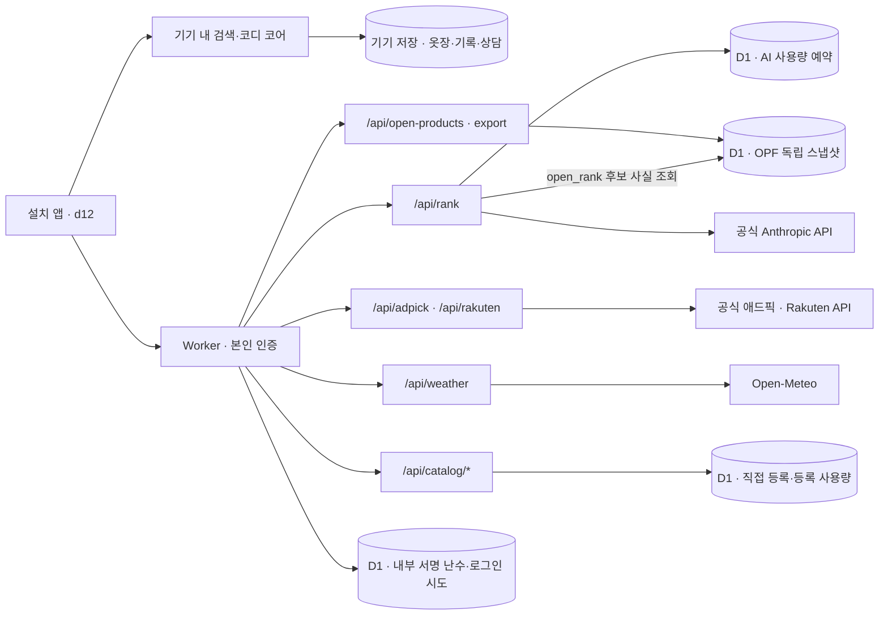

# 시스템·운영 인수인계

갱신: 2026-10-23. 현재 코드 기준은 master `90889b7e11f9d9d223cd8d468c87402b49536fb4`다. 이 문서는 코드와 **2026-10-22 마지막 운영 검증**을 정리한다. 오늘 실행 중인 버전을 새로 조회하거나 AI를 다시 호출한 기록은 아니다.

작업 시작점은 [문서 안내](README.md), 제품 결정은 [대표 요구사항](owner-requirements.md), 다음 구현 순서는 [개발 계획](development-plan.md)이다. 날짜가 붙은 문서는 당시 판단·실행 증거로 보존한다. 이후 결정과 충돌하면 최신 요구사항과 이 인수인계를 먼저 보고, 과거 기록을 삭제해 이력을 맞추지 않는다.

## 1. 현재 운영 앱과 다른 코드의 경계

| 코드 | 역할 | 현재 확인 상태 |
|---|---|---|
| `app/lite` | 본인 전용 설치형 PWA, Cloudflare Worker API·D1 연결 | master에 병합·비공개 배포. 실제 Chrome 로그인·AI·일부 상품 검색 확인 |
| `app/mockups/ux10v2/links/d12-hang.html` | 설치 앱의 화면 원본, ‘걸어 보고 사기’ | `app/lite/build.mjs`의 `SCREEN`이 이 파일을 사용 |
| `app/mockups/ux10v2/shared/eoul-mock.js` | 공유 추천·옷장 코어 | 로컬 후보 검색·코디 규칙·기기 저장. 서버 AI 및 외부 상품 검색과 별도 |
| `app` | 기존 독립 웹 앱, 전체 백업·복원 등 기존 기능 | lite와 같은 제품의 모든 기능이 자동으로 연결된 것은 아님 |
| `server`·`deploy` | Node 자체 서버, 계정·동기화·커뮤니티·운영 도구 | 이 코드가 있다는 사실을 Worker 앱의 가입·자동 동기화·커뮤니티 제공으로 해석하지 않음 |
| 시안·실험 브랜치 | 디자인 대안·VTON 등 | master 병합·설치 앱 채택·배포·실물 검증과 구분 |

2026-10-23 확인 당시 PR #48의 d16 시안(head `19a5eee8`)은 **열린 PR이며 master 병합·운영 배포 전**이다. 현재 화면을 d16으로 인계하지 않는다. PR 상태는 이후 바뀔 수 있으므로 작업 전에 재확인한다.

## 2. 요청과 저장 흐름

`RANK_DB`·`CROWD_DB`는 **같은 D1의 두 바인딩 이름**이다. 그림은 논리 영역을 나눈 것이며 DB 여러 개를 새로 만든 구성이 아니다.

| 영역 | 저장·전송하는 것 | 하지 않는 것 |
|---|---|---|
| 브라우저 | 옷장·저장/구매 관련 기록·직접 등록·상담 이력·날씨 지역 | 기기 간 자동 동기화 보장 없음. 로그인 성공만으로 개인 자료가 D1에 백업되지 않음 |
| 인증 D1 | 서버가 만든 내부 서명 난수, 분 단위 로그인 시도 HMAC 태그 | API 키·앱 비밀번호·원본 IP 저장 안 함 |
| AI 사용량 D1 | `rank_budget_usage`에 공유 일/월/분 사용 예약 | 질문·상담 원문을 사용량 원장에 저장하지 않음 |
| 사용자 등록 D1 | `crowd_items`, `crowd_submission_usage` | 개인 옷장 전체 동기화 DB가 아님. 사진을 받지 않음 |
| OPF D1 | `open_product_snapshots`, `open_product_facts`에 별도 ODbL 스냅샷 194건 | 애드픽·Rakuten·개인 행과 섞지 않음. 가격·재고·사진·구매 링크를 채워 만들지 않음 |
| 외부 검색 D1 | `external_source_usage`의 단기 호출 카운터 | 애드픽·Rakuten 상품 목록·검색어의 장기 복제 없음 |

직접 등록의 현재 기본 집계는 서로 다른 무작위 **기기 ID 3개**다. 실제 사람 3명이나 인증 계정 3개를 확인한 것이 아니며 기기 ID는 위조할 수 있다. 본인 전용 테스트의 임시 집계로 유지하고 공개 전에 계정 기반 중복·남용 방지를 설계해야 한다. [현재 구현](../app/lite/functions/api/catalog.js).

OPF는 최초 인증된 조회에서 배포 스냅샷을 멱등하게 넣고, 이후 검색·내보내기는 DB 행을 읽는다. 20행씩 묶어 D1 Free의 호출/바인딩 상한 안에 둔다. 스냅샷 교체는 유지보수 작업이며 자동 전 상품 수집이 아니다. [선택 이유·운영 내보내기 증거](automatic-search-open-catalog-20261022.md).

## 3. 실제 상품 검색과 AI의 역할

- 검색·등록 화면은 검색 **제출 한 번**으로 국내 애드픽 검색을 실행한다. 자동완성 타이핑마다 외부 조회하지 않는다. 같은 검색의 진행 중 요청만 공유하고 완료 상품 응답은 장기 저장하지 않는다. 상담의 없는 브랜드 검색 버튼은 사용자가 눌렀을 때만 조회한다.
- 애드픽·Rakuten은 공식 API가 준 원문·순서·참고 가격·원래 구매 링크를 표시한다. 예산·핏·보유 옷과의 조화 적용이나 상품별 AI 재정렬을 완료한 경로가 아니다. 두 공급자의 응답/사진을 외부 AI에 넘기지 않는다.
- `/api/rank`의 `rank`·`consult`는 기존 서버 카탈로그 후보를 사용한다. 상담은 같은 상담의 최근 메시지 최대 6개와 선택된 텍스트 옷장 참고 정보를 보낼 수 있다. **사진을 보내지 않는다는 원칙과 텍스트까지 전송하지 않는다는 주장은 다르다.** 없는 브랜드의 일반 지식 답변은 확인된 상품 사실과 구분한다.
- `open_rank`는 질문과 최대 12개 OPF 코드만 받고 서버 DB에서 이름·브랜드·분류를 확인한 후 AI로 비교한다. 현재 화면은 후보 0~1개일 때 AI 요청을 생략한다. 서버 API 자체는 후보 1개도 허용하므로 직접 요청하면 사용 예약·실제 호출이 생길 수 있다. 가격·구매 가능성이 없는 **추가 확인용 후보 비교**다.
- `retailer_search`는 사용자 문구만 일본어 검색어로 제안한다. 상품·사진·옷장·대화 이력은 받지 않는다. 사용자가 제안어를 확인한 다음 Rakuten을 조회한다.
- 기존 937개 수집 카탈로그는 **공개 출시 권리 미확인**이다. 공식 API 연결이나 OPF 라이선스가 기존 카탈로그의 권리를 해결하지 않는다. 현재가·정품·재고·정확한 핏·동일 상품 최저가를 보장하지 않는다.

[공급처별 권리·미완료 범위](automatic-search-open-catalog-20261022.md#공급원-판단)와 [Rakuten 검토](legal-clothing-sources-20261021.md)를 함께 본다. API가 무료인 것과 앱의 상용 출시·상품 저장·AI 처리 허용은 별개다.

## 4. 인증·비밀값·한도

현재 모드는 `PRIVATE_AUTH_MODE=session`. Access 카드·약관 단계는 중단했으며 신규 가입·카드를 요구하지 않는다. Worker는 로그인용 경로 외 앱·정적 자산·API 모두 인증을 거친다(`assets.run_worker_first: true`). `noindex`나 주소 비공개는 인증을 대신하지 않는다.

| 런타임 Secret 이름 | 용도 |
|---|---|
| `PRIVATE_APP_ACCESS_KEY` | 공백 없는 인쇄 가능한 ASCII 8~128자 앱 비밀번호. 중간 공백·탭·제어문자도 거절 |
| `ANTHROPIC_API_KEY` | 공식 Claude API 호출 |
| `ADPICK_API_KEY` | 국내 제휴 상품 검색 |
| `RAKUTEN_APPLICATION_ID` | Rakuten 앱 식별 |
| `RAKUTEN_ACCESS_KEY` | Rakuten 검색 인증 |

값을 읽거나 Git·채팅·PR·브라우저 번들·CLI 인수에 복사하지 않는다. 선택적 `CROWD_SALT`가 설정되면 등록의 IP 해시 한도를 추가한다. 위 표는 마지막 연결 기록과 코드의 설정 이름이며 2026-10-23 대시보드를 새로 조회한 결과가 아니다.

- 서버가 만든 독립 32바이트 난수는 D1에 원자 저장한다. 비밀번호 세대별 서명으로 비밀번호 변경 시 이전 세션을 거절한다. 로그인 쿠키는 7일, `HttpOnly; Secure; SameSite=Strict`다. 인증·D1 실패를 공개 허용으로 대체하지 않는다.
- 앱 세션 종료 API는 같은 Origin의 인증된 `POST /_private/logout`이다. CLI의 `wrangler logout`은 로컬 배포 도구의 인증만 끝내며 앱 세션·서버 Secret·D1을 지우지 않는다. 앱을 로그아웃했다고 기기 옷장·상담 기록까지 삭제되는 것도 아니다.
- 로그인 시도: IP 태그별 분당 5회·전체 분당 60회. 태그는 분 단위로 바뀌고 다음 시도에서 오래된 행을 정리한다. 정확한 시각의 자동 TTL 삭제라고 설명하지 않는다.
- 실제 배포 AI 한도: **UTC 일 100·월 300·분 5회**. 모듈의 미지정 기본값과 구분한다. 공유 D1에서 원자 예약하며 실패·취소도 사용 횟수에 포함한다. 호출 횟수 제한은 통화 금액의 절대 상한이 아니다.
- 모델 `claude-haiku-5-5`, effort `low`, SDK 재시도 0회·15초. 최대 출력 2,000토큰(검색어 제안 600). 상담의 5문장은 프롬프트 지시이며 문장 수를 서버가 강제 검증하지는 않는다. 서버가 강제하는 표시 길이는 550자이고, 범위 안의 문장 끝을 우선해 자른다. 최근 메시지 6개는 전체 대화를 영구 기억한다는 뜻이 아니다.
- 외부 검색·직접 등록에는 별도 공유 호출/등록 한도가 있다. 한도 오류를 해결하려고 자동 상향·메모리 무제한 대체·API 키 변경을 하지 않는다. 계정 잔액·만료·추가 충전은 별도 관리하며 과거 특정 크레딧의 만료일을 전체 잔액에 적용하지 않는다.

## 5. 마지막 배포·실제 동작 증거

다음은 **2026-10-22에 확인한 기록**이다. 새로운 배포가 있었는지 확인하지 않고 오늘의 활성 버전이라고 단정하지 않는다.

| 항목 | 마지막 확인 |
|---|---|
| Git | [PR #47](https://github.com/daedaem/otjang/pull/47) 병합, master `90889b7e11f9d9d223cd8d468c87402b49536fb4` |
| 검사 | lite 135개·app 688개. PR 검사 7개 성공. master 앱·서버·Docker 및 Cloudflare 자동 빌드 성공 |
| 활성 배포 | `14e6fd7b-8900-49b5-8d3c-4455aec74a49` 100% |
| 대응 검증 | 수동 배포 `ee5cb989-4c32-444a-971b-8e48b4183755`와 script ETag·바인딩 이름 동일, 자산 `55e80bddc6a1` |
| 실행 배치 | `placement.region=aws:ap-northeast-2`, 서울 인근 힌트 유지 |
| 실제 AI | 공개 후보 비교·상담·이어 묻기 총 5회 연속 성공. 실제 SDK 모델·토큰·요청 ID를 Console 성공 로그와 대조 |
| 최종 후속 질문 | 셔츠에 어울리는 5만원 이하 바지 → 수집가 21,890원 상품 카드. 실제 Haiku 5.5 입력/출력 2607/1274토큰 |
| 미인증 접근 | 실제 API 401. 인증 해제 없이 확인 |

근거는 [403 기록](ai-provider-403-20261022.md), [최종 완료 댓글](https://github.com/daedaem/otjang/pull/47#issuecomment-6339905634)이다. 전체 제공자 요청 ID·계정 정보·비공개 앱 주소는 이 문서에 싣지 않는다.

기본 배치의 JSON `forbidden`·HKG 응답 이후 배치만 바꿔 성공했다. 실행/연결 경로 가설을 지지하지만 제공자 내부의 IP 판정·국가 차단 규칙은 확정하지 못했다. 공식 배치 힌트를 사용했고 새 AI 중계 서버·임의 프록시·재시도는 추가하지 않았다. 중계 추가는 키 접근 주체·로그·비용·장애 지점을 늘리므로 근거 없이 채택하지 않는다. 장기 가용성과 데이터의 물리 위치를 보장하는 설정도 아니다.

## 6. 빌드·배포와 프리뷰를 구분하기

| 대상 | 루트 | 빌드 | 후속 명령 | 의미 |
|---|---|---|---|---|
| 프로덕션 master | `app/lite` | `npm run build` | `npx wrangler deploy` | 승인된 본인 전용 Worker 갱신 |
| 기능 브랜치 프리뷰 검증 | `app/lite` | `OTJANG_PRIVATE_DEPLOY=owner-approved PRIVATE_AUTH_MODE=session npm run build` | `npx wrangler deploy --dry-run` | 산출물 검사만. 별도 배포/URL 생성 아님 |

프로덕션 빌드에는 비밀값이 아닌 비공개 승인 변수와 인증 모드를 설정한다. `OTJANG_ALLOW_PUBLIC_DEPLOY`는 설정하지 않는다. `keep_vars: true`, `preview_urls: false`, D1 두 별칭, 런타임 Secret과 인증을 유지한다. 이 빌드 허용 장치는 실제 런타임 인증/Secret 검증을 대체하지 않는다.

PR #47 때 프리뷰 **기본값**을 고친 뒤에도 이미 생성된 브랜치의 **개별 설정**에는 루트 `/`가 남아 있었다. 두 곳을 각각 정정하고 같은 head의 성공 빌드를 확인했다. 이후에도 기존 브랜치 override를 직접 확인해야 하며 기본값 저장만으로 소급 반영됐다고 보고하지 않는다. [설정 정정 증거](https://github.com/daedaem/otjang/pull/47#issuecomment-6339841323).

수동 배포가 필요한 경우 검증한 master·기존 본인용 Worker만 대상으로 한다. 새 공개 미리보기·Access 해제·계정/유료 플랜 추가는 포함되지 않는다. 기존 Git 자동 빌드 지연은 이후 성공 기록과 구분하며 항상 고장 났다고 가정하지 않는다. 공식 Wrangler의 기존 승인 범위는 `account:read user:read workers_scripts:write`이며 `workers:write`는 이번에 잘못 선택했던 값이다. 새 범위 승인이나 비밀값 입력은 소유자가 수행한다. 필요한 작업과 확인을 마치면 `wrangler logout`하고 로컬 배포 인증과 앱 로그인·서버 Secret이 별개임을 기록한다. 최종 403 배포 뒤 같은 10-22 작업 대화의 후속 도구 실행에서 `Successfully logged out`을 확인했다. 이 실행은 PR 완료 댓글 이후이며 이번 문서 정리에서 CLI 상태를 다시 조회한 것은 아니다.

## 7. 장애 확인 순서와 금지할 복구

1. 먼저 [대표 요구사항](owner-requirements.md), master 커밋, 해당 배포/자산 버전을 읽는다. 같은 시점의 화면·HTTP 상태·안전한 오류 코드로 문제를 좁힌다. 키 값·쿠키·질문 원문을 진단 로그로 수집하지 않는다.
2. 인증 문제는 `/_private/status`의 미인증 상태와 정상 로그인 화면으로 구분한다. 로그인 실패를 AI 오류로, 외부 HTML 403을 앱의 JSON 403으로 단정하지 않는다.
3. 503은 인증 설정·Secret 이름·D1 바인딩/상태, 429는 로그인/앱 사용량/제공자 제한, 502는 제공자·타임아웃·출력 검증을 구분한다. 상태만 보고 키를 교체하거나 데이터를 지우지 않는다.
4. AI 403은 제한된 `status`·허용 오류 type·JSON/HTML 분류·검증한 요청 ID·3글자 지역 코드와 version/placement를 대조한다. 원문 SDK 오류·전체 헤더·IP·키는 남기지 않는다. 무제한 재시도·다른 중계로 우회하지 않는다.
5. 실제 AI 요청은 유료 사용량과 앱 예약을 소비한다. 문서·로컬 검사로 확인할 수 있는 단계에서는 호출하지 않는다. 필요한 최소 실호출은 기존 승인·크레딧·한도 안에서만 하고 모델 메타데이터와 제공자 로그를 대조한다. ‘AI’ 배지만으로 호출 성공을 판정하지 않는다.
6. 롤백은 마지막으로 확인한 **인증 보호가 있는** 버전을 사용한다. DB 초기화·원래 옷장 교체·앱/사이트 데이터 삭제를 복구 절차로 삼지 않는다. 배포 롤백이 기기 자료나 DB를 자동 복구하는 것도 아니다.

로컬 검사는 저장소 루트에서 `cd app/lite` 후 `npm ci`, `npm test`, `npm run build`로 수행한다. `node dev.mjs --fake`는 loopback의 합성 AI 화면 시험용이다. 실제 Worker의 로그인·D1·외부 상품 API까지 모두 재현하는 서버가 아니며 터널로 공개하지 않는다. 기준 master의 `dev.mjs`에는 `.mjs` MIME 매핑이 없어 OPF 모듈 응답이 `application/octet-stream`으로 나가는 코드상 문제가 있다. [PR #48](https://github.com/daedaem/otjang/pull/48)에 수정이 포함됐으나 미병합이다. 이번 문서 정리에서 실브라우저 오류를 다시 재현하거나 수정 코드를 반영한 것은 아니다. 실행하지 않은 검사 수치를 최신 결과로 복사하지 않는다.

## 8. 개인정보·보존·아직 남은 일

- 개인 사진·옷장 원본·실제 주문 내역·원본 대화·생성 개인 HTML은 Git에 넣지 않는다. 개인 사진의 외부 전송은 승인되지 않았다. 상품 이미지 원격 표시와 개인 사진 전송을 구분한다.
- 현재 lite 옷장·상담·구매 관련 기록은 기기에 남는다. 기존 앱의 전체 백업·복원 기능과 자체 서버 동기화 구현을 lite의 완성된 전체 백업/자동 동기화로 안내하지 않는다. 브라우저·홈 화면 앱·다른 기기의 저장 영역이 같다고 가정하지 않는다. **전체 백업/복원과 실물 복구 훈련은 공개 운영 전 검증 과제**다. 기존 내보내기 자료가 있으면 원본을 먼저 보존하고 앱 삭제·사이트 데이터 초기화는 피한다.
- 운영 D1 전체 덤프에는 내부 인증 난수·등록 자료가 포함될 수 있다. 라이선스가 열린 OPF 데이터만 별도 내보내며 전체 D1 덤프를 Git·공개 링크로 백업하지 않는다. 비공개 보존·권한·복구 확인은 별도 운영 절차다.
- OPF의 ‘사용한 DB 내려받기’는 공개 상품 194행의 ODbL 내보내기다. 개인 옷장·상담·구매내역 전체 백업이 아니다. D1이 있다고 개인 자료가 자동으로 보존되는 것도 아니다.
- 호출 성공은 추천 품질 완료가 아니다. 403 검증 중 50,960원을 10만원 예산 초과처럼 설명한 문장 오류가 남았다. 후보 가격 조건과 AI 이유의 사실 검증을 함께 보완해야 한다.
- 실물 iPhone의 갱신·로그인 유지·원래 자료 보존·날씨·검색 흐름, 원격 DB 장애/한도 초과·등록 철회·복구 훈련은 별도 검증한다. Node/Chromium/CI 통과를 대체 증거로 쓰지 않는다.
- 공개 출시에는 기존 상품/사진 권리, 애드픽·Rakuten의 실제 매체/상품 AI 범위, Open-Meteo 상업 조건, 개인정보 처리와 운영/복구 준비가 남는다. 현재는 본인 전용 시험판이며 정식 출시 완료가 아니다.

## 관련 실행 기록

- [설치 앱 설정](lite-app-setup-20261020.md)
- [자체 로그인·첫 실제 AI](private-ai-connect-20261021.md)
- [국내 애드픽 연결](adpick-domestic-search-20261021.md)
- [Rakuten·OPF 최초 연결](legal-clothing-sources-20261021.md)
- [한 번 검색·OPF D1](automatic-search-open-catalog-20261022.md)
- [403 수정과 최종 배포](ai-provider-403-20261022.md)
