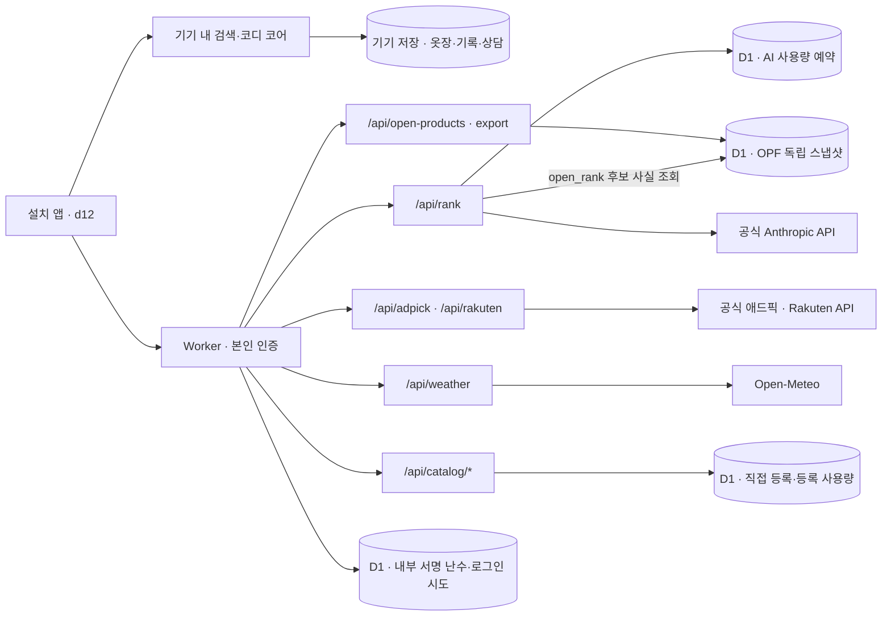

# 시스템·운영 인수인계

갱신: 2026-10-23. 현재 코드 기준은 master `90889b7e11f9d9d223cd8d468c87402b49536fb4`다. 이 문서는 코드와 **2026-10-22 마지막 운영 검증**을 정리한다. 오늘 실행 중인 버전을 새로 조회하거나 AI를 다시 호출한 기록은 아니다.

작업 시작점은 [문서 안내](README.md), 제품 결정은 [대표 요구사항](owner-requirements.md), 다음 구현 순서는 [개발 계획](development-plan.md)이다. 날짜가 붙은 문서는 당시 판단·실행 증거로 보존한다. 이후 결정과 충돌하면 최신 요구사항과 이 인수인계를 먼저 보고, 과거 기록을 삭제해 이력을 맞추지 않는다.

## 후속 저장 계약 (2026-10-23 KST, 작업 브랜치)

이번 기준은 master `293930d`. 아직 머지·배포하지 않은 save 오류 처리 변경은 코어 저장 실패 시 메모리/버전/구독을 롤백하고 등록 부가정보 실패를 명시한다. 직접 등록은 현재 화면에서 같은 옷 ID로 부가정보만 재시도한다. `eoul-d12-hang:v1`과 `:reg` 키/스키마는 유지한다. 두 키의 원자성·새로고침 후 미완료 등록 복원·다중 탭 충돌은 해결하지 않았다. D1 개인 옷장 이전은 계획이며 실제 DB·Worker·Access·비용 설정은 변경하지 않았다. [인수할 한계와 후속 저장 인터페이스](react-storage-plan-20261022.md).

PR #48은 10-23 03:35 UTC에 병합 없이 닫혔다(head `29e05e7`). 그 안의 개발 계획 1~3번 작업은 Codex의 [분리 권고](react-storage-plan-20261022.md#pr-48-보류-후-목적별-분리-권고)와 PR #66 리뷰 7회를 반영해 PR #66으로 master `9826dac`에 병합했다(10-23, master CI·Workers Builds 성공). d16 시안 파일은 참고용으로만 남고 설치 앱 화면이 아니다(커밋 `19a5eee`에 원본 보존).

## 1. 현재 운영 앱과 다른 코드의 경계

| 코드 | 역할 | 현재 확인 상태 |
|---|---|---|
| `app/lite` | 본인 전용 설치형 PWA, Cloudflare Worker API·D1 연결 | master에 병합·비공개 배포. 실제 Chrome 로그인·AI·일부 상품 검색 확인 |
| `app/lite/src/screen.html` | d12 화면 원본 | #70 후보의 새 위치. `build.mjs`는 시안 폴더를 읽지 않음 |
| `app/lite/src/core.mjs`·`src/domain` | 기기 내 검색·코디·저장, 공유 도메인 원본 20파일 | #66 정본을 이동. 빌드·pretest가 `.generated/core-bundle.js` 생성, 생성물은 Git 제외 |
| `app/lite/src/browser`·`public/icons` | 브라우저 보조와 아이콘 | 기존 원본 이동. 저장 키·API 경로·Worker 빌드 루트는 유지 |
| `legacy/app` | 기존 독립 웹 앱, 전체 백업·복원 등 기존 기능 | lite와 모든 기능·자료가 자동 연결된 것은 아님 |
| `legacy/server`·`legacy/deploy` | Node 자체 서버, 계정·동기화·커뮤니티·Docker 도구 | 공유 도메인은 lite의 같은 원본을 읽음. Worker의 가입·자동 동기화·커뮤니티 완성을 뜻하지 않음 |
| 시안·실험 브랜치 | 디자인 대안·VTON 등 | master 병합·설치 앱 채택·배포·실물 검증과 구분 |

d16 시안은 PR #48이 닫히며 채택되지 않았다. 현재 화면을 d16으로 인계하지 않는다.

## 2. 요청과 저장 흐름

`RANK_DB`·`CROWD_DB`는 **같은 D1의 두 바인딩 이름**이다. 그림은 논리 영역을 나눈 것이며 DB 여러 개를 새로 만든 구성이 아니다.

| 영역 | 저장·전송하는 것 | 하지 않는 것 |
|---|---|---|
| 브라우저 | 옷장·저장/구매 관련 기록·직접 등록·상담 이력·날씨 지역 | 기기 간 자동 동기화 보장 없음. 로그인 성공만으로 개인 자료가 D1에 백업되지 않음. 10-23 PR #66(master `9826dac`)부터 메뉴 '백업 · 복원'으로 `eoul-` 키 원문을 JSON 한 파일로 내보내고 되돌릴 수 있다(사용자가 직접 보관, 서버 저장 없음) |
| 인증 D1 | 서버가 만든 내부 서명 난수, 분 단위 로그인 시도 HMAC 태그 | API 키·앱 비밀번호·원본 IP 저장 안 함 |
| AI 사용량 D1 | `rank_budget_usage`에 공유 일/월/분 사용 예약 | 질문·상담 원문을 사용량 원장에 저장하지 않음 |
| 사용자 등록 D1 | `crowd_items`, `crowd_submission_usage` | 개인 옷장 전체 동기화 DB가 아님. 사진을 받지 않음 |
| OPF D1 | `open_product_snapshots`, `open_product_facts`에 별도 ODbL 스냅샷 194건 | 애드픽·Rakuten·개인 행과 섞지 않음. 가격·재고·사진·구매 링크를 채워 만들지 않음 |
| 외부 검색 D1 | `external_source_usage`의 단기 호출 카운터 | 애드픽·Rakuten 상품 목록·검색어의 장기 복제 없음 |

직접 등록의 현재 기본 집계는 서로 다른 무작위 **기기 ID 3개**다. 실제 사람 3명이나 인증 계정 3개를 확인한 것이 아니며 기기 ID는 위조할 수 있다. 본인 전용 테스트의 임시 집계로 유지하고 공개 전에 계정 기반 중복·남용 방지를 설계해야 한다. [현재 구현](../app/lite/functions/api/catalog.js).

OPF는 최초 인증된 조회에서 배포 스냅샷을 멱등하게 넣고, 이후 검색·내보내기는 DB 행을 읽는다. 20행씩 묶어 D1 Free의 호출/바인딩 상한 안에 둔다. 스냅샷 교체는 유지보수 작업이며 자동 전 상품 수집이 아니다. [선택 이유·운영 내보내기 증거](automatic-search-open-catalog-20261022.md).

## 3. 실제 상품 검색과 AI의 역할

- 검색·등록 화면은 검색 **제출 한 번**으로 국내 애드픽 검색을 실행한다. 자동완성 타이핑마다 외부 조회하지 않는다. 같은 검색의 진행 중 요청만 공유하고 완료 상품 응답은 장기 저장하지 않는다. 상담의 없는 브랜드 검색 버튼은 사용자가 눌렀을 때만 조회한다.
- 애드픽·Rakuten은 공식 API가 준 원문·순서·참고 가격·원래 구매 링크를 표시한다. 예산·핏·보유 옷과의 조화 적용이나 상품별 AI 재정렬을 완료한 경로가 아니다. 두 공급자의 응답/사진을 외부 AI에 넘기지 않는다.
- `/api/rank`의 `rank`·`consult`는 기존 서버 카탈로그 후보를 사용한다. 상담은 같은 상담의 최근 메시지 최대 6개와 선택된 텍스트 옷장 참고 정보를 보낼 수 있다. 상담 요청은 선택 필드 `budget {max?, min?}`(원 단위 정수 1,000~100,000,000, 화면의 엔진 검색 조건에서 읽음)을 받고, 없으면 서버가 질문 문장에서만 읽는다(`parseBudget`, 앱 검색 엔진 `app/src/query.js`의 `priceBounds`를 그대로 사용). 서버는 후보마다 `budgetFit`을 붙여 AI에 주고, 답이 그 판정과 반대로 말한 후보가 있으면 응답 `price_check.lines`에 "가격 확인: …" 줄을 넣는다(답 문장 수정·재호출 없음). 화면은 그 줄을 답 아래 사실 줄로 보여 주고 상담 이력(`turn.check`)에 함께 저장한다. **사진을 보내지 않는다는 원칙과 텍스트까지 전송하지 않는다는 주장은 다르다.** 없는 브랜드의 일반 지식 답변은 확인된 상품 사실과 구분한다.
- `open_rank`는 질문과 최대 12개 OPF 코드만 받고 서버 DB에서 이름·브랜드·분류를 확인한 후 AI로 비교한다. 현재 화면은 후보 0~1개일 때 AI 요청을 생략한다. 서버 API 자체는 후보 1개도 허용하므로 직접 요청하면 사용 예약·실제 호출이 생길 수 있다. 가격·구매 가능성이 없는 **추가 확인용 후보 비교**다.
- `retailer_search`는 사용자 문구만 일본어 검색어로 제안한다. 상품·사진·옷장·대화 이력은 받지 않는다. 사용자가 제안어를 확인한 다음 Rakuten을 조회한다.
- 기존 937개 수집 카탈로그는 **공개 출시 권리 미확인**이다. 공식 API 연결이나 OPF 라이선스가 기존 카탈로그의 권리를 해결하지 않는다. 현재가·정품·재고·정확한 핏·동일 상품 최저가를 보장하지 않는다.

[공급처별 권리·미완료 범위](automatic-search-open-catalog-20261022.md#공급원-판단)와 [Rakuten 검토](legal-clothing-sources-20261021.md)를 함께 본다. API가 무료인 것과 앱의 상용 출시·상품 저장·AI 처리 허용은 별개다.

## 4. 인증·비밀값·한도

현재 모드는 `PRIVATE_AUTH_MODE=session`. Access 카드·약관 단계는 중단했으며 신규 가입·카드를 요구하지 않는다. Worker는 로그인용 경로 외 앱·정적 자산·API 모두 인증을 거친다(`assets.run_worker_first: true`). `noindex`나 주소 비공개는 인증을 대신하지 않는다.

| 런타임 Secret 이름 | 용도 |
|---|---|
| `PRIVATE_APP_ACCESS_KEY` | 공백 없는 인쇄 가능한 ASCII 8~128자 앱 비밀번호. 중간 공백·탭·제어문자도 거절 |
| `ANTHROPIC_API_KEY` | 공식 Claude API 호출 |
| `ADPICK_API_KEY` | 국내 제휴 상품 검색 |
| `RAKUTEN_APPLICATION_ID` | Rakuten 앱 식별 |
| `RAKUTEN_ACCESS_KEY` | Rakuten 검색 인증 |

값을 읽거나 Git·채팅·PR·브라우저 번들·CLI 인수에 복사하지 않는다. 선택적 `CROWD_SALT`가 설정되면 등록의 IP 해시 한도를 추가한다. 위 표는 마지막 연결 기록과 코드의 설정 이름이며 2026-10-23 대시보드를 새로 조회한 결과가 아니다.

- 서버가 만든 독립 32바이트 난수는 D1에 원자 저장한다. 비밀번호 세대별 서명으로 비밀번호 변경 시 이전 세션을 거절한다. 로그인 쿠키는 7일, `HttpOnly; Secure; SameSite=Strict`다. 인증·D1 실패를 공개 허용으로 대체하지 않는다.
- 앱 세션 종료 API는 같은 Origin의 인증된 `POST /_private/logout`이다. CLI의 `wrangler logout`은 로컬 배포 도구의 인증만 끝내며 앱 세션·서버 Secret·D1을 지우지 않는다. 앱을 로그아웃했다고 기기 옷장·상담 기록까지 삭제되는 것도 아니다.
- 로그인 시도: IP 태그별 분당 5회·전체 분당 60회. 태그는 분 단위로 바뀌고 다음 시도에서 오래된 행을 정리한다. 정확한 시각의 자동 TTL 삭제라고 설명하지 않는다.
- 실제 배포 AI 한도: **UTC 일 100·월 300·분 5회**. 모듈의 미지정 기본값과 구분한다. 공유 D1에서 원자 예약하며 실패·취소도 사용 횟수에 포함한다. 호출 횟수 제한은 통화 금액의 절대 상한이 아니다.
- 모델 `claude-haiku-5-5`, effort `low`, SDK 재시도 0회·15초. 최대 출력 2,000토큰(검색어 제안 600). 상담의 5문장은 프롬프트 지시이며 문장 수를 서버가 강제 검증하지는 않는다. 서버가 강제하는 표시 길이는 550자이고, 범위 안의 문장 끝을 우선해 자른다. 최근 메시지 6개는 전체 대화를 영구 기억한다는 뜻이 아니다.
- 외부 검색·직접 등록에는 별도 공유 호출/등록 한도가 있다. 한도 오류를 해결하려고 자동 상향·메모리 무제한 대체·API 키 변경을 하지 않는다. 계정 잔액·만료·추가 충전은 별도 관리하며 과거 특정 크레딧의 만료일을 전체 잔액에 적용하지 않는다.

## 5. 마지막 배포·실제 동작 증거

다음은 **2026-10-22에 확인한 기록**이다. 새로운 배포가 있었는지 확인하지 않고 오늘의 활성 버전이라고 단정하지 않는다.

| 항목 | 마지막 확인 |
|---|---|
| Git | [PR #47](https://github.com/daedaem/otjang/pull/47) 병합, master `90889b7e11f9d9d223cd8d468c87402b49536fb4` |
| 검사 | lite 135개·app 688개. PR 검사 7개 성공. master 앱·서버·Docker 및 Cloudflare 자동 빌드 성공 |
| 활성 배포 | `14e6fd7b-8900-49b5-8d3c-4455aec74a49` 100% |
| 대응 검증 | 수동 배포 `ee5cb989-4c32-444a-971b-8e48b4183755`와 script ETag·바인딩 이름 동일, 자산 `55e80bddc6a1` |
| 실행 배치 | `placement.region=aws:ap-northeast-2`, 서울 인근 힌트 유지 |
| 실제 AI | 공개 후보 비교·상담·이어 묻기 총 5회 연속 성공. 실제 SDK 모델·토큰·요청 ID를 Console 성공 로그와 대조 |
| 최종 후속 질문 | 셔츠에 어울리는 5만원 이하 바지 → 수집가 21,890원 상품 카드. 실제 Haiku 5.5 입력/출력 2607/1274토큰 |
| 미인증 접근 | 실제 API 401. 인증 해제 없이 확인 |

근거는 [403 기록](ai-provider-403-20261022.md), [최종 완료 댓글](https://github.com/daedaem/otjang/pull/47#issuecomment-6339905634)이다. 전체 제공자 요청 ID·계정 정보·비공개 앱 주소는 이 문서에 싣지 않는다.

기본 배치의 JSON `forbidden`·HKG 응답 이후 배치만 바꿔 성공했다. 실행/연결 경로 가설을 지지하지만 제공자 내부의 IP 판정·국가 차단 규칙은 확정하지 못했다. 공식 배치 힌트를 사용했고 새 AI 중계 서버·임의 프록시·재시도는 추가하지 않았다. 중계 추가는 키 접근 주체·로그·비용·장애 지점을 늘리므로 근거 없이 채택하지 않는다. 장기 가용성과 데이터의 물리 위치를 보장하는 설정도 아니다.

## 6. 빌드·배포와 프리뷰를 구분하기

| 대상 | 루트 | 빌드 | 후속 명령 | 의미 |
|---|---|---|---|---|
| 프로덕션 master | `app/lite` | `npm run build` | `npx wrangler deploy` | 승인된 본인 전용 Worker 갱신 |
| 기능 브랜치 프리뷰 검증 | `app/lite` | `OTJANG_PRIVATE_DEPLOY=owner-approved PRIVATE_AUTH_MODE=session npm run build` | `npx wrangler deploy --dry-run` | 산출물 검사만. 별도 배포/URL 생성 아님 |

프로덕션 빌드에는 비밀값이 아닌 비공개 승인 변수와 인증 모드를 설정한다. `OTJANG_ALLOW_PUBLIC_DEPLOY`는 설정하지 않는다. `keep_vars: true`, `preview_urls: false`, D1 두 별칭, 런타임 Secret과 인증을 유지한다. 이 빌드 허용 장치는 실제 런타임 인증/Secret 검증을 대체하지 않는다.

PR #47 때 프리뷰 **기본값**을 고친 뒤에도 이미 생성된 브랜치의 **개별 설정**에는 루트 `/`가 남아 있었다. 두 곳을 각각 정정하고 같은 head의 성공 빌드를 확인했다. 이후에도 기존 브랜치 override를 직접 확인해야 하며 기본값 저장만으로 소급 반영됐다고 보고하지 않는다. [설정 정정 증거](https://github.com/daedaem/otjang/pull/47#issuecomment-6339841323).

수동 배포가 필요한 경우 검증한 master·기존 본인용 Worker만 대상으로 한다. 새 공개 미리보기·Access 해제·계정/유료 플랜 추가는 포함되지 않는다. 기존 Git 자동 빌드 지연은 이후 성공 기록과 구분하며 항상 고장 났다고 가정하지 않는다. 공식 Wrangler의 기존 승인 범위는 `account:read user:read workers_scripts:write`이며 `workers:write`는 이번에 잘못 선택했던 값이다. 새 범위 승인이나 비밀값 입력은 소유자가 수행한다. 필요한 작업과 확인을 마치면 `wrangler logout`하고 로컬 배포 인증과 앱 로그인·서버 Secret이 별개임을 기록한다. 최종 403 배포 뒤 같은 10-22 작업 대화의 후속 도구 실행에서 `Successfully logged out`을 확인했다. 이 실행은 PR 완료 댓글 이후이며 이번 문서 정리에서 CLI 상태를 다시 조회한 것은 아니다.

## 7. 장애 확인 순서와 금지할 복구

1. 먼저 [대표 요구사항](owner-requirements.md), master 커밋, 해당 배포/자산 버전을 읽는다. 같은 시점의 화면·HTTP 상태·안전한 오류 코드로 문제를 좁힌다. 키 값·쿠키·질문 원문을 진단 로그로 수집하지 않는다.
2. 인증 문제는 `/_private/status`의 미인증 상태와 정상 로그인 화면으로 구분한다. 로그인 실패를 AI 오류로, 외부 HTML 403을 앱의 JSON 403으로 단정하지 않는다.
3. 503은 인증 설정·Secret 이름·D1 바인딩/상태, 429는 로그인/앱 사용량/제공자 제한, 502는 제공자·타임아웃·출력 검증을 구분한다. 상태만 보고 키를 교체하거나 데이터를 지우지 않는다.
4. AI 403은 제한된 `status`·허용 오류 type·JSON/HTML 분류·검증한 요청 ID·3글자 지역 코드와 version/placement를 대조한다. 원문 SDK 오류·전체 헤더·IP·키는 남기지 않는다. 무제한 재시도·다른 중계로 우회하지 않는다.
5. 실제 AI 요청은 유료 사용량과 앱 예약을 소비한다. 문서·로컬 검사로 확인할 수 있는 단계에서는 호출하지 않는다. 필요한 최소 실호출은 기존 승인·크레딧·한도 안에서만 하고 모델 메타데이터와 제공자 로그를 대조한다. ‘AI’ 배지만으로 호출 성공을 판정하지 않는다.
6. 롤백은 마지막으로 확인한 **인증 보호가 있는** 버전을 사용한다. DB 초기화·원래 옷장 교체·앱/사이트 데이터 삭제를 복구 절차로 삼지 않는다. 배포 롤백이 기기 자료나 DB를 자동 복구하는 것도 아니다.

로컬 검사는 저장소 루트에서 `cd app/lite` 후 `npm ci`, `npm test`, `npm run build`로 수행한다. `node dev.mjs --fake`는 loopback의 합성 AI 화면 시험용이다. 실제 Worker의 로그인·D1·외부 상품 API까지 모두 재현하는 서버가 아니며 터널로 공개하지 않는다. `dev.mjs`의 `.mjs` MIME 매핑 누락(OPF 모듈 응답이 `application/octet-stream`으로 나가던 문제)은 PR #66(`9826dac`)으로 master에 반영돼 해결됐다. 10-23에 `node dev.mjs --fake`로 `200 text/javascript; charset=utf-8` 응답을 확인했다. 실행하지 않은 검사 수치를 최신 결과로 복사하지 않는다.

## 8. 개인정보·보존·아직 남은 일

- 개인 사진·옷장 원본·실제 주문 내역·원본 대화·생성 개인 HTML은 Git에 넣지 않는다. 개인 사진의 외부 전송은 승인되지 않았다. 상품 이미지 원격 표시와 개인 사진 전송을 구분한다.
- lite의 직접 구매 기록은 서버 카탈로그 상품에만 붙는다: 상세 '살게요'→기록 탭 '주문했어요'→'받았어요'→'계속 입을게요'(옷장에 productId 달린 옷으로 추가) 또는 '반품했어요'(사유 필수, 옷장에서 제외, 같은 상품 상세에 주의 표시). 애드픽·Rakuten·OPF 후보는 링크 이동만 되고 이 기록 흐름에 들어오지 않는다.
- 현재 lite 옷장·상담·구매 관련 기록은 기기에 남는다. 10-23 master(PR #66)의 '백업 · 복원'(d12 `BK` 블록)은 `eoul-`로 시작하는 저장 키 중 캐시(`:last`)·탐침(`:probe`)·보관본(`eoul-backup:`)을 뺀 원문을 `{app:'eoul-lite', format:1, at, data:{키:원문}}`으로 내보내고, 복원은 현재 값을 임시 칸 `eoul-backup:stash-next`에 저장·재확인한 뒤에만 키를 바꾸고, 끝까지 성공했을 때만 그것을 되돌리기 지점 `eoul-backup:stash`로 올린다(앞선 되돌리기 지점은 그전까지 건드리지 않음). 깨끗이 되돌려지면 임시 칸만 지우고, 일부만 바뀌었거나 올리기가 막히면 임시 칸이 되돌리기 지점이 된다. 새 복원을 시작할 때 앞선 임시 칸이 남아 있으면(일부만 바뀜·올리기 막힘) 복원을 시작하지 않고 먼저 '복원 전으로 되돌리기'를 하게 한다(깨끗한 복구 지점을 덮지 않기 위해). 백업에 없는 키 중 지우는 것은 `eoul-d12-hang:`(읽지 못한 원문 보관 `:unreadable:` 제외)과 날씨 지역뿐이다. 쓴 값은 다시 읽어 확인하고, 중간에 막히면 바꾼 키만 원래 값으로 되돌린다. 되돌리기까지 막히면 '일부만 바뀜'을 알리고 보관본을 남겨 나중에 '복원 전으로 되돌리기'로 복구한다. 옷장 원문은 복원 전에 엔진 불러오기와 같은 규칙(`M.canReadSaved`, `src/core.mjs`의 `readSaved`)으로 먼저 읽어 본다. 수동 파일 보관이며 자동 동기화가 아니다. 기존 앱의 전체 백업·복원 기능과 자체 서버 동기화 구현을 lite의 완성된 전체 백업/자동 동기화로 안내하지 않는다. 브라우저·홈 화면 앱·다른 기기의 저장 영역이 같다고 가정하지 않는다. **전체 백업/복원과 실물 복구 훈련은 공개 운영 전 검증 과제**다. 기존 내보내기 자료가 있으면 원본을 먼저 보존하고 앱 삭제·사이트 데이터 초기화는 피한다.
- 운영 D1 전체 덤프에는 내부 인증 난수·등록 자료가 포함될 수 있다. 라이선스가 열린 OPF 데이터만 별도 내보내며 전체 D1 덤프를 Git·공개 링크로 백업하지 않는다. 비공개 보존·권한·복구 확인은 별도 운영 절차다.
- OPF의 ‘사용한 DB 내려받기’는 공개 상품 194행의 ODbL 내보내기다. 개인 옷장·상담·구매내역 전체 백업이 아니다. D1이 있다고 개인 자료가 자동으로 보존되는 것도 아니다.
- 호출 성공은 추천 품질 완료가 아니다. 403 검증 중 50,960원을 10만원 예산 초과처럼 설명한 문장 오류가 남았고, 10-23에 서버 가격 대조(`price_check`)를 넣어 그런 문장 아래에 실제 가격·판정 줄이 붙게 했다. 대조는 후보 이름이 들어간 문장에만 작동하며, 예산 외 조건의 자유문장은 검증하지 않는다([개발 계획](development-plan.md) 1번).
- 실물 iPhone의 갱신·로그인 유지·원래 자료 보존·날씨·검색 흐름, 원격 DB 장애/한도 초과·등록 철회·복구 훈련은 별도 검증한다. Node/Chromium/CI 통과를 대체 증거로 쓰지 않는다.
- 공개 출시에는 기존 상품/사진 권리, 애드픽·Rakuten의 실제 매체/상품 AI 범위, Open-Meteo 상업 조건, 개인정보 처리와 운영/복구 준비가 남는다. 현재는 본인 전용 시험판이며 정식 출시 완료가 아니다.

## 관련 실행 기록

- [설치 앱 설정](lite-app-setup-20261020.md)
- [자체 로그인·첫 실제 AI](private-ai-connect-20261021.md)
- [국내 애드픽 연결](adpick-domestic-search-20261021.md)
- [Rakuten·OPF 최초 연결](legal-clothing-sources-20261021.md)
- [한 번 검색·OPF D1](automatic-search-open-catalog-20261022.md)
- [403 수정과 최종 배포](ai-provider-403-20261022.md)

## 등록 저장 준비 (2026-10-23, 후속 작업 브랜치)

기존 lite v1 저장 키를 유지하고 선택적 `registrations: {v:1, receipts:[]}` 확장을 읽는다. 이전 v1은 빈 등록 영수증으로 해석하며 기존 `:reg` 및 IndexedDB 원본을 옮기거나 삭제하지 않는다. 새 `registerGarment`는 옷·브랜드/링크·draftId 영수증을 같은 localStorage 쓰기에 저장한다. 같은 ID/같은 입력은 재로드 뒤에도 기존 결과를 반환하고 변경된 입력은 충돌로 거절한다. 미래 등록 스키마는 원문을 보호하며 저장을 막는다. 과거 화면의 등록은 아직 기존 두 키 경로이며 React 전환 PR에서 새 커맨드를 연결한다. 예전 앱으로 롤백하면 새로운 부가정보 표시 기능은 없으므로 다운그레이드 이전에 JSON 보존이 필요하다. 다중 탭 동시 쓰기 해결이나 D1 이전 완료는 아니다.

### React 직접 등록 빌드 (2026-10-23, 미배포)

Cloudflare `app/lite`의 기존 `npm run build`/`dist` 설정을 유지한다. 빌드는 타입 검사 후 Vite 해시 자산을 `dist/react`에 생성하고 기존 PWA shell 목록에 포함한다. React 코드는 입력 진입 때 import되지만 기존 서비스워커의 shell 사전 캐시는 이를 다운로드한다. 현 빌드 JS 약 197.48kB, gzip 62.57kB이며 3D 용량 최적화와 별개다. Safari 16.4/Chrome 110을 번들 변환 기준으로 지정했으며 실제 지원 보증 범위는 기기 검사 후 확정한다.

기존 localStorage 키, IndexedDB, API 인증 경로를 바꾸지 않았다. 새 직접 등록의 메타데이터는 코어에 함께 저장하고 기존 `:reg` 정보도 읽는다. 등록 검색의 로컬 목록은 두 출처를 합쳐 표시한다. 저장 실패는 입력을 유지하고 성공 전에 공용 목록 API에 제출하지 않는다. UI의 async 등록 repository는 향후 서버 명령 교체를 위한 경계이며, D1 동기화·다중 탭 충돌 해결·전체 저장 계층 추출 완료가 아니다. 초안은 이 PR에서는 메모리만 사용하며 후속 PR에서 복원한다.

출시 전: 실제 iPhone Safari 홈 화면 추가/재실행/키보드/뒤로 가기, Galaxy Chrome·Samsung Internet 설치/키보드/복귀, 서비스워커 업데이트/오프라인 자산을 확인한다. Playwright WebKit은 iOS 실기기 대체가 아니다. 기존 비공개 접근 정책을 유지한다.

### 입력 초안 복원 경계 (2026-10-23, #55 후속·미배포)

이전 절의 메모리 초안 한계를 후속 PR에서 보완했다. 새 키 `eoul-d12-hang:input-draft:v1`에 버전 1·단계·등록 입력·draftId·갱신 시각을 보관한다. 옷장/구매 이력 키나 IndexedDB는 이동하지 않는다. 한 기기에 한 입력 초안이며 서버 동기화·여러 탭 병합을 지원하지 않는다. 자동 만료/자동 삭제는 없으며 읽을 수 없는 초안은 사용자가 초안 삭제를 선택하기 전까지 보존한다. 초기 빈 입력도 저장할 수 있으므로 재접속 복원 안내가 나올 수 있다. 복원은 원래 draftId를 유지하며 이미 등록된 초안의 재제출은 중복을 만들지 않는다. 초안 정리 실패 안내가 떠도 옷 저장은 성공한 상태다.

초안 복원은 앱 저장 공간이 유지될 때만 가능하다. OS/브라우저의 사이트 데이터 삭제를 서버 백업으로 보완한 것은 아니다. 초안은 브랜드/상품명/종류/색/링크/공개 DB 출처만 포함하고 사진은 포함하지 않는다. 입력 단계마다 현재 출처를 유지하며 다른 검색/공개 DB 진입 때는 저장된 초안의 이어 쓰기 또는 삭제를 선택한다.

## 2026-10-23 React 입력 반영 기록

대표의 “반영해줘요” 승인으로 #52(저장 오류), #54(원자 등록/draftId), #55(React 직접 입력), #56(초안 복원)을 차례로 master에 병합했다. 최종 기능 기준은 `7aea9f5fb3f49a0c3442f6895f2d8c21a122a35a`. 위 각 절의 미병합/미배포 표기는 작성 당시 상태이며 이번 병합 기록으로 갱신한다. PR #48은 이 작업에 포함하지 않았다.

#56의 첫 CI에서 초안 저장 효과보다 먼저 단계를 검사한 1건 실패를 고쳤다. 수정 head `42f9c4c`의 push run [39894177723](https://github.com/daedaem/otjang/actions/runs/39894177723)은 Chromium/WebKit·app/server/image 검사 모두 성공했다. PR별 run은 같은 head라도 따로 실행되므로 설치 지연과 테스트 실패를 혼동하지 않는다. #55 병합 master `21718ba`의 Workers Builds 성공도 확인했다. 최종 기능 master의 배포 결과는 별도 확인하며, GitHub 빌드 성공과 실제 로그인 기기 검증을 구분한다.

현재 클라우드 실행 환경에는 Cloudflare 인증 연결 및 운영 호스트 접근이 없어 활성 버전/로그인 화면을 직접 대조하지 못했다. 기존 master 자동 배포 설정, session 인증, preview_urls:false, D1/Secret/한도는 변경하지 않았다. 실제 iPhone/Galaxy 설치·키보드·복귀·오프라인과 최신 서비스워커 적용은 미검증이다. 앱/사이트 데이터 삭제를 업데이트 방법으로 안내하지 않는다.
