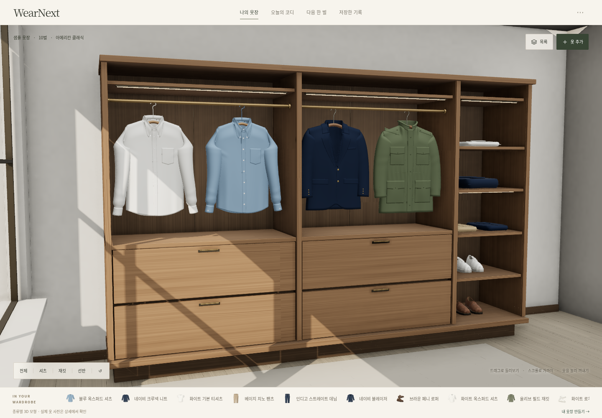

# WearNext — 개인 옷장 프로토타입

**상태: 기능 프로토타입, 시각 품질 재설계 중.** [Claude 시안과의 비교](../docs/design-review/current-comparison.md)에서 찾은 모바일 구도·상세 조작·셔츠 표면·저장 시 장면 재생성 문제를 [이번 개선](../docs/design-review/current-improvements.md)에 반영했습니다. 디자인 완성으로 표시하지 않습니다.

Blender로 만든 드레스룸에서 옷을 꺼내 살펴보고, 선택한 옷으로 코디를 찾아보는 개인 프로토타입입니다. 사진 등록 → 옷장 → 코디 → 구매 후보·후기 비교 → 기록·백업이 하나의 로컬 옷장 데이터로 이어집니다.

[실행 HTML 다운로드](https://github.com/daedaem/otjang/raw/refs/heads/feat/wearnext-prototype/prototype/WearNext.html) · [Blender 원본 다운로드](https://github.com/daedaem/otjang/raw/refs/heads/feat/wearnext-prototype/prototype/scene/assets/WearNext-wardrobe.blend) · [전체 소스 다운로드](https://github.com/daedaem/otjang/archive/refs/heads/feat/wearnext-prototype.zip)



[한 벌 살펴보기](preview-detail.png) · [모바일 옷장](preview-mobile.png) · [모바일 상세](preview-mobile-detail.png)

## 바로 사용하기

`WearNext.html`은 Blender 장면·텍스처·Three.js·화면 코드를 모두 포함한 단일 파일입니다. 내려받아 최신 브라우저에서 열어 보세요. 계정·API 키·유료 서비스·Blender 설치가 필요하지 않습니다. 이 환경에서는 파일 주소 열기가 제한되어 동일 HTML을 로컬 HTTP로 검증했습니다.

브라우저가 파일 열기나 저장을 제한하면 Node.js 20 이상에서 실행합니다. 미리 빌드된 HTML 실행에는 의존성 설치가 필요하지 않습니다.

```sh
cd prototype
npm start
```

브라우저에서 `http://127.0.0.1:4173`을 엽니다. **먼저 둘러보기**는 샘플 옷 10벌로 시작합니다. **내 옷으로 시작**은 빈 옷장으로 시작하며 사진을 확인해 확정한 옷만 연결합니다.

- 화면을 드래그해 둘러보고 스크롤·핀치로 가까이 봅니다.
- 옷이나 하단 선택 메뉴를 누르면 옷이 앞으로 나오고 상세가 열립니다. 꺼낸 뒤 가로로 드래그하면 방 대신 옷 자체를 돌려 봅니다.
- **이 옷으로 코디**는 선택한 옷을 실제 조합에 포함합니다. **옷장에 다시 넣기**, Escape, 빈 공간 클릭으로 복귀합니다.
- 모바일은 전체 옷장을 먼저 보여줍니다. **전체·셔츠·재킷·선반** 버튼으로 구역에 가까이 가고 돌아옵니다. 한 벌을 꺼내면 중복 탐색 메뉴를 접어 옷과 상세에 공간을 줍니다.
- 이름·브랜드·메모를 고쳐도 열린 3D 공간과 회전 상태를 유지합니다. 색 변경은 기존 위치의 재질을 갱신합니다. **목록**에서 검색·분류·직접 기록을 이용합니다.
- 사진을 여러 장 넣고 초안의 종류·색·영역을 확인한 뒤 선택한 옷만 확정합니다.
- 브랜드·정확한 상품명·품번·참조 링크를 아는 만큼 기록하고 직접 확인 여부를 남깁니다. 브랜드 목록에 없는 이름도 입력할 수 있습니다.
- 사진·프로필·기록은 이 브라우저에 저장합니다. 옷장 설정 또는 저장한 기록 화면에서 JSON 백업·복원할 수 있습니다.

## 실제 동작과 표현 범위

Blender에서 옷을 가까이 볼 수 있는 비대칭 수납장, 짙은 목재, 창으로 들어오는 빛, 셔츠·재킷·접은 옷·신발을 구성했습니다. `.blend` 원본과 GLB를 함께 제공합니다. 브라우저는 실제 메시를 렌더링하고 시점 이동·옷 꺼내기·회전·복귀를 처리합니다. 시작 화면과 로딩 배경은 같은 공간의 Cycles 정지 렌더이며 미리보기로 표시합니다.

목재·원단의 색과 미세 표면을 분리하고, 움직이는 옷을 제외한 고정 가구의 차폐(AO)를 미리 계산해 선반 안쪽의 깊이를 보강합니다. 브라우저에서는 방향성 조명·그림자와 지원 기기의 동적 AO를 더하고 ACES 톤 매핑을 사용합니다. 정지 렌더와 실제 WebGL은 동일하지 않으며, 실제 저사양 PC 성능과 시각 품질 목표 달성은 아직 확인 중입니다.

등록한 옷의 **종류·색에 맞는 유형 모형**을 연결합니다. 사진에서 정확한 실물 3D 모델을 복원하거나 특정 브랜드 제품의 형태를 재현한 것이 아닙니다. 실제 등록 사진은 옷 상세에서 별도로 확인합니다. 셔츠 2칸, 재킷 2칸, 접은 의류 4칸, 신발 2칸을 지원하며 미지원 종류·초과 의류는 하단 메뉴와 목록에서 계속 접근할 수 있습니다. 빈 개인 옷장에는 샘플 의류를 표시하지 않습니다. WebGL이 열리지 않으면 이미지 배경의 성격을 알리고 목록 접근을 유지합니다.

기존 기능도 유지합니다.

- 사진 파일 선택·끌어놓기·카메라 입력, 로컬 영역·대표색 추출, 크롭, 중복 후보, 묶기·취소, 부분 확정.
- 옷 이름·종류·색 수정, 오늘 제외·삭제, 스타일·상황에 따른 규칙 코디, 저장·착용 기록.
- 직접 기록한 구매 후보·판매처 링크·가격·후기를 보유 옷과 비교하고 결정·실제 구매를 기록.
- IndexedDB 직렬 저장, 사진 포함/제외 백업, 검토 후 복원, 전체 삭제. 실패한 저장은 성공으로 처리하지 않음.

## AI 추천을 이용하는 방식

개인 PC에서 LLM을 실행하거나 앱이 API를 호출하지 않습니다. **오늘의 코디**에는 개발 중 Codex로 미리 작성한 샘플 코디 **6개**가 들어 있으며, 실시간 생성이 아님을 표시합니다. 현재 사용 가능한 샘플 옷으로 만들 수 있는 조합만 보여 주고 실제 개인 옷장에는 적용하지 않습니다. 종류·색·스타일로 만드는 기본 규칙 조합도 별도로 이용할 수 있습니다.

새 옷장으로 추천이 필요하면 **내 옷 정보로 AI 추천 업데이트하기**에서 요청문을 복사하거나 내려받고, 사용 중인 Codex·Claude 대화에 직접 전달합니다. 반환된 JSON을 앱에 가져오면 코디·구매 판단·일반적인 보완 제안을 브라우저와 개인 백업에 저장합니다. 같은 옷장·조건에서는 다시 요청하지 않고 볼 수 있습니다. 옷·구매 후보·스타일 조건이 바뀌면 이전 응답을 숨기고 갱신을 안내합니다.

요청문에는 확정한 사용 가능 옷의 텍스트 정보·스타일 조건·구매 후보의 이름과 기록 가격을 담고 사진·상품 링크·개인 메모·착용 기록은 제외합니다. 앱은 외부 AI에 자동 전송하지 않으며 생성 모델이나 설명의 사실성까지 확인하지 않습니다. 앱의 반복 API 비용은 없지만 외부 AI 서비스 자체의 요금·이용 조건은 별개입니다. **MCP 연결은 후속 범위이며 현재 연결되어 있지 않습니다.**

## 데이터와 남은 범위

**직접 등록한 구매 후보에 대한 AI 판단을 가져올 수 있습니다.** AI가 후보를 구매 고려·보류·건너뛰기로 평가하고 실제 보유 옷 ID와 이유를 연결합니다. 상품·가격·후기 자동 검색은 없으며, 비교용으로 종류·색·예산에 따른 기본 규칙 계산도 별도로 제공합니다. AI가 실제 판매 아이템을 자동으로 찾거나 가격·후기를 수집해 추천하는 기능은 연결하지 않았습니다. 샘플 상품·가격·후기는 합성 예시입니다.

구현한 AI 범위는 준비된 코디와 사용자가 가져온 보유 옷 코디·등록 후보 평가·일반적인 보완 제안입니다. **확인된 실제 구매 아이템을 내 옷장에 맞춰 발견·추천하는 경험은 남은 핵심 요구**이며, 현재 후보 비교만으로 완료 처리하지 않습니다. 이후 상품 출처·확인 시점과 사용자 옷장 근거를 연결해야 합니다.

사진 처리는 단색 배경에서 연결된 영역과 대표색을 찾는 로컬 이미지 처리입니다. 학습된 의류 인식 모델이 아니며 종류·브랜드·정확한 상품명은 직접 확인해야 합니다. 복잡하거나 겹친 옷장 사진은 영역 수정이 필요합니다. 한 번에 12장, 한 장당 12MB·24MP까지 받고 저장 이미지는 긴 변 900px 이하 JPEG로 변환해 EXIF를 제거합니다. 원본 사진 보관 기능은 아닙니다.

브랜드·상품명·품번·참조 링크는 사용자 입력이며 사진으로 식별한 결과가 아닙니다. Google·네이버 검색은 입력한 상품 텍스트로 외부 검색을 여는 기능입니다. 상품 링크를 보관해도 페이지를 자동 수집하거나 동일 제품·정품 여부를 인증하지 않습니다. 상품 정보를 고치면 확인 상태를 다시 검토합니다.

실측 분석·사이즈 예측·얼굴 분석·실사 착장은 구현하지 않았습니다. 실제 기기 성능, 실제 사진 인식 품질, 본인의 사용 효용은 추가 확인이 필요합니다. 브라우저 데이터를 지우거나 다른 주소·기기를 사용하면 같은 기록이 보이지 않으므로 개인 백업을 보관하세요.

구매 전에 본인의 얼굴·체형과 실제 상품을 유지한 착장을 보는 **가상 피팅은 아직 구현하지 않았습니다.** 3D 공간은 이를 대신하는 기능이 아닙니다. [가상 피팅 검토](../docs/virtual-fitting-feasibility.md)와 [AI 비용 추정](../docs/ai-cost-estimate.md)에 다음 검증 방향을 기록했습니다.

## 개발·검증

```sh
cd prototype
npm ci
npm run build       # esbuild로 GLB·텍스처·런타임까지 단일 HTML에 포함
npm test
npx playwright install chromium  # 기존 Chromium이 없을 때
npm start           # 별도 터미널에서 유지
npm run test:room
npm run test:room-persistence
npm run test:browser
node tools/photo-smoke.mjs
node tools/photo-edge-smoke.mjs
node tools/identity-ai-smoke.mjs
```

기존 Chromium은 `CHROMIUM_EXECUTABLE`로 지정하고, 서버 주소는 `PROTOTYPE_URL`로 바꿀 수 있습니다. 테스트는 합성 사진·옷 데이터를 사용합니다. GPU 없는 클라우드는 SwiftShader로 검증하므로 브라우저 검증을 순차 실행합니다.

- `blender/`: 실제 공간·의류 제작 코드. [재생성 방법과 출처](blender/README.md).
- `scene/assets/`: 편집 가능한 `.blend`, GLB, Cycles 이미지, 슬롯 메타데이터.
- `src/room.js`: Three.js 로딩·시점·선택·모형 연결·리소스 해제.
- `src/main.js`, `src/styles.css`: 공간 중심 화면과 전체 사용 흐름.
- `src/model.js`, `src/photo.js`: 도메인 규칙·저장·백업·로컬 사진 처리.
- `src/ai-samples.js`, `src/ai.js`: 미리 준비한 추천과 사용자 요청문·JSON 교환. 모델 런타임이나 API 클라이언트가 아님.
- `src/art.js`: 보조 목록·코디 화면의 의류 SVG.

기존 인계 원본은 보존했습니다. 첨부 자료는 경험을 이해하는 참고로 사용했고 새 공간을 독립적으로 구성했습니다. 실물 브랜드 의류나 개인 사진을 개발 자산에 넣지 않았습니다. [검증 기록](VALIDATION.md)에 실행 결과와 미검증 범위를 남깁니다.
